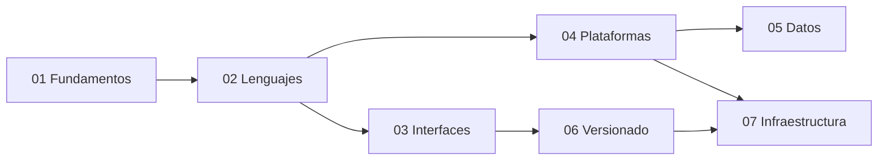

# Enciclopedia Tecnica Dev Visualizer (73 Colecciones • 7,410 Conceptos)

> **Documento Maestro Integrado del Atlas Pedagogico Dev Visualizer**  
> Fecha de generacion: 2026-11-02 • Autor: [@Luics415](https://github.com/Luics415) • Coautoria Tecnica: [@Azlynn17](https://github.com/Azlynn17)

---

## Metricas Consolidadas
- **Colecciones Oficiales:** 73
- **Conceptos Tecnicos Indexados:** 7,410
- **Rutas Tecnicas:** 146
- **Paginas SSG Generadas:** 394
- **Recursos Verificados:** 272

---

## Diagrama de Arquitectura de Colecciones

---

## Catalogo de Grupos y Colecciones
### Grupo: Fundamentos (Pensamiento computacional, algoritmos y práctica profesional)
- **[101] Fundamentos de programación** (91 conceptos) — [Atlas en vivo](https://luics415.github.io/Dev-Visualizer/fundamentos-programacion) | [En accion](https://luics415.github.io/Dev-Visualizer/fundamentos-programacion-en-accion): Problemas, datos, control, funciones, diseño, pruebas y pensamiento computacional.
- **[A&D] Algoritmos y estructuras de datos** (120 conceptos) — [Atlas en vivo](https://luics415.github.io/Dev-Visualizer/algoritmos) | [En accion](https://luics415.github.io/Dev-Visualizer/algoritmos-en-accion): Complejidad, secuencias, árboles, grafos, búsqueda, ordenación y optimización.
- **[Math] Matemáticas para programación** (105 conceptos) — [Atlas en vivo](https://luics415.github.io/Dev-Visualizer/matematicas-programacion) | [En accion](https://luics415.github.io/Dev-Visualizer/matematicas-programacion-en-accion): Lógica, conjuntos, álgebra, probabilidad, cálculo y matemática discreta.
- **[Flow] Metodologías de desarrollo** (88 conceptos) — [Atlas en vivo](https://luics415.github.io/Dev-Visualizer/metodologias-desarrollo) | [En accion](https://luics415.github.io/Dev-Visualizer/metodologias-desarrollo-en-accion): Descubrimiento, entrega iterativa, Scrum, Kanban, XP, evidencia y mejora continua.
- **[Cat] Scratch** (76 conceptos) — [Atlas en vivo](https://luics415.github.io/Dev-Visualizer/scratch) | [En accion](https://luics415.github.io/Dev-Visualizer/scratch-en-accion): Programación visual, eventos, mensajes, clones, juegos y pensamiento computacional.

### Grupo: Lenguajes (Sintaxis, tipos, memoria y ejecución)
- **[JS] JavaScript ES6+** (55 conceptos) — [Atlas en vivo](https://luics415.github.io/Dev-Visualizer/) | [En accion](https://luics415.github.io/Dev-Visualizer/javascript-en-accion): Lenguaje, objetos, asincronía, módulos, protocolos y memoria.
- **[TS] TypeScript** (64 conceptos) — [Atlas en vivo](https://luics415.github.io/Dev-Visualizer/typescript) | [En accion](https://luics415.github.io/Dev-Visualizer/typescript-en-accion): Modelado, narrowing, genéricos, compilador y producción.
- **[Py] Python** (240 conceptos) — [Atlas en vivo](https://luics415.github.io/Dev-Visualizer/python) | [En accion](https://luics415.github.io/Dev-Visualizer/python-en-accion): Desde cero: lenguaje, biblioteca estándar, automatización, web, datos, IA y producción.
- **[PL] Prolog** (120 conceptos) — [Atlas en vivo](https://luics415.github.io/Dev-Visualizer/prolog) | [En accion](https://luics415.github.io/Dev-Visualizer/prolog-en-accion): Términos, unificación, resolución, backtracking, restricciones, tabling, gramáticas y producción.
- **[C] C** (60 conceptos) — [Atlas en vivo](https://luics415.github.io/Dev-Visualizer/c) | [En accion](https://luics415.github.io/Dev-Visualizer/c-en-accion): Compilación, memoria, punteros, ABI, herramientas y seguridad.
- **[C++] C++** (66 conceptos) — [Atlas en vivo](https://luics415.github.io/Dev-Visualizer/cpp) | [En accion](https://luics415.github.io/Dev-Visualizer/cpp-en-accion): RAII, tipos, STL, templates, concurrencia y rendimiento.
- **[C#] C#** (49 conceptos) — [Atlas en vivo](https://luics415.github.io/Dev-Visualizer/c-sharp) | [En accion](https://luics415.github.io/Dev-Visualizer/c-sharp-en-accion): Tipos, patrones, LINQ, asincronía, memoria y concurrencia.
- **[Obj-C] Objective-C** (48 conceptos) — [Atlas en vivo](https://luics415.github.io/Dev-Visualizer/objective-c) | [En accion](https://luics415.github.io/Dev-Visualizer/objective-c-en-accion): Mensajería, runtime, ARC, Foundation e interoperabilidad con Swift.
- **[C*] C*** (42 conceptos) — [Atlas en vivo](https://luics415.github.io/Dev-Visualizer/c-star) | [En accion](https://luics415.github.io/Dev-Visualizer/c-star-en-accion): Programación data-parallel para sistemas Connection Machine.
- **[CWEB] CWEB** (42 conceptos) — [Atlas en vivo](https://luics415.github.io/Dev-Visualizer/cweb) | [En accion](https://luics415.github.io/Dev-Visualizer/cweb-en-accion): Programación literaria con CTANGLE, CWEAVE, C y TeX.
- **[EC] Embedded C** (55 conceptos) — [Atlas en vivo](https://luics415.github.io/Dev-Visualizer/embedded-c) | [En accion](https://luics415.github.io/Dev-Visualizer/embedded-c-en-accion): Microcontroladores, registros, interrupciones, timing y seguridad.
- **[VB] Visual Basic .NET** (48 conceptos) — [Atlas en vivo](https://luics415.github.io/Dev-Visualizer/visual-basic) | [En accion](https://luics415.github.io/Dev-Visualizer/visual-basic-en-accion): Lenguaje .NET, eventos, LINQ, WinForms e interoperabilidad.
- **[Rb] Ruby** (93 conceptos) — [Atlas en vivo](https://luics415.github.io/Dev-Visualizer/ruby) | [En accion](https://luics415.github.io/Dev-Visualizer/ruby-en-accion): Objetos, bloques, enumerables, metaprogramación, concurrencia, tooling y producción.
- **[Rs] Rust** (113 conceptos) — [Atlas en vivo](https://luics415.github.io/Dev-Visualizer/rust) | [En accion](https://luics415.github.io/Dev-Visualizer/rust-en-accion): Ownership, borrowing, tipos, traits, concurrencia segura, tooling y rendimiento.
- **[PHP] PHP** (99 conceptos) — [Atlas en vivo](https://luics415.github.io/Dev-Visualizer/php) | [En accion](https://luics415.github.io/Dev-Visualizer/php-en-accion): Lenguaje, runtime web, tipos, objetos, Composer, seguridad y operación.
- **[Hs] Haskell** (112 conceptos) — [Atlas en vivo](https://luics415.github.io/Dev-Visualizer/haskell) | [En accion](https://luics415.github.io/Dev-Visualizer/haskell-en-accion): Funciones puras, tipos algebraicos, evaluación perezosa, efectos y concurrencia.
- **[Go] Go** (103 conceptos) — [Atlas en vivo](https://luics415.github.io/Dev-Visualizer/go) | [En accion](https://luics415.github.io/Dev-Visualizer/go-en-accion): Tipos, interfaces, goroutines, canales, contexto, módulos y servicios.
- **[Kt] Kotlin** (105 conceptos) — [Atlas en vivo](https://luics415.github.io/Dev-Visualizer/kotlin) | [En accion](https://luics415.github.io/Dev-Visualizer/kotlin-en-accion): Null safety, objetos, funciones, coroutines, multiplataforma e interoperabilidad JVM.
- **[Java] Java** (115 conceptos) — [Atlas en vivo](https://luics415.github.io/Dev-Visualizer/java) | [En accion](https://luics415.github.io/Dev-Visualizer/java-en-accion): JVM, tipos, objetos, colecciones, concurrencia, GC, tooling y producción.
- **[R] R** (117 conceptos) — [Atlas en vivo](https://luics415.github.io/Dev-Visualizer/r) | [En accion](https://luics415.github.io/Dev-Visualizer/r-en-accion): Vectores, data frames, estadística, visualización, modelado e informes reproducibles.
- **[ASM] Ensamblador** (103 conceptos) — [Atlas en vivo](https://luics415.github.io/Dev-Visualizer/ensamblador) | [En accion](https://luics415.github.io/Dev-Visualizer/ensamblador-en-accion): ISA, registros, memoria, pila, llamadas, ABI, depuración y optimización.
- **[Erl] Erlang** (94 conceptos) — [Atlas en vivo](https://luics415.github.io/Dev-Visualizer/erlang) | [En accion](https://luics415.github.io/Dev-Visualizer/erlang-en-accion): BEAM, procesos, mensajes, supervisión, distribución y tolerancia a fallos.
- **[λ] Lisp** (98 conceptos) — [Atlas en vivo](https://luics415.github.io/Dev-Visualizer/lisp) | [En accion](https://luics415.github.io/Dev-Visualizer/lisp-en-accion): S-expressions, evaluación, funciones, macros, metaprogramación y REPL.
- **[Pl] Perl** (86 conceptos) — [Atlas en vivo](https://luics415.github.io/Dev-Visualizer/perl) | [En accion](https://luics415.github.io/Dev-Visualizer/perl-en-accion): Texto, expresiones regulares, referencias, módulos, automatización y operación.
- **[Rk] Raku** (88 conceptos) — [Atlas en vivo](https://luics415.github.io/Dev-Visualizer/raku) | [En accion](https://luics415.github.io/Dev-Visualizer/raku-en-accion): Gramáticas, tipos, junctions, concurrencia, metaprogramación y herramientas.
- **[Sc] Scala** (109 conceptos) — [Atlas en vivo](https://luics415.github.io/Dev-Visualizer/scala) | [En accion](https://luics415.github.io/Dev-Visualizer/scala-en-accion): Objetos y funciones, tipos, colecciones, efectos, concurrencia y JVM.
- **[Dart] Dart** (60 conceptos) — [Atlas en vivo](https://luics415.github.io/Dev-Visualizer/dart) | [En accion](https://luics415.github.io/Dev-Visualizer/dart-en-accion): Lenguaje orientado a objetos, Sound Null Safety, records, isolates, event loop y compilación dual JIT/AOT.

### Grupo: Diseño e interfaces (Experiencia, web y aplicaciones móviles)
- **[UX] UX/UI** (55 conceptos) — [Atlas en vivo](https://luics415.github.io/Dev-Visualizer/ux-ui) | [En accion](https://luics415.github.io/Dev-Visualizer/ux-ui-en-accion): Investigación, flujos, accesibilidad, prototipos y validación.
- **[HTML] HTML y CSS** (42 conceptos) — [Atlas en vivo](https://luics415.github.io/Dev-Visualizer/html-css) | [En accion](https://luics415.github.io/Dev-Visualizer/html-css-en-accion): Semántica, cascade, layout, responsive y render del navegador.
- **[BS] Bootstrap** (55 conceptos) — [Atlas en vivo](https://luics415.github.io/Dev-Visualizer/bootstrap) | [En accion](https://luics415.github.io/Dev-Visualizer/bootstrap-en-accion): Grid, utilidades, componentes, Sass, accesibilidad y personalización.
- **[AJS] AngularJS** (52 conceptos) — [Atlas en vivo](https://luics415.github.io/Dev-Visualizer/angularjs) | [En accion](https://luics415.github.io/Dev-Visualizer/angularjs-en-accion): Mantenimiento de aplicaciones 1.x, digest cycle y migración gradual.
- **[React] React** (62 conceptos) — [Atlas en vivo](https://luics415.github.io/Dev-Visualizer/react) | [En accion](https://luics415.github.io/Dev-Visualizer/react-en-accion): Componentes, estado, reconciliación, efectos y concurrencia.
- **[RN] React Native** (80 conceptos) — [Atlas en vivo](https://luics415.github.io/Dev-Visualizer/react-native) | [En accion](https://luics415.github.io/Dev-Visualizer/react-native-en-accion): Nueva Arquitectura, dispositivo, offline, performance y releases.
- **[Qwik] Qwik** (88 conceptos) — [Atlas en vivo](https://luics415.github.io/Dev-Visualizer/qwik) | [En accion](https://luics415.github.io/Dev-Visualizer/qwik-en-accion): Resumibilidad, serialización, carga bajo demanda, routing y rendimiento.
- **[Ng] Angular** (130 conceptos) — [Atlas en vivo](https://luics415.github.io/Dev-Visualizer/angular) | [En accion](https://luics415.github.io/Dev-Visualizer/angular-en-accion): Componentes, señales, DI, router, formularios, SSR, pruebas y producción.
- **[Flutter] Flutter** (60 conceptos) — [Atlas en vivo](https://luics415.github.io/Dev-Visualizer/flutter) | [En accion](https://luics415.github.io/Dev-Visualizer/flutter-en-accion): Framework UI declarativo multiplataforma, árbol tripartito, motor Impeller y renderizado autónomo por GPU.

### Grupo: Plataformas y servidor (Runtimes, frameworks, contratos y automatización)
- **[API] APIs** (48 conceptos) — [Atlas en vivo](https://luics415.github.io/Dev-Visualizer/apis) | [En accion](https://luics415.github.io/Dev-Visualizer/apis-en-accion): REST, GraphQL, gRPC, eventos, tiempo real, contratos y seguridad.
- **[Back] Backend** (96 conceptos) — [Atlas en vivo](https://luics415.github.io/Dev-Visualizer/backend) | [En accion](https://luics415.github.io/Dev-Visualizer/backend-en-accion): Arquitectura, seguridad, persistencia, mensajería y confiabilidad.
- **[Node] Node.js** (65 conceptos) — [Atlas en vivo](https://luics415.github.io/Dev-Visualizer/nodejs) | [En accion](https://luics415.github.io/Dev-Visualizer/nodejs-en-accion): Runtime, event loop, streams, workers, módulos y operación.
- **[Lv] Laravel** (65 conceptos) — [Atlas en vivo](https://luics415.github.io/Dev-Visualizer/laravel) | [En accion](https://luics415.github.io/Dev-Visualizer/laravel-en-accion): Contenedor, HTTP, Eloquent, políticas, colas, eventos y pruebas.
- **[n8n] n8n** (55 conceptos) — [Atlas en vivo](https://luics415.github.io/Dev-Visualizer/n8n) | [En accion](https://luics415.github.io/Dev-Visualizer/n8n-en-accion): Workflows, credenciales, datos, reintentos, subflujos y operación.
- **[.NET] .NET** (52 conceptos) — [Atlas en vivo](https://luics415.github.io/Dev-Visualizer/dotnet) | [En accion](https://luics415.github.io/Dev-Visualizer/dotnet-en-accion): SDK, CLR, IL, JIT/AOT, GC, bibliotecas, hosting y diagnóstico.
- **[MP] MediaPipe** (120 conceptos) — [Atlas en vivo](https://luics415.github.io/Dev-Visualizer/mediapipe) | [En accion](https://luics415.github.io/Dev-Visualizer/mediapipe-en-accion): Tasks, modelos, grafos, visión, audio, texto, tiempo real, edge y operación responsable.
- **[FB] Firebase** (250 conceptos) — [Atlas en vivo](https://luics415.github.io/Dev-Visualizer/firebase) | [En accion](https://luics415.github.io/Dev-Visualizer/firebase-en-accion): Auth, datos, Storage, Functions, Hosting, FCM y Rules.
- **[And] Android** (130 conceptos) — [Atlas en vivo](https://luics415.github.io/Dev-Visualizer/android) | [En accion](https://luics415.github.io/Dev-Visualizer/android-en-accion): Componentes, lifecycle, Compose, almacenamiento, permisos, trabajo y publicación.
- **[Dj] Django** (123 conceptos) — [Atlas en vivo](https://luics415.github.io/Dev-Visualizer/django) | [En accion](https://luics415.github.io/Dev-Visualizer/django-en-accion): Proyecto, HTTP, ORM, formularios, seguridad, tareas, pruebas y despliegue.

### Grupo: Datos (Estado, modelado, consultas y persistencia)
- **[XML] XML** (110 conceptos) — [Atlas en vivo](https://luics415.github.io/Dev-Visualizer/xml) | [En accion](https://luics415.github.io/Dev-Visualizer/xml-en-accion): Documentos, namespaces, parsing, XPath, XSLT, seguridad e interoperabilidad.
- **[XSD] XSD** (100 conceptos) — [Atlas en vivo](https://luics415.github.io/Dev-Visualizer/xsd) | [En accion](https://luics415.github.io/Dev-Visualizer/xsd-en-accion): Schemas XML, tipos, facets, identidad, composición, evolución y validación.
- **[JSON] JSON** (110 conceptos) — [Atlas en vivo](https://luics415.github.io/Dev-Visualizer/json) | [En accion](https://luics415.github.io/Dev-Visualizer/json-en-accion): Sintaxis, JSON Schema, Pointer, Patch, seguridad, contratos y producción.
- **[State] Gestión de estado** (75 conceptos) — [Atlas en vivo](https://luics415.github.io/Dev-Visualizer/gestion-estado) | [En accion](https://luics415.github.io/Dev-Visualizer/gestion-estado-en-accion): Ownership, stores, caché remota, persistencia y offline.
- **[DB] Bases de datos** (113 conceptos) — [Atlas en vivo](https://luics415.github.io/Dev-Visualizer/bases-datos) | [En accion](https://luics415.github.io/Dev-Visualizer/bases-datos-en-accion): Modelado, SQL, índices, concurrencia, distribución y backups.
- **[SQL] Microsoft SQL Server** (120 conceptos) — [Atlas en vivo](https://luics415.github.io/Dev-Visualizer/sql-server) | [En accion](https://luics415.github.io/Dev-Visualizer/sql-server-en-accion): T-SQL, almacenamiento, optimizador, concurrencia, seguridad, operación y alta disponibilidad.
- **[SQL] SQL** (130 conceptos) — [Atlas en vivo](https://luics415.github.io/Dev-Visualizer/sql) | [En accion](https://luics415.github.io/Dev-Visualizer/sql-en-accion): Modelo relacional, DDL, consultas, joins, transacciones, optimización y portabilidad.
- **[NoSQL] NoSQL** (123 conceptos) — [Atlas en vivo](https://luics415.github.io/Dev-Visualizer/nosql) | [En accion](https://luics415.github.io/Dev-Visualizer/nosql-en-accion): Documentos, clave-valor, columnas, grafos, partición, replicación y consistencia.
- **[Chain] Blockchain** (109 conceptos) — [Atlas en vivo](https://luics415.github.io/Dev-Visualizer/blockchain) | [En accion](https://luics415.github.io/Dev-Visualizer/blockchain-en-accion): Criptografía, bloques, consenso, transacciones, contratos y operación.
- **[IA] Inteligencia Artificial** (130 conceptos) — [Atlas en vivo](https://luics415.github.io/Dev-Visualizer/inteligencia-artificial) | [En accion](https://luics415.github.io/Dev-Visualizer/inteligencia-artificial-en-accion): Datos, modelos, entrenamiento, evaluación, inferencia, seguridad y monitoreo.

### Grupo: Control de versiones y calidad (Historia, colaboración, diagnóstico y recuperación)
- **[Git] Git** (60 conceptos) — [Atlas en vivo](https://luics415.github.io/Dev-Visualizer/git) | [En accion](https://luics415.github.io/Dev-Visualizer/git-en-accion): Objetos, referencias, staging, historia, sincronización y rescate.
- **[GH] GitHub** (60 conceptos) — [Atlas en vivo](https://luics415.github.io/Dev-Visualizer/github) | [En accion](https://luics415.github.io/Dev-Visualizer/github-en-accion): Colaboración, PRs, gobierno, seguridad, comunidad y releases.
- **[Debug] Debugging** (238 conceptos) — [Atlas en vivo](https://luics415.github.io/Dev-Visualizer/debugging) | [En accion](https://luics415.github.io/Dev-Visualizer/debugging-en-accion): Reproducción, evidencia, hipótesis, rendimiento e incidentes.
- **[SVN] Subversion** (81 conceptos) — [Atlas en vivo](https://luics415.github.io/Dev-Visualizer/subversion) | [En accion](https://luics415.github.io/Dev-Visualizer/subversion-en-accion): Control centralizado, working copies, revisiones, ramas, merges y administración.

### Grupo: Infraestructura y entrega (Hosts, nube, pipelines y releases operables)
- **[Linux] Linux** (182 conceptos) — [Atlas en vivo](https://luics415.github.io/Dev-Visualizer/linux) | [En accion](https://luics415.github.io/Dev-Visualizer/linux-en-accion): Kernel, shell, procesos, redes, storage, hardening y contenedores.
- **[AWS] AWS** (228 conceptos) — [Atlas en vivo](https://luics415.github.io/Dev-Visualizer/aws) | [En accion](https://luics415.github.io/Dev-Visualizer/aws-en-accion): Identidad, VPC, compute, datos, eventos, gobierno y costo.
- **[CI] CI/CD** (42 conceptos) — [Atlas en vivo](https://luics415.github.io/Dev-Visualizer/ci-cd) | [En accion](https://luics415.github.io/Dev-Visualizer/ci-cd-en-accion): Integración, evidencia, artefactos, supply chain y promoción.
- **[Ship] Deployment** (133 conceptos) — [Atlas en vivo](https://luics415.github.io/Dev-Visualizer/deployment) | [En accion](https://luics415.github.io/Dev-Visualizer/deployment-en-accion): Entornos, configuración, rollouts, tráfico, migraciones y rollback.
- **[NGINX] NGINX** (313 conceptos) — [Atlas en vivo](https://luics415.github.io/Dev-Visualizer/nginx) | [En accion](https://luics415.github.io/Dev-Visualizer/nginx-en-accion): Servidor web, reverse proxy, balanceo, TLS, caché y operación.
- **[Docker] Docker** (236 conceptos) — [Atlas en vivo](https://luics415.github.io/Dev-Visualizer/docker) | [En accion](https://luics415.github.io/Dev-Visualizer/docker-en-accion): Imágenes, BuildKit, storage, networking, Compose y runtime.
- **[OS] Sistemas operativos** (130 conceptos) — [Atlas en vivo](https://luics415.github.io/Dev-Visualizer/sistemas-operativos) | [En accion](https://luics415.github.io/Dev-Visualizer/sistemas-operativos-en-accion): Procesos, scheduling, memoria virtual, archivos, E/S, concurrencia y seguridad.
- **[TeX] LaTeX** (95 conceptos) — [Atlas en vivo](https://luics415.github.io/Dev-Visualizer/latex) | [En accion](https://luics415.github.io/Dev-Visualizer/latex-en-accion): Composición, estructura, referencias, matemáticas, paquetes, builds y publicación.

---

## Indice Tematico de los 7,410 Conceptos
*(Para consultar el desglose interactivo individual de cada concepto y sus escenas animadas, visita la Wiki de GitHub en `/wiki` o el Atlas interactivo en [https://luics415.github.io/Dev-Visualizer/](https://luics415.github.io/Dev-Visualizer/)).*

### JavaScript ES6+ (`JS`) — 55 conceptos
**Fundamentos del lenguaje:** `Variables`, `Tipos primitivos`, `typeof y detección de valores`, `Truthy y falsy`, `Coerción de tipos`, `Igualdad estricta y flexible`, `Operadores y precedencia`, `Control de flujo`, `Bucles e iteración`

**Funciones y contexto:** `Funciones`, `Parámetros por defecto`, `Rest parameters`, `Arrow functions`, `Scope`, `Hoisting y TDZ`, `Closures`, `this, call, apply y bind`

**Estructuras de datos:** `Objetos`, `Acceso y propiedades computadas`, `Desestructuración de objetos`, `Spread y copia superficial`, `Arrays`, `Desestructuración de arrays`, `Spread en arrays`

**Transformaciones de colecciones:** `map`, `filter`, `reduce`, `find, some y every`, `Ordenamiento y métodos de copia`

**Colecciones especializadas:** `Set`, `Map`, `WeakMap y WeakSet`, `Symbols`

**Datos y representación:** `JSON`, `structuredClone`

**Objetos, clases y metaprogramación:** `Prototipos`, `Clases`, `Herencia y campos privados`, `Proxy y Reflect`

**Asincronía y runtime:** `Event Loop`, `Promesas`, `Combinadores de promesas`, `Async / Await`, `Manejo de errores`, `Cancelación con AbortController`

**Módulos y carga:** `Módulos ES`, `Importación dinámica`

**Protocolos avanzados:** `Iteradores y protocolos iterable`, `Generadores`, `TypedArray y ArrayBuffer`

**Texto, tiempo e internacionalización:** `Expresiones regulares`, `Intl y formato local`, `Date, zonas horarias y timestamps`

**Memoria y recursos:** `Gestión explícita de recursos`, `Memoria y garbage collection`

---

### TypeScript (`TS`) — 64 conceptos
**Fundamentos del sistema de tipos:** `Inferencia de tipos`, `Anotaciones`, `Tipos primitivos`, `any`, `unknown`, `void y never`

**Modelado de datos:** `Uniones`, `Tipos literales`, `null, undefined y strictNullChecks`, `Propiedades opcionales`, `Readonly`, `Arrays y tuplas`, `Tipos de objetos`, `Alias de tipos`, `Interfaces`, `Intersecciones`, `Uniones discriminadas`

**Funciones tipadas:** `Tipos de funciones`, `Firmas de llamada y constructores`, `Sobrecargas`, `Parámetros opcionales y por defecto`, `this en funciones`

**Narrowing y seguridad:** `Narrowing`, `typeof, instanceof e in`, `Predicados de tipo`, `Funciones de aserción`, `Comprobación exhaustiva`, `Aserciones de tipo`, `satisfies`, `Const assertions`

**Genéricos y tipos derivados:** `Genéricos`, `Restricciones genéricas`, `Parámetros genéricos por defecto`, `keyof`, `typeof en posiciones de tipo`, `Indexed access types`, `Mapped types`, `Remapeo de claves`, `Tipos condicionales`, `infer`, `Template literal types`, `Utility Types`, `Tipos recursivos`, `Tipos nominales con branding`

**Clases y módulos:** `Clases y modificadores`, `Clases abstractas`, `Polimorfismo de this`, `Decoradores`, `Módulos y exports`, `Imports y exports solo de tipos`, `Declaraciones .d.ts`, `Declaraciones ambientales`, `Module augmentation y declaration merging`

**Compilador y producción:** `tsconfig`, `Modo strict`, `Opciones de precisión adicional`, `Resolución de módulos`, `Emisión, source maps y declarations`, `Project references`, `Migración desde JavaScript`, `Validación de runtime`, `Compatibilidad estructural y varianza`, `Pruebas de tipos`, `Rendimiento del checker`

---

### Python (`Py`) — 240 conceptos
**Antes de escribir código:** `Problema, entrada y salida`, `Algoritmo`, `Datos y estado`, `Caso normal y casos límite`, `Depuración como experimento`

**Preparar el entorno:** `Instalación oficial`, `Versión e implementación`, `REPL`, `Scripts y terminal`, `Editor y ayuda integrada`

**Primer programa y sintaxis:** `Indentación significativa`, `Comentarios y legibilidad`, `Nombres y asignación`, `Expresiones y sentencias`, `print e input`

**Números, verdad y ausencia:** `int`, `float`, `bool y operadores lógicos`, `None`, `Decimal, Fraction y complex`

**Texto, Unicode y bytes:** `str y puntos de código`, `Indexación y slicing`, `Métodos y formato`, `Codificar y decodificar`, `bytes, bytearray y memoryview`

**Decisiones y coincidencia de patrones:** `Comparaciones`, `if, elif y else`, `Expresión condicional`, `match y case`, `Invariantes de una decisión`

**Repetición y recorridos:** `while`, `for y protocolo iterable`, `range, enumerate y zip`, `break, continue y else`, `Comprensiones`

**Colecciones y mutabilidad:** `list`, `tuple`, `dict`, `set y frozenset`, `Alias, copia superficial y profunda`

**Funciones fundamentales:** `def, llamada y return`, `Parámetros posicionales y por nombre`, `Valores predeterminados`, `Argumentos variables`, `Desempaquetado en llamadas`

**Contratos y composición funcional:** `Alcance LEGB`, `Docstrings`, `Anotaciones`, `Funciones como objetos y closures`, `Pureza, efectos y recursión`

**Errores y recuperación:** `Errores sintácticos, de runtime y lógicos`, `try, except, else y finally`, `raise y encadenamiento`, `Excepciones propias`, `ExceptionGroup y except star`

**Archivos y serialización:** `pathlib`, `with y cierre determinista`, `Texto, binario y newline`, `JSON y CSV`, `Temporales, compresión y archivos`

**Módulos, paquetes e imports:** `Módulo y namespace`, `Guard de entrada`, `Paquetes e imports relativos`, `Resolución y sys.path`, `Caché de imports y recarga`

**Iteradores, generadores y flujo perezoso:** `Iterable e iterator`, `yield`, `Generator expressions`, `itertools`, `Demanda y backpressure`

**Objetos y clases:** `Identidad, tipo y valor`, `class e instancias`, `Inicialización y atributos`, `Métodos y properties`, `Composición, herencia y super`

**Modelo de datos de Python:** `Métodos especiales`, `Context managers propios`, `Descriptors`, `__slots__ y layout`, `Metaclases y creación de tipos`

**Modelado moderno de datos:** `dataclasses`, `Enum y Flag`, `NamedTuple y registros inmutables`, `ABC y Protocol`, `Patrones sobre modelos`

**Tipado gradual:** `Tipos estáticos opcionales`, `Uniones, Optional y narrowing`, `Colecciones y Callable`, `TypeVar y genéricos`, `TypedDict, Protocol y type aliases`

**Biblioteca estándar: datos, matemáticas y tiempo:** `collections`, `functools`, `statistics, math y random`, `datetime y zoneinfo`, `re y parsing`

**Biblioteca estándar: sistema y automatización:** `os, pathlib y shutil`, `glob y fnmatch`, `subprocess`, `argparse`, `signal, sched y atexit`

**Red, protocolos y criptografía disponible:** `urllib y HTTP clients`, `socket y direccionamiento`, `ssl y TLS`, `hashlib, hmac y secrets`, `email, json y XML seguro`

**Entornos y dependencias:** `Gestor de instalación de Python`, `venv`, `pip y PyPI`, `Version specifiers, wheel tags y compatibilidad`, `Resolución reproducible`

**Empaquetado y distribución:** `pyproject.toml`, `Layout src y paquetes`, `sdist y wheel`, `Entry points y CLI`, `Build, TestPyPI, firma y publicación`

**Estilo, análisis y documentación:** `PEP 8 y consistencia`, `Ruff y formateo`, `Type checker`, `Documentación de API y tutoriales`, `Revisión y deuda técnica`

**Pruebas automatizadas:** `unittest y pytest`, `Arrange, Act, Assert`, `Fixtures y parametrización`, `Mocks, fakes y contract tests`, `Unitarias, propiedades, integración y end to end`

**Depuración y observabilidad:** `Tracebacks y pdb`, `logging estructurado`, `warnings`, `Métricas y trazas`, `Reporte y postmortem`

**CPython e internals:** `Tokenización, AST y compilación`, `Frame, stack y bytecode`, `PyObject, identidad y referencias`, `Recolector cíclico`, `Implementaciones y ABI`

**Rendimiento y memoria:** `Complejidad y estructura de datos`, `timeit y benchmarks`, `cProfile y perfiles de muestreo`, `tracemalloc y fugas`, `Vectorización, batching y código nativo`

**Concurrencia paralela:** `threading y sincronización`, `multiprocessing`, `concurrent.futures`, `Intérpretes múltiples`, `Free threading en CPython`

**Programación asíncrona:** `Event loop, coroutine y Task`, `TaskGroup y concurrencia estructurada`, `Cancelación y timeout`, `asyncio.Queue y backpressure`, `Recursos async y bloqueo`

**Arquitectura, seguridad y producción:** `Configuración y secretos`, `Capas y puertos`, `Idempotencia, retry y circuit breaker`, `Supply chain y entrada no confiable`, `Lifecycle de servicio`

**Web y servidores Python:** `Semántica HTTP y HTTPS`, `WSGI y ASGI`, `Flask`, `Django`, `FastAPI`

**APIs, persistencia y fronteras web:** `Diseño de contratos`, `Validación y serialización`, `Autenticación y autorización`, `SQLAlchemy y unidad de trabajo`, `Migraciones, jobs y WebSockets`

**Automatización e integración:** `CLI y procesos por lotes`, `Archivos, hojas y documentos`, `Playwright y navegadores`, `Celery y colas de tareas`, `APIs, webhooks y calendario`

**Notebooks y análisis de datos:** `Jupyter y orden de ejecución`, `Ingesta y perfilado`, `pandas Series y DataFrame`, `Limpieza, reshape y joins`, `EDA y comunicación`

**Cómputo numérico y científico:** `NumPy ndarray`, `Broadcasting y ufuncs`, `Indexación, vistas y copias`, `SciPy`, `Matplotlib`

**Aprendizaje automático clásico:** `Problema, objetivo y baseline`, `Split y leakage`, `Preprocessing y Pipeline`, `Modelos y cross-validation`, `Métricas, calibración y drift`

**Deep learning e IA:** `Tensores y dispositivos`, `Autodiff y gradientes`, `Dataset, batch y augmentación`, `Entrenamiento y evaluación`, `PyTorch, TensorFlow y modelos externos`

**Escritorio, interoperabilidad e IoT:** `Tkinter`, `PySide6 y Qt`, `ctypes, C API y extensiones`, `MicroPython y CircuitPython`, `Portabilidad y entrega edge`

**Algoritmos y estructuras de datos aplicadas:** `Invariantes y contratos`, `Búsqueda lineal y binaria`, `Orden estable y funciones key`, `bisect, heapq y deque`, `Grafos y programación dinámica`

**Aplicaciones de línea de comandos y TUI:** `Contrato de una CLI`, `argparse y configuración`, `Terminal y streams`, `Interfaces de texto`, `Distribución de herramientas`

**Validación y modelos en fronteras:** `Datos confiables y no confiables`, `Dataclasses y modelos inmutables`, `Parsear, no solo comprobar`, `Errores por campo`, `Frontera con librerías de validación`

**Ingeniería de datos y pipelines:** `Ingesta por lotes e incremental`, `Esquema y calidad de datos`, `Particionado y formatos columnares`, `Idempotencia y reanudación`, `Orquestación y linaje`

**Cómputo distribuido y grandes volúmenes:** `Partir el problema`, `Serialización y movimiento de datos`, `Scheduling y skew`, `Retries y efectos externos`, `Escalar después de perfilar`

**Lenguaje natural, embeddings y RAG:** `Texto como datos`, `Pipelines de NLP`, `Embeddings`, `Retrieval augmented generation`, `Modelos generativos responsables`

**Simulación, juegos y medios:** `Loop de simulación`, `Pygame y multimedia`, `Física y precisión temporal`, `IA de agentes`, `Replays y determinismo`

**Cloud, serverless y automatización operativa:** `Proceso efímero`, `Arranque y dependencias`, `Identidad de workload`, `Infraestructura y SDKs`, `Observabilidad y costo`

**Gobierno, mantenimiento y cadena de suministro:** `Política de versiones`, `Procedencia de paquetes`, `Licencias y activos`, `Deprecación y migraciones`, `Runbook y ownership`

---

### Prolog (`PL`) — 120 conceptos
**Primer contacto y ciclo de trabajo:** `SWI-Prolog estable`, `Top level`, `Archivos .pl y consulta`, `Editar, recargar y repetir`, `Ayuda y documentación`

**Términos y sintaxis:** `Átomos y números`, `Variables`, `Términos compuestos`, `Listas, pares y colas abiertas`, `Operadores y precedencia`

**Hechos, reglas y consultas:** `Hechos`, `Reglas`, `Consultas y objetivos`, `Cláusulas y predicados`, `Lectura lógica y operacional`

**Unificación e identidad:** `Unificación implícita`, `Bindings y variables compartidas`, `=/2, ==/2 y =@=/2`, `dif/2 frente a \=/2`, `Occurs check y términos cíclicos`

**Resolución y árbol de prueba:** `Demostración dirigida por objetivos`, `Selección izquierda a derecha`, `Orden de cláusulas`, `Puntos de elección y trail`, `Búsqueda en profundidad`

**Nondeterminismo y modos:** `Múltiples respuestas`, `Generadores y verificadores`, `Modos de uso`, `Determinismo`, `Relaciones reversibles`

**Recursión y terminación:** `Caso base`, `Paso recursivo`, `Recursión estructural`, `Acumuladores`, `Medida decreciente`

**Listas, árboles y estructuras simbólicas:** `member/2 y append/3`, `Listas diferencia`, `Árboles algebraicos`, `Conjuntos y asociaciones`, `Copia, variables y sharing`

**Control declarativo e impuro:** `Conjunción y disyunción`, `true y fail`, `If-then-else y once/1`, `Negación como fallo`, `Cuts verdes y rojos`

**Aritmética y orden:** `Evaluación con is/2`, `Comparaciones aritméticas`, `Comparación de términos`, `Tipos y errores numéricos`, `Límite de la aritmética tradicional`

**Soluciones y programación de orden superior:** `findall/3`, `bagof/3 y variables libres`, `setof/3`, `call/N y goals como datos`, `maplist, include y foldl`

**Texto, términos e I/O:** `Átomos, strings y listas de códigos`, `Lectura y escritura de términos`, `Streams y encoding`, `Limpieza garantizada`, `Mensajes y formato`

**Gramáticas de cláusulas definidas:** `Reglas -->`, `phrase/2 y phrase/3`, `Expansión a listas diferencia`, `Tokenización y AST`, `Parsing y generación`

**CLP(FD):** `Variables de dominio finito`, `Restricciones aritméticas`, `Propagación`, `Reificación y restricciones globales`, `Labeling y optimización`

**Otras restricciones y coroutining:** `CLP(Q)`, `CLP(R)`, `CLP(B)`, `Variables atribuidas`, `Goals demorados`

**Tabling y terminación avanzada:** `Ejecución tabulada`, `Recursión izquierda`, `Tabling por variante y subsunción`, `Answer subsumption`, `Well-founded e incremental tabling`

**Base dinámica y estado:** `Predicados dynamic`, `asserta, assertz y retract`, `Logical Update View`, `Transacciones y snapshots`, `Estado explícito frente a base dinámica`

**Módulos, librerías y portabilidad:** `Interfaz de módulo`, `Importación y calificación`, `Meta-predicados y contexto`, `Autoload, packs y dependencias`, `ISO y dialectos reales`

**Excepciones, límites y seguridad:** `Términos de error ISO`, `throw/1 y catch/3`, `Validación de frontera`, `Límites de tiempo, profundidad e inferencias`, `Datos no confiables`

**Pruebas y contratos:** `Unidades PlUnit`, `Éxito, fallo y excepciones esperadas`, `Conjuntos de respuestas`, `Tests parametrizados y propiedades`, `Pruebas desde CLI`

**Debugging y diagnóstico:** `Modelo Byrd de cuatro puertos`, `Trace y debug`, `Spy points y breakpoints`, `Warnings de determinismo y singletons`, `Cross-referencer y llamadas indefinidas`

**Rendimiento e internals:** `Warren Abstract Machine`, `Indexación de cláusulas`, `Last-call optimization`, `Profiling y estadísticas`, `Stacks, GC y tablas`

**Concurrencia:** `Threads y engines`, `Message queues`, `Mutexes`, `Base dinámica concurrente`, `Cancelación y cierre`

**Integración y producción:** `HTTP y dispatch`, `JSON y dicts`, `Foreign Language Interface`, `Scripts, entrypoints y saved states`, `Observabilidad y compatibilidad`

---

### C (`C`) — 60 conceptos
**Traducción y programa:** `Fases de traducción`, `Función main y entorno hospedado`, `Declaraciones y definiciones`, `Headers y linkage`, `Preprocesador`, `Pragmas y extensiones del compilador`

**Tipos, enteros y representación binaria:** `Tipos enteros y promociones`, `Punto flotante`, `Arrays y decaimiento a puntero`, `Struct, union y padding`, `Enum, typedef y qualifiers`, `Enteros de ancho fijo stdint`

**Punteros y aritmética estricta:** `Direcciones y aritmética de punteros`, `Punteros void y alineación`, `Punteros nulos y comprobación`, `Puntero a puntero y mutación`, `Punteros a funciones y callbacks`, `Punteros constantes y restrict`

**Memoria dinámica, lifetime y ownership:** `Stack, static storage y heap`, `malloc, calloc, realloc y free`, `Ownership y responsabilidad de liberación`, `Doble liberación y use-after-free`, `Fragmentación del heap`, `Asignadores de arena y pools`

**Aliasing, effective type y restrict:** `Aliasing y effective type`, `Strict aliasing rule`, `El calificador restrict`, `Casts de tipos y type punning`, `Memory clobbers y optimizaciones`, `Punteros volátiles en hardware`

**Control de flujo y secuencia temporal:** `Expresiones y sequence rules`, `Control de flujo condicional`, `Sentencias switch y fallthrough`, `Loops while, for y do-while`, `Saltos locales y goto de limpieza`, `setjmp y longjmp en recuperación`

**Funciones, calling conventions y ABI:** `Funciones y calling convention`, `Pila de llamadas y frame pointers`, `Argumentos variables con stdarg`, `Funciones inline y linkage interno`, `Recursión y límites de stack`, `Estabilidad de ABI y exportación`

**I/O, streams y manejo de archivos:** `stdio y buffering`, `Archivos y descriptores del sistema`, `Lecturas binarias fread y fwrite`, `Posicionamiento con fseek y ftell`, `Formateo seguro con snprintf`, `Errores, errno y códigos de retorno`

**Concurrencia, atomicidad y memoria C11/C23:** `Atomics y memory order`, `Tipos atómicos y operaciones lock-free`, `Threads estándar de C11`, `Mutexes y variables de condición`, `Memory barriers y sequential consistency`, `Data races y comportamiento indefinido`

**Seguridad de sistemas, sanitizers y hardening:** `Warnings como contrato estricto`, `Sanitizers de memoria ASan y UBSan`, `Mitigación de desbordamientos de buffer`, `Protección de stack canaries y FORTIFY_SOURCE`, `Debugger LLDB/GDB y core dumps`, `Fuzzing con libFuzzer y AFL`

---

### C++ (`C++`) — 66 conceptos
**Modelo del lenguaje y compilación ODR:** `Compilación y One Definition Rule`, `Inicialización`, `const y constexpr`, `Namespaces y lookup`, `Modules y headers`, `Linkage y visibilidad de símbolos`

**Objetos, lifetime y RAII determinista:** `Storage y object lifetime`, `Constructores y destructores`, `RAII`, `Smart pointers`, `Regla del cero, tres y cinco`, `Invariantes de clase y estado válido`

**Move semantics, rvalues y value categories:** `Lvalues, prvalues y xvalues`, `Constructores y asignación de movimiento`, `std`, `Perfect forwarding con std`, `Referencias a rvalues (T&&)`, `Movimiento sin excepciones noexcept`, `Elisión de copia y RVO`

**Tipos, herencia y polimorfismo dinámico:** `Clases e invariantes`, `Herencia y substitución`, `Virtual dispatch y vtables`, `Destructores virtuales`, `Herencia múltiple y clases virtuales`, `std`

**Templates, especialización y variadic packs:** `Function y class templates`, `Type deduction`, `Especialización explícita y parcial`, `Variadic templates y parameter packs`, `Fold expressions`, `SFINAE y std`, `Template template parameters`

**Concepts, constraints y type traits de C++20:** `Concepts como contratos de tipos`, `Cláusula requires`, `Type traits en std`, `Concepts estándar en std`, `Sobrecargas restringidas por conceptos`, `Diagnósticos claros del compilador`

**STL moderna, ranges y allocators PMR:** `Contenedores y localidad de memoria`, `Iteradores y categorías de acceso`, `Vistas y pipelines en std`, `Polymorphic memory resources (PMR)`, `std`, `Algoritmos paralelos de la STL`, `Estructuras asociadas planas (flat_map)`

**Concurrencia, atomics y coroutines C++20:** `Hilos nativos con std`, `Locks RAII y mutexes`, `Variables de condición`, `Modelo de memoria atómica std`, `Coroutines y co_await`, `Generadores con co_yield`, `std`

**Programación en compilación, constexpr y consteval:** `Funciones constexpr`, `Funciones consteval (immediate functions)`, `if constexpr y compilación condicional`, `Variables y estructuras constexpr`, `std`, `Reflexión estática emergente`, `Metaprogramación basada en valores`

**Toolchains, CMake, sanitizers y hardening de producción:** `CMake y targets modernos`, `Sanitizers de Clang y GCC`, `Perfilado de CPU y memoria`, `Control de ABI y compatibilidad binaria`, `Fuzz testing con libFuzzer`, `Hardening de binarios y directivas de seguridad`, `Auditoría con C++ Core Guidelines y Clang-Tidy`

---

### C# (`C#`) — 49 conceptos
**Tipos y expresiones:** `Value y reference types`, `Variables nullable y análisis de flujo`, `Conversiones y pattern variables`, `Tuples y deconstruction`, `Enums y flags con operaciones de bits`, `Sintaxis Target-typed new`, `Raw string literals e interpolación avanzada`

**Objetos, records y modelos inmutables:** `Classes y encapsulación`, `Structs readonly y ref structs`, `Records y records struct`, `Interfaces y default interface methods`, `Required members y modificador init`, `Primary constructors en clases y structs`, `Jerarquías selladas (sealed)`

**Pattern Matching y control de flujo:** `Switch expressions exhaustivas`, `Property y relational patterns`, `List patterns y slices`, `Type testing y cast seguro (is/as)`, `Patrones posicionales y Tuple patterns`, `Exceptions y exception filters (when)`, `Using declarations y await using`

**Genéricos y LINQ avanzado:** `Generic constraints (where)`, `Varianza en interfaces (in/out)`, `Delegates, acciones, funciones y lambdas`, `LINQ deferred execution`, `IEnumerable e IQueryable`, `Expresiones de colección y spread operator`, `Métodos de extensión y composición funcional`

**Asincronía y concurrencia:** `Task y async/await`, `CancellationToken y cancelación cooperativa`, `ConfigureAwait y sincronización de contexto`, `IAsyncEnumerable y streams asíncronos`, `ValueTask e IValueTaskSource`, `Manejo de excepciones en Task.WhenAll`, `Channels para productor-consumidor`

**Memoria, punteros y alto rendimiento:** `Span<T>, ReadOnlySpan<T> y memoria contigua`, `Memory<T> e IMemoryOwner<T>`, `ArrayPool<T> y alquiler de buffers`, `Boxing y unboxing de Value Types`, `Source Generators en compilación`, `Modificador unsafe y punteros nativos`, `Interlocked y primitivas de bajo nivel`

**Calidad, arquitectura y pruebas:** `Analizadores Roslyn y reglas de estilo`, `Pruebas unitarias con xUnit y FluentAssertions`, `Falsos y mocks con interfaces pequeñas`, `Diseño guiado por el dominio (DDD) en C#`, `Arquitectura limpia y puertos/adaptadores`, `Pruebas de arquitectura con NetArchTest`, `Benchmarking con BenchmarkDotNet`

---

### Objective-C (`Obj-C`) — 48 conceptos
**Lenguaje, objetos e isa:** `Clases, objetos e isa`, `Mensajes y selectors (SEL)`, `Métodos de instancia y clase`, `Properties e ivars`, `Inicializadores y ciclo de vida`, `Literales de Foundation`

**Despacho dinámico y objc_msgSend:** `Función objc_msgSend`, `Method lookup y cache interno`, `Method Swizzling`, `Punteros de implementación IMP`, `Resolución dinámica de métodos`, `Estructura objc_class y metaclases`

**Introspección, selectors y message forwarding:** `Introspección con isKindOfClass y respondsToSelector`, `Fast forwarding con forwardingTargetForSelector`, `Normal forwarding con forwardInvocation`, `Clasificación NSMethodSignature`, `Manejo de doesNotRecognizeSelector`, `Dynamic proxying con NSProxy`

**Gestión de memoria y semántica ARC:** `Strong, weak y unsafe references`, `Autorelease pools y @autoreleasepool`, `Retain cycles en bloques y delegates`, `Bridging con Core Foundation`, `Semántica de copia para bloques`, `Método dealloc y limpieza de recursos`

**Composición Cocoa, categorías y protocolos:** `Protocols y métodos requeridos u opcionales`, `Categories y class extensions`, `Patrón Delegation`, `Key-Value Coding (KVC)`, `Key-Value Observing (KVO)`, `Associated Objects`

**Grand Central Dispatch, colas y asincronía:** `Colas seriales y concurrentes en GCD`, `Main Queue y actualizaciones de interfaz`, `Dispatch groups y sincronización`, `Dispatch barriers y patrón reader-writer`, `Bloques como callbacks de finalización`, `Operaciones NSOperation y NSOperationQueue`

**Fronteras seguras con Swift y modernización:** `Nullability annotations (_Nonnull, _Nullable)`, `Generics ligeros en colecciones`, `Bridging headers de proyecto`, `Atributos NS_SWIFT_NAME y NS_REFINED_FOR_SWIFT`, `NS_ENUM y NS_OPTIONS`, `Aislamiento de módulos legados detrás de protocolos`

**Diagnóstico, LLDB y profiling en Instruments:** `Depuración con LLDB y comandos po`, `Herramienta Leaks y Allocations en Instruments`, `Time Profiler y cuellos de botella de CPU`, `Zombies y depuración de memoria liberada`, `Clang Static Analyzer integrado`, `Pruebas unitarias con XCTest`

---

### C* (`C*`) — 42 conceptos
**Connection Machine y arquitectura SIMD:** `Front end y processing elements`, `Modelo SIMD puro`, `Memoria distribuida masiva`, `Máquinas CM-2 y CM-5`, `Microcódigo del secuenciador`, `Toolchain de compilación C*`

**Dominios, shapes y coordenadas pcoord:** `Definición de shapes`, `Coordenadas intrínsecas pcoord`, `Mapeo de shapes físicos y virtuales`, `Dimensiones múltiples en shapes`, `Variables paralelas (poly)`, `Alineación de shapes compatibles`

**Variables paralelas y active sets:** `Calificador poly`, `Active set de procesadores`, `Contextos de ejecución paralela`, `Operaciones mono sobre poly`, `Punteros paralelos a memoria poly`, `Persistencia de estado en memoria local`

**Operaciones de selección where y máscaras:** `Sentencia where paralela`, `Cláusula elsewhere`, `Anidamiento de bloques where`, `Condiciones sin saltos de programa`, `Impacto en rendimiento por divergencia`, `Máscaras de borde y fronteras`

**Reducciones globales y scans de prefijos:** `Operador de reducción += y suma global`, `Reducciones de mínimo y máximo`, `Reducción lógica and y or`, `Scans de prefijos y sumas acumuladas`, `Segmented scans con banderas de reinicio`, `Árboles de reducción por hardware`

**Topología Hypercube, router y comunicación:** `Red de interconexión Hypercube`, `Comunicación con vecinos NEWS`, `El router general de la CM`, `Conflictos de envío y combinadores`, `Latencia de comunicación vs cálculo local`, `Permutaciones y transposiciones de matrices`

**I/O masivo, Paris/Prism y legado en GPU:** `Arquitectura DataVault de I/O paralelo`, `Instrucciones de bajo nivel Paris`, `Entorno de visualización Prism`, `Influencia de C* en CUDA y compute shaders`, `Paralelismo de datos moderno`, `Lecciones de diseño en HPC`

---

### CWEB (`CWEB`) — 42 conceptos
**El programa como obra literaria humana:** `Filosofía de la programación literaria`, `Dualidad fuente única (.w)`, `Inversión de orden estructural`, `Prosa intercalada y tipografía`, `Fragmentos nombrados como abstracción`, `Indexación automática de identificadores`

**Estructura de secciones y fragmentos nombrados:** `Secciones numeradas automáticamente`, `Sintaxis @<Fragmento@>=`, `Fragmentos acumulativos`, `Secciones estrella @* (capítulos)`, `Fragmentos sin nombre @c`, `Comentarios y texto verbatim @=`

**CTANGLE y reorganización para el compilador:** `Proceso de Tangling`, `Directivas #line de sincronización`, `Eliminación de prosa explicativa`, `Manejo de macros de preprocesador`, `Soporte para código C++ (@+ y @-)`, `Automatización en Makefiles y build systems`

**CWEAVE y composición tipográfica con TeX:** `Proceso de Weaving`, `Pretty printing automático`, `Referencias cruzadas de fragmentos`, `Construcción de tablas de contenido`, `El archivo de formato cwebmac.tex`, `Generación de PDF interactivo`

**Change files y mantenimiento sin bifurcación:** `El concepto de change file (.ch)`, `Bloques de reemplazo @x, @y, @z`, `Validación estricta de contexto`, `Capas de adaptación multiplataforma`, `Facilidad de actualización del original`, `Auditoría transparente de parches`

**Control de macros, índices y referencias cruzadas:** `Directiva de definición @d`, `Directiva de formato @f`, `Exclusión de términos del índice @!`, `Citas tipográficas en prosa |variable|`, `Manejo de caracteres especiales TeX`, `Garantía de completitud del índice`

**Depuración literaria y legado en documentación:** `Depuración con LLDB y GDB sobre .w`, `Pruebas de software literarias`, `CWEB frente a herramientas docgen (Doxygen)`, `CWEB frente a Notebooks modernos (Jupyter)`, `Mantenibilidad a largo plazo`, `El legado de Donald Knuth`

---

### Embedded C (`EC`) — 55 conceptos
**Arquitectura de microcontroladores y mapa de memoria:** `CPU, buses y periféricos`, `Flash, SRAM y memoria no volátil`, `Startup code y vector table`, `Linker scripts (.ld)`, `Puntero de pila (MSP/PSP) y límites de RAM`, `Sistemas de reloj y PLL`

**Registros mapeados en memoria, MMIO y volatile:** `Memory-mapped I/O (MMIO)`, `El calificador volatile en hardware`, `Máscaras de bits y operaciones atómicas`, `Bit-banding y acceso directo a bits`, `Barreras de memoria de hardware (DMB, DSB, ISB)`, `Definiciones CMSIS y estructuras periféricas`

**Interrupciones, vector table y controlador NVIC:** `Rutinas de servicio de interrupción (ISR)`, `Controlador de interrupciones NVIC`, `Latencia de interrupción y jitter`, `Interrupciones anidadas y priorización`, `Secciones críticas y desactivación temporal`, `Compartición de datos atómica con ISRs`

**Transferencias DMA y arquitectura double buffering:** `Controlador DMA (Direct Memory Access)`, `Modo circular de DMA`, `Interrupciones Half-Transfer y Transfer-Complete`, `Double buffering sin carreras`, `Coherencia de caché y atributos de memoria`, `Manejo de errores de bus en DMA`

**Buses de comunicación periférica: UART, SPI e I2C:** `Protocolo UART y framing de bytes`, `Bus serie SPI síncrono`, `Bus I2C bifilar y direccionamiento`, `Detección de timeouts y bus hang`, `Control de flujo por hardware (RTS/CTS)`

**Sistemas de tiempo real cooperativos y RTOS:** `Superloop y máquinas de estado`, `Planificador preemptivo de FreeRTOS`, `Colas de mensajes inter-tarea`, `Semáforos binarios y mutexes en RTOS`, `Inversión de prioridad y herencia`, `Worst-Case Execution Time (WCET)`

**Gestión de energía y transiciones a modos Sleep:** `Modos de bajo consumo (Sleep, Stop, Standby)`, `Fuentes de despertar (Wake-up sources)`, `Instrucciones WFI (Wait For Interrupt) y WFE`, `Presupuesto energético y duty cycling`, `Restauración de relojes al despertar`

**Watchdogs independientes, brownout y reset causes:** `Watchdog independiente (IWDG)`, `Watchdog con ventana (WWDG)`, `Detector de caídas de tensión (Brown-out Reset)`, `Registro de causas de reinicio (RCC CSR)`, `Estado seguro físico ante fallo (Fail-Safe)`

**Firmware seguro, bootloaders y partición A/B:** `Bootloaders primarios y secundarios`, `Esquema de doble partición (A/B updates)`, `Comprobación de integridad CRC32 y SHA-256`, `Protección de lectura de Flash (RDP)`, `Reglas MISRA-C en firmware crítico`

**Diagnóstico hardware-in-the-loop, SWD/JTAG y fallos:** `Protocolos de depuración SWD y JTAG`, `Puntos de ruptura por hardware (Hardware Breakpoints)`, `HardFault Handler y análisis de stack`, `Instrumentación ligera con Segger RTT`, `Pruebas Hardware-in-the-Loop (HIL)`

---

### Visual Basic .NET (`VB`) — 48 conceptos
**Fundamentos del lenguaje y Option Strict:** `Option Strict y tipado estricto`, `Option Explicit y declaración obligatoria`, `Option Infer y tipos deducidos`, `Variables, Dim y alcance (Scope)`, `Procedures y Functions`, `Módulos estándar frente a Clases`

**Objetos, encapsulación y ciclo de vida:** `Properties con Get y Set explícitos`, `Auto-implemented Properties`, `Constructores Sub New y sobrecargas`, `Herencia con Inherits y Overrides`, `Interfaces con Implements explícito`, `Estructuras (Structure) y Value Types`

**Eventos, Handles, AddHandler y desacoplamiento:** `Eventos con Event y RaiseEvent`, `Cláusula Handles declarativa`, `Suscripción dinámica con AddHandler y RemoveHandler`, `Custom Events y almacenamiento de delegates`, `WithEvents y variables con eventos`, `Eliminación de suscripciones en Dispose`

**Colecciones genéricas y LINQ to Objects:** `Colecciones genéricas List(Of T) y Dictionary`, `Sintaxis declarativa de LINQ (From ... In ... Select)`, `Operadores Where, Order By y Group By`, `Ejecución diferida en LINQ`, `Anonymous Types y proyecciones`, `Funciones Lambda multilínea y de una línea`

**XML Literals y metaprogramación visual:** `Literales XML incrustados en código`, `Expresiones embebidas <%= %> en XML`, `Ejes XML y navegación de nodos (...<nodo>)`, `LINQ to XML y transformaciones de datos`, `Serialización tipada de esquemas`, `Casos de uso en configuración y Office`

**Asincronía moderna con Async, Await y Tasks:** `Modificador Async y operador Await`, `Task y Task(Of TResult)`, `CancellationToken en bucles asíncronos`, `Control de SynchronizationContext en WinForms`, `Manejo de excepciones con Try...Catch...Finally`, `Uso de bloques Using en recursos asíncronos`

**WinForms mantenible, MVP y separación de capas:** `Ciclo de vida del Form (Load, Shown, FormClosing)`, `Data Binding tipado con BindingSource`, `Patrón Model-View-Presenter (MVP)`, `Evitar congelamiento de UI con BackgroundWorker o Task`, `Validación de controles con ErrorProvider`, `Arquitectura por componentes y UserControls`

**Interoperabilidad con C#, COM y calidad:** `Bibliotecas de clases interoperables con C#`, `Consumo de metadatos Nullable de C#`, `Interoperabilidad con COM nativo y ActiveX`, `Pruebas unitarias con MSTest y xUnit`, `Estrategia de modernización desde VB6`, `Perfilado de memoria y compilación cruzada`

---

### Fundamentos de programación (`101`) — 91 conceptos
**Pensamiento computacional:** `Problema, entrada y salida`, `Descomposición en subproblemas`, `Patrones y abstracciones`, `Algoritmo y programa`, `Pseudocódigo y trazas manuales`

**Datos y ejecución:** `Valores, tipos y representación`, `Variables y constantes`, `Expresiones y operadores`, `Memoria y cambio de estado`, `Entrada, salida y efectos`

**Control y composición:** `Condiciones y ramas`, `Bucles e invariantes`, `Funciones y parámetros`, `Alcance y tiempo de vida`, `Colecciones elementales`

**Errores y diagnóstico:** `Errores de sintaxis`, `Errores de ejecución`, `Errores lógicos`, `Depuración por evidencia`, `Casos límite y datos inválidos`

**Calidad y crecimiento:** `Nombres y legibilidad`, `Pruebas con ejemplos`, `Refactorización pequeña`, `Complejidad intuitiva`, `Versionado y documentación`

**Representación de información:** `Bits, bytes y palabras`, `Sistemas binario y hexadecimal`, `Codificación de texto y Unicode`, `Representación de imágenes y sonido`, `Serialización de datos`, `Complemento a dos`, `Compresión con y sin pérdida`

**Diseño paso a paso:** `Requisitos observables`, `Precondiciones y postcondiciones`, `Casos de uso mínimos`, `Diagramas de flujo`, `Descomposición descendente`

**Modelado de datos:** `Entidades y atributos`, `Identidad frente a igualdad`, `Registros y estructuras`, `Enumeraciones y estados válidos`, `Relaciones entre datos`, `Normalización de estados`, `Valores opcionales y ausencia`

**Estado, efectos y tiempo:** `Estado mutable e inmutable`, `Funciones puras y efectos laterales`, `Orden de evaluación`, `Idempotencia básica`, `Relojes, fechas y zonas horarias`, `Máquinas de estados finitos`

**Modularidad y contratos:** `Separación de responsabilidades`, `Interfaces como contratos`, `Acoplamiento y cohesión`, `Reutilización frente a duplicación`, `Dependencias explícitas`, `Encapsulación de invariantes`, `Inversión de dependencias elemental`, `Compatibilidad de interfaces`

**Estrategias de prueba:** `Tabla de casos de prueba`, `Particiones de equivalencia`, `Valores frontera`, `Pruebas unitarias e integración`, `Dobles de prueba elementales`, `Pruebas de regresión`

**Herramientas de desarrollo:** `Editor e IDE`, `Terminal y línea de comandos`, `Compilador e intérprete`, `Breakpoints y ejecución paso a paso`, `Gestores de paquetes`, `Formateadores y linters`, `Automatización de tareas repetibles`

**Seguridad desde el inicio:** `Datos confiables y no confiables`, `Validación y normalización`, `Secretos fuera del código`, `Principio de mínimo privilegio`, `Manejo seguro de errores`, `Codificación segura de salida`

**Recursos y rendimiento:** `Costo de CPU`, `Consumo de memoria`, `Latencia y throughput`, `Trabajo redundante`, `Medición antes de optimizar`, `Complejidad empírica`, `Presupuestos de recursos`

**Entrega y mantenimiento:** `Configuración por entorno`, `Logs útiles`, `Compatibilidad hacia atrás`, `Deuda técnica deliberada`, `Ciclo de vida del software`, `Migraciones de configuración`, `Retiro seguro de funcionalidades`

---

### Algoritmos y estructuras de datos (`A&D`) — 120 conceptos
**Modelos de costo:** `Corrección y terminación`, `Notación O, Ω y Θ`, `Mejor, promedio y peor caso`, `Tiempo frente a espacio`, `Análisis amortizado`

**Estructuras esenciales:** `Arrays y listas enlazadas`, `Pilas, colas y deques`, `Tablas hash`, `Árboles de búsqueda`, `Heaps y colas de prioridad`

**Técnicas algorítmicas:** `Divide y vencerás`, `Programación dinámica`, `Estrategias voraces`, `Backtracking y poda`, `Aleatorización`

**Grafos y diagnóstico:** `BFS y DFS`, `Caminos mínimos`, `Orden topológico`, `Componentes y ciclos`, `Trazas, invariantes y contraejemplos`

**Algoritmos en producción:** `Ordenamiento estable`, `Localidad de caché`, `Entradas adversariales`, `Benchmarks reproducibles`, `Elección basada en workload`

**Secuencias y almacenamiento:** `Vectores dinámicos`, `Listas con centinela`, `Buffers circulares`, `Matrices dispersas`, `Representaciones compactas`, `Ropes para texto extenso`, `Gap buffers`, `Succinct data structures`

**Árboles avanzados:** `Árboles AVL`, `Árboles rojo-negro`, `B-trees y B+ trees`, `Tries y radix trees`, `Árboles de intervalos`

**Hashing en profundidad:** `Funciones hash y distribución`, `Encadenamiento separado`, `Direccionamiento abierto`, `Cuckoo hashing`, `Filtros de Bloom`, `Robin Hood hashing`, `Hash flooding defensivo`

**Conjuntos y particiones:** `Disjoint-set union`, `Compresión de caminos`, `Union por rango`, `Bitsets`, `Estructuras persistentes`

**Ordenamiento y selección:** `Quicksort y particionado`, `Mergesort externo`, `Counting y radix sort`, `Selección de orden k`, `Límites inferiores de comparación`, `Introsort`, `Ordenamiento adaptativo`

**Grafos ponderados y redes:** `Bellman-Ford`, `Floyd-Warshall`, `Árbol de expansión mínima`, `Flujo máximo y corte mínimo`, `Emparejamiento bipartito`, `A-star`, `Johnson para todos los pares`, `Dominators en grafos de flujo`

**Procesamiento de texto:** `Búsqueda Knuth-Morris-Pratt`, `Algoritmo Rabin-Karp`, `Autómatas de patrones`, `Suffix arrays`, `Distancia de edición`, `Aho-Corasick`

**Geometría computacional:** `Orientación y producto cruz`, `Envolvente convexa`, `Intersección de segmentos`, `Barrido de línea`, `Vecino más cercano`, `Triangulación de Delaunay`, `Diagramas de Voronoi`

**Programación dinámica avanzada:** `Diseño de estados`, `Transiciones y dependencias`, `Memoización frente a tabulación`, `Optimización de espacio`, `Reconstrucción de soluciones`, `Optimización por divide and conquer`

**Algoritmos probabilísticos:** `Monte Carlo frente a Las Vegas`, `Reservoir sampling`, `Skip lists`, `MinHash`, `Conteo aproximado`

**Datos masivos y streaming:** `Algoritmos de memoria externa`, `Ventanas deslizantes`, `Heavy hitters`, `Sketches de frecuencia`, `Procesamiento por lotes`, `K-way merge`, `Count-min sketch con conservative update`

**Concurrencia algorítmica:** `Trabajo y profundidad`, `Fork-join`, `Estructuras lock-free`, `Particionado paralelo`, `Determinismo reproducible`

**Algoritmos distribuidos:** `Relojes lógicos`, `Elección de líder`, `Consenso y quórums`, `Gossip`, `Detección de fallos`, `Vector clocks`

**Complejidad computacional:** `Clases P y NP`, `Reducciones polinomiales`, `NP-completitud`, `Algoritmos de aproximación`, `Complejidad parametrizada`

**Ingeniería y verificación:** `Propiedades metamórficas`, `Oráculos diferenciales`, `Fuzzing de estructuras`, `Contadores de rendimiento`, `Validación contra una referencia`, `Differential performance testing`, `Invariant checking in production`, `Adversarial workload generation`

---

### Matemáticas para programación (`Math`) — 105 conceptos
**Lenguaje matemático:** `Lógica proposicional`, `Predicados y cuantificadores`, `Conjuntos y relaciones`, `Funciones y composición`, `Demostración e inducción`

**Representación numérica:** `Enteros y modularidad`, `Punto flotante IEEE 754`, `Error absoluto y relativo`, `Unidades y dimensiones`, `Estabilidad numérica`

**Estructuras y cambio:** `Vectores y matrices`, `Transformaciones lineales`, `Derivadas y gradientes`, `Recurrencias`, `Grafos como relaciones`

**Azar y evidencia:** `Conteo y combinatoria`, `Probabilidad condicional`, `Variables aleatorias`, `Estimación e intervalos`, `Simulación Monte Carlo`

**Optimización computacional:** `Funciones objetivo`, `Restricciones`, `Descenso de gradiente`, `Condicionamiento`, `Verificación numérica`

**Álgebra booleana y circuitos:** `Tablas de verdad`, `Formas normales CNF y DNF`, `Leyes de De Morgan`, `Simplificación booleana`, `Puertas y circuitos combinacionales`

**Teoría de números:** `Divisibilidad y máximo común divisor`, `Algoritmo extendido de Euclides`, `Aritmética modular`, `Números primos y factorización`, `Teorema chino del resto`, `Exponenciación modular rápida`, `Pruebas probabilísticas de primalidad`

**Combinatoria aplicada:** `Permutaciones y combinaciones`, `Principio del palomar`, `Inclusión-exclusión`, `Funciones generadoras`, `Recurrencias combinatorias`

**Teoría de grafos:** `Grado, camino y conectividad`, `Árboles y bosques`, `Grafos bipartitos`, `Planaridad`, `Coloración de grafos`, `Teorema de Hall`, `Cortes y puentes`, `Espectro de un grafo`

**Probabilidad discreta:** `Espacios muestrales`, `Independencia de eventos`, `Teorema de Bayes`, `Esperanza y varianza`, `Cadenas de Markov`, `Concentración y desigualdad de Chernoff`

**Inferencia estadística:** `Muestreo y sesgo`, `Estimación puntual`, `Pruebas de hipótesis`, `Potencia estadística`, `Corrección por comparaciones múltiples`, `Intervalos bootstrap`, `Tamaño del efecto`

**Álgebra lineal computacional:** `Producto interno y normas`, `Sistemas de ecuaciones lineales`, `Descomposición LU`, `Autovalores y autovectores`, `Descomposición en valores singulares`, `Número de condición matricial`

**Geometría y transformaciones:** `Coordenadas cartesianas y polares`, `Trigonometría computacional`, `Transformaciones afines`, `Cuaterniones y rotaciones`, `Intersecciones geométricas`, `Coordenadas baricéntricas`, `Geometría proyectiva`

**Cálculo numérico:** `Límites y continuidad`, `Integración numérica`, `Diferenciación automática`, `Métodos de búsqueda de raíces`, `Ecuaciones diferenciales discretizadas`

**Optimización avanzada:** `Convexidad`, `Multiplicadores de Lagrange`, `Métodos de Newton`, `Optimización estocástica`, `Criterios de parada`, `Condiciones KKT`, `Métodos de punto interior`, `Optimización multiobjetivo`

**Teoría de la información:** `Entropía`, `Información mutua`, `Codificación sin pérdida`, `Capacidad de canal`, `Distancias entre distribuciones`

**Fundamentos criptográficos:** `Grupos y campos finitos`, `Problemas de logaritmo discreto`, `Curvas elípticas`, `Funciones unidireccionales`, `Aleatoriedad criptográfica`

**Métodos formales:** `Lógica de Hoare`, `Invariantes inductivos`, `Satisfacibilidad SAT y SMT`, `Model checking`, `Pruebas asistidas por computadora`, `Refinement types`

---

### Metodologías de desarrollo (`Flow`) — 88 conceptos
**Principios y contexto:** `Valores ágiles`, `Entrega incremental`, `Feedback temprano`, `Riesgo y aprendizaje`, `Elegir un marco`

**Sistema de trabajo:** `Backlog y objetivos`, `Historias y criterios`, `Límites de trabajo en curso`, `Definición de terminado`, `Roles y responsabilidades`

**Cadencias y colaboración:** `Planificación`, `Daily y coordinación`, `Review con evidencia`, `Retrospectiva`, `Refinamiento continuo`

**Diagnóstico del flujo:** `Lead time y cycle time`, `Bloqueos y colas`, `Throughput`, `Diagramas de flujo acumulado`, `Antipatrones de métricas`

**Gobierno y mejora:** `Políticas explícitas`, `Calidad incorporada`, `Gestión de dependencias`, `Experimentos de proceso`, `Memoria de decisiones`

**Scrum aplicado:** `Product Goal`, `Sprint Goal`, `Product Backlog ordenado`, `Incremento inspeccionable`, `Responsabilidades de Scrum`, `Empirismo y sus pilares`, `Cancelación de un Sprint`

**Kanban aplicado:** `Puntos de compromiso y entrega`, `Clases de servicio`, `Aging work in progress`, `Service level expectation`, `Replenishment y delivery review`

**Extreme Programming:** `Programación en pareja`, `Test-first programming`, `Integración continua`, `Diseño simple`, `Propiedad colectiva del código`, `Refactorización continua`, `Metáfora del sistema`, `Ritmo sostenible`

**Lean y teoría de colas:** `Valor y desperdicio`, `Tamaño de lote`, `Ley de Little`, `Variabilidad del flujo`, `Optimización del sistema completo`

**Descubrimiento de producto:** `Hipótesis de problema`, `Entrevistas de descubrimiento`, `Prototipos de baja fidelidad`, `Experimentos y señales`, `Dual-track discovery`, `Opportunity solution tree`, `Pruebas de desirability`

**Requisitos y alcance:** `Mapeo de historias`, `Ejemplos por especificación`, `Requisitos no funcionales`, `Trazabilidad de decisiones`, `Gestión explícita del alcance`, `Impact mapping`

**Entrega y operaciones:** `Trunk-based development`, `Feature flags`, `Despliegue progresivo`, `Feedback de producción`, `Responsabilidad operativa compartida`, `Value stream mapping`, `Error budgets`

**Riesgo y gobernanza:** `Registro de riesgos`, `Threat modeling colaborativo`, `Cumplimiento continuo`, `Segregación de funciones`, `Criterios de escalamiento`, `Decision gates basados en riesgo`, `Controles compensatorios`

**Equipos y organizaciones:** `Topologías de equipo`, `Límites cognitivos`, `Contratos entre equipos`, `Facilitación remota`, `Seguridad psicológica`

**Métricas orientadas a resultados:** `Outcome frente a output`, `Métricas DORA`, `Objetivos y resultados clave`, `Guardrails de calidad`, `Revisión estadística del proceso`, `Métricas leading y lagging`

---

### Scratch (`Cat`) — 76 conceptos
**Escenario y bloques:** `Proyecto, escenario y sprites`, `Paleta y área de programas`, `Eventos de inicio`, `Movimiento y coordenadas`, `Apariencia y sonido`

**Estado y control:** `Variables`, `Listas`, `Condiciones`, `Bucles`, `Operadores`

**Interacción:** `Sensores`, `Mensajes broadcast`, `Preguntas y respuestas`, `Teclado y puntero`, `Colisiones`

**Abstracción y diagnóstico:** `Mis bloques`, `Parámetros`, `Clones`, `Concurrencia de guiones`, `Depuración por observación`

**Proyecto completo:** `Máquina de estados del juego`, `Puntuación y vidas`, `Niveles`, `Rendimiento de clones`, `Compartir y remixar`

**Geometría con sprites:** `Dirección y rotación`, `Deslizamiento interpolado`, `Capas y orden visual`, `Lápiz y dibujo procedural`, `Transformaciones con coordenadas`

**Modelo de eventos:** `Sombreros de evento`, `Orden no determinista de guiones`, `Broadcast con espera`, `Temporizadores y latidos`, `Protocolos entre sprites`, `Condiciones de carrera entre guiones`, `Barreras por mensajes`

**Datos persistentes y compartidos:** `Variables locales del sprite`, `Listas como tablas`, `Codificación de registros en listas`, `Variables en la nube`, `Límites de datos compartidos`, `Codificación numérica en variables cloud`, `Listas paralelas y consistencia`, `Migración de formato guardado`

**Patrones con clones:** `Fábricas de clones`, `Estado privado por clon`, `Pooling de objetos`, `Destrucción controlada`, `Coordinación de multitudes`, `Límite global de clones`

**Animación y audio:** `Fotogramas y disfraces`, `Sincronización por tempo`, `Síntesis de sonidos`, `Transiciones de escena`, `Feedback audiovisual`, `Interpolación de disfraces`, `Latencia perceptual del sonido`

**Física para juegos:** `Velocidad y aceleración`, `Gravedad discreta`, `Rebote y restitución`, `Hitboxes`, `Cámara y desplazamiento`

**Extensiones y mundo físico:** `Texto a voz`, `Detección de video`, `micro:bit con Scratch Link`, `Motores y sensores`, `Servicios de traducción`

**Calidad y publicación:** `Pruebas por escenarios`, `Indicadores de estado oculto`, `Controles accesibles`, `Créditos de recursos`, `Empaquetado para remix`, `Prueba de reinicio limpio`, `Presupuesto de clones por escena`, `Verificación de atribuciones`

---

### Ruby (`Rb`) — 93 conceptos
**Ruby esencial:** `Objetos y mensajes`, `Variables y constantes`, `Símbolos y strings`, `Arrays y hashes`, `Control de flujo`

**Modelo de objetos:** `Clases e instancias`, `Módulos y mixins`, `Lookup de métodos`, `Singleton classes`, `Visibilidad`

**Composición idiomática:** `Bloques, Proc y lambda`, `Enumerable`, `Pattern matching`, `Excepciones`, `Gemas y Bundler`

**Diagnóstico:** `Stack traces`, `IRB y debugger`, `Warnings`, `Profiling y allocations`, `Pruebas con Minitest`

**Producción:** `Ractors, threads y GVL`, `I/O y encoding`, `Seguridad de dependencias`, `Documentación RDoc`, `Versiones y despliegue`

**Semántica del lenguaje:** `Todo valor es un objeto`, `Verdad y nil`, `Asignación paralela`, `Splat y double splat`, `Refinements`

**Despacho dinámico:** `Method tables`, `Ancestors chain`, `method_missing`, `Super y forwarding`, `Inline caches`, `Prepend en la cadena de ancestros`

**Metaprogramación:** `define_method`, `class_eval e instance_eval`, `Hooks de clases y módulos`, `Introspection`, `Generación segura de DSL`, `BasicObject para proxies`, `Source locations y trazabilidad`

**Datos y enumeración:** `Enumeradores externos`, `Lazy enumerators`, `Ranges`, `Struct y Data`, `Transformaciones funcionales`

**Memoria y runtime:** `Object space`, `Generational garbage collection`, `Copy-on-write friendly GC`, `Shape trees`, `YJIT`, `Write barriers`, `Compaction`, `GC.stat`

**Concurrencia y asincronía:** `Fibers`, `Fiber scheduler`, `Mutex y condition variables`, `Colas thread-safe`, `Aislamiento con Ractor`, `Thread exception reporting`

**Web y red:** `Contrato Rack`, `Servidores Puma`, `Net`, `Sockets`, `Streaming de respuestas`, `Hijacking de conexiones Rack`, `DNS y timeouts por fase`

**Persistencia y formatos:** `JSON y YAML`, `Marshal y sus riesgos`, `Adaptadores SQL`, `Migraciones de esquema`, `Transacciones y bloqueos`

**Pruebas y diseño:** `RSpec`, `Property testing`, `Dobles verificados`, `Mutation testing`, `Arquitectura hexagonal en Ruby`

**Seguridad del ecosistema:** `Bundler audit`, `Firmas de gemas`, `Deserialización insegura`, `Command injection`, `Gestión de credenciales`, `RubyGems trusted publishing`, `Tainted archive extraction`, `Template injection`

**Empaquetado y operación:** `Gemspec`, `Resolución de dependencias`, `Version managers`, `Boot time y eager loading`, `Métricas y trazas en procesos Ruby`, `Fork safety after preload`

---

### Rust (`Rs`) — 113 conceptos
**Fundamentos:** `Cargo y crates`, `Variables y mutabilidad`, `Tipos algebraicos`, `Pattern matching`, `Funciones y módulos`

**Memoria:** `Ownership`, `Borrowing`, `Lifetimes`, `Slices`, `Drop y RAII`

**Abstracciones:** `Structs y enums`, `Traits`, `Genéricos`, `Iteradores`, `Closures`

**Errores y diagnóstico:** `Option y Result`, `Operador ?`, `Panic y unwind`, `Clippy`, `Miri y sanitizers`

**Producción:** `Send y Sync`, `Threads y canales`, `Async y Future`, `Unsafe y FFI`, `Perfiles de release`

**Sistema de tipos expresivo:** `Newtype pattern`, `Enums con datos`, `Tipos never e inhabitados`, `Inferencia y coerciones`, `PhantomData`

**Ownership avanzado:** `Movimientos parciales`, `Copy frente a Clone`, `Interior mutability`, `Reference counting Rc y Arc`, `Weak references`, `Cow y clonación bajo demanda`, `Cycle prevention con arenas`

**Préstamos en diseños reales:** `Reborrowing`, `Non-lexical lifetimes`, `Lifetime elision`, `Self-referential structures`, `Pin y Unpin`, `Two-phase borrows`

**Traits y coherencia:** `Associated types`, `Trait objects`, `Static frente a dynamic dispatch`, `Orphan rule`, `Blanket implementations`, `Object safety`, `Supertraits`, `Specialization y sus límites`

**Abstracciones de costo cero:** `Monomorphization`, `Const generics`, `Higher-ranked trait bounds`, `Generic associated types`, `Type-state pattern`

**Macros y generación:** `macro_rules`, `Fragment specifiers`, `Hygiene`, `Procedural macros`, `Build scripts`, `Token trees`, `Span-aware diagnostics`

**Colecciones e iteración:** `Vec y capacidad`, `HashMap y entry API`, `BTreeMap`, `Iterator adapters`, `IntoIterator y ownership`

**Concurrencia sin carreras:** `Mutex y RwLock`, `Atomics y ordering`, `Scoped threads`, `Channel patterns`, `Rayon y paralelismo de datos`, `Poisoning de locks`, `False sharing`, `Loom model checking`

**Asincronía en profundidad:** `State machines de Future`, `Wakers`, `Executors y runtimes`, `Streams asíncronos`, `Cancel safety`, `Backpressure con bounded channels`

**Unsafe con invariantes:** `Raw pointers`, `Alias rules`, `Layout y alignment`, `MaybeUninit`, `Safe wrappers`, `Provenance de punteros`, `Stacked Borrows model`

**Interoperabilidad:** `ABI C`, `Bindgen y cbindgen`, `WebAssembly`, `no_std`, `Representación repr(C)`

**Pruebas y calidad:** `Unit e integration tests`, `Documentation tests`, `Property-based testing`, `Fuzz targets`, `Compile-fail tests`, `Concurrency fuzzing`, `Snapshot testing de formatos`, `Semver compatibility checks`

**Rendimiento y diagnóstico:** `Criterion benchmarks`, `Flamegraphs`, `Heap profiling`, `LLVM optimizations`, `Binary size analysis`

**Cadena de suministro y entrega:** `Cargo workspaces`, `Feature flags de crates`, `Cargo audit y deny`, `Cross compilation`, `Releases reproducibles`, `Minimal versions testing`

---

### PHP (`PHP`) — 99 conceptos
**Lenguaje moderno:** `Tipos escalares`, `Arrays y colecciones`, `Funciones y closures`, `Control de flujo`, `Namespaces`

**Modelo de ejecución:** `Ciclo request-response`, `Zend Engine`, `OPcache`, `Memoria por petición`, `Autoloading PSR-4`

**Aplicación web:** `Superglobals y entrada`, `Headers y cookies`, `PDO y parámetros`, `Sesiones`, `Composer`

**Errores y calidad:** `Throwable`, `Niveles de error`, `Xdebug`, `PHPUnit`, `Análisis estático`

**Producción segura:** `PHP-FPM`, `Configuración php.ini`, `Escapado y XSS`, `Uploads seguros`, `Observabilidad`

**Tipos y semántica moderna:** `Strict types`, `Union e intersection types`, `Readonly properties`, `Enums`, `Attributes`

**Orientación a objetos:** `Interfaces y clases abstractas`, `Traits`, `Late static binding`, `Magic methods`, `Covarianza y contravarianza`, `Propiedades dinámicas obsoletas`

**Internals de Zend:** `zval`, `Reference counting`, `Copy-on-write`, `Opcodes`, `Just-in-time compilation`, `Interned strings`, `Garbage collector de ciclos`

**Estándares e interoperabilidad:** `PHP-FIG y PSR`, `PSR-3 logging`, `PSR-7 mensajes HTTP`, `PSR-11 contenedores`, `Extensiones nativas`

**HTTP y APIs:** `Routing`, `Middleware`, `Negociación de contenido`, `Streaming HTTP`, `Clientes resilientes`, `Server-Sent Events`, `Problem Details para HTTP APIs`

**Persistencia segura:** `Transacciones PDO`, `Niveles de aislamiento`, `Mapeo objeto-relacional`, `Migraciones reversibles`, `Evitar consultas N+1`, `Bloqueo optimista`

**Seguridad web:** `CSRF tokens`, `Hashing de contraseñas`, `Fijación de sesión`, `Inyección de comandos`, `Políticas de seguridad de contenido`, `SameSite cookies`, `Validación de uploads por contenido`, `Prevención de SSRF`

**Trabajo asíncrono:** `Colas de trabajos`, `Procesos workers`, `Fibers en PHP`, `Event loops`, `Idempotencia de consumidores`

**Verificación automatizada:** `Pruebas de integración HTTP`, `PHPStan y Psalm`, `Mutation testing`, `Fixtures y factories`, `Pruebas de contratos`, `Architecture tests`, `Static-analysis baselines`

**Rendimiento:** `Preloading`, `Realpath cache`, `Profiling de peticiones`, `Caching por capas`, `Pools y límites de FPM`

**Despliegue:** `Configuración inmutable`, `Zero-downtime deployment`, `Warmup de cachés`, `Workers de larga vida`, `Rollbacks compatibles`

**Operación y evolución:** `Logs estructurados`, `Tracing distribuido`, `Métricas RED`, `Deprecations y upgrades`, `Auditoría de Composer`, `FPM slowlog`, `Backward-compatible API deprecations`, `Runtime configuration drift`

---

### Haskell (`Hs`) — 112 conceptos
**Expresiones y tipos:** `Funciones puras`, `Currying`, `Inferencia Hindley-Milner`, `Tipos algebraicos`, `Pattern matching`

**Evaluación:** `No estricta y perezosa`, `Thunks`, `Normal forms`, `Strictness`, `Compartición`

**Composición:** `Typeclasses`, `Functor`, `Applicative`, `Monad`, `Foldable y Traversable`

**Errores y diagnóstico:** `Maybe y Either`, `Excepciones`, `GHCi`, `Warnings de GHC`, `Profiling de heap`

**Producción:** `IO`, `STM y concurrencia`, `Cabal y paquetes`, `QuickCheck`, `Optimización con criterio`

**Cálculo funcional:** `Cálculo lambda`, `Sustitución y reducción`, `Combinadores`, `Composición point-free`, `Eta y beta equivalencia`

**Diseño con tipos algebraicos:** `Product y sum types`, `Tipos recursivos`, `Smart constructors`, `Generalized algebraic data types`, `DataKinds`, `Recursion schemes`, `Pattern synonyms`

**Typeclasses avanzadas:** `Leyes de typeclasses`, `Multi-parameter typeclasses`, `Functional dependencies`, `Deriving strategies`, `Coerciones newtype`

**Tipos de orden superior:** `Kinds`, `Rank-N types`, `Existential types`, `Type families`, `Constraint kinds`, `Impredicative polymorphism`, `Roles y representational equality`, `Linear types`

**Efectos componibles:** `Reader`, `State`, `Writer`, `Monad transformers`, `Efectos algebraicos`, `ResourceT y liberación determinista`

**Evaluación interna:** `Graph reduction`, `Weak head normal form`, `Black holes`, `Space leaks`, `Unboxed values`, `Pointer tagging`, `Selector thunks`

**Optimización con GHC:** `Core language`, `Inlining`, `Rewrite rules`, `Fusion`, `Demand analysis`, `Worker-wrapper transformation`

**Concurrencia robusta:** `Green threads`, `MVar`, `Software transactional memory`, `Async exceptions`, `Structured async`, `Bound threads`, `Masking states`

**Paralelismo:** `Sparks`, `Strategies`, `Evaluation monad`, `Parallel arrays`, `Eventlog analysis`

**Parsing y lenguajes:** `Parser combinators`, `Applicative parsing`, `Megaparsec`, `Árboles de sintaxis`, `Pretty printing`, `Incremental parsing`, `Error recovery combinators`

**Pruebas y verificación:** `Generators y shrinkers`, `State-machine testing`, `Liquid types`, `Equational reasoning`, `Golden tests`, `Coverage-guided property generation`

**Construcción y distribución:** `Componentes Cabal`, `Stackage snapshots`, `Backpack modules`, `Nix y builds herméticos`, `Versionado de paquetes`

**Interoperabilidad:** `Foreign function interface`, `Marshalling`, `Stable pointers`, `C callbacks`, `WebAssembly backends`

**Producción observable:** `Heap residency`, `Cost centres`, `Runtime system options`, `Structured logging`, `Manejo de señales y shutdown`, `Heap census automation`, `Eventlog correlation IDs`, `Allocation limit handling`

---

### Go (`Go`) — 103 conceptos
**Go esencial:** `Paquetes`, `Tipos y zero values`, `Slices y maps`, `Structs`, `Métodos e interfaces`

**Runtime:** `Goroutines`, `Scheduler G-M-P`, `Canales`, `Select`, `Garbage collector`

**Trabajo cotidiano:** `Errores explícitos`, `Context`, `HTTP`, `Módulos`, `Testing`

**Diagnóstico:** `Race detector`, `pprof`, `Trace`, `Vet`, `Benchmarks`

**Producción:** `Backpressure`, `Cierre ordenado`, `Límites y timeouts`, `Build reproducible`, `Observabilidad`

**Tipos e interfaces:** `Type identity`, `Type aliases`, `Embedding`, `Interface satisfaction implícita`, `Type sets`

**Memoria:** `Escape analysis`, `Stack growth`, `Pointers sin aritmética`, `Allocation patterns`, `sync.Pool`, `Write barrier del collector`

**Runtime en profundidad:** `Work stealing`, `Network poller`, `Preemption`, `Tri-color marking`, `Stop-the-world pauses`, `Sysmon`, `Pacer del garbage collector`

**Patrones concurrentes:** `Fan-out y fan-in`, `Pipelines`, `Worker pools`, `Ownership por canal`, `Errgroup`, `Singleflight suppression`

**Cancelación y límites:** `Context propagation`, `Deadlines`, `Cancellation causes`, `Leak de goroutines`, `Presupuestos de latencia`, `Hedged requests`, `Admission control`, `Semaphore-weighted concurrency`

**I/O y formatos:** `Reader y Writer`, `Buffered I/O`, `JSON streaming`, `Templates`, `Embed filesystem`

**Servicios de red:** `HTTP transports`, `Middleware idiomático`, `TLS configuration`, `gRPC`, `Connection pooling`, `HTTP/2 stream limits`, `DNS resolver behavior`

**Datos y consistencia:** `database/sql`, `Connection lifetimes`, `Transacciones`, `Prepared statements`, `Migrations`, `Optimistic concurrency tokens`

**Pruebas avanzadas:** `Table-driven tests`, `Subtests`, `Fuzzing nativo`, `Testcontainers`, `Golden files`

**Toolchain:** `go generate`, `Build tags`, `Cross compilation`, `Staticcheck`, `Workspaces`

**Seguridad:** `govulncheck`, `Crypto randomness`, `Path traversal`, `Command execution`, `Dependency verification`, `HTTP request smuggling defenses`, `Filesystem sandbox boundaries`

**Rendimiento:** `CPU profiles`, `Heap profiles`, `Block y mutex profiles`, `Allocation reduction`, `Profile-guided optimization`

**Operación de servicios:** `Health y readiness`, `Structured slog`, `OpenTelemetry`, `Graceful restarts`, `Minimal container images`, `Load shedding`

---

### Kotlin (`Kt`) — 105 conceptos
**Lenguaje:** `Val, var e inferencia`, `Null safety`, `Funciones y lambdas`, `Clases de datos`, `Sealed classes`

**Modelo interno:** `Compilación JVM`, `Tipos plataforma`, `Inline functions`, `Delegación`, `Reflection`

**Aplicación:** `Colecciones`, `Extension functions`, `Generics y variance`, `Coroutines`, `Flow`

**Diagnóstico:** `Excepciones`, `Coroutine debugging`, `Pruebas`, `Análisis estático`, `Interop con Java`

**Producción:** `Structured concurrency`, `Dispatchers`, `Kotlin Multiplatform`, `Gradle`, `Rendimiento y perfiles`

**Tipos y nulabilidad avanzada:** `Smart casts`, `Nothing y Unit`, `Definite non-null types`, `Value classes`, `Contracts`

**Objetos y composición:** `Object declarations`, `Companion objects`, `Delegated properties`, `Interface delegation`, `Scope functions`, `Data object`, `Context receivers y parámetros de contexto`

**Genéricos expresivos:** `Declaration-site variance`, `Use-site projections`, `Star projections`, `Reified type parameters`, `Type aliases`

**Programación funcional:** `Higher-order functions`, `Function receivers`, `Sequences perezosas`, `Result`, `DSL type-safe`, `Persistent collections`, `Tail recursion optimization`, `Inline value transformations`

**Compilador y bytecode:** `Frontend FIR`, `Intermediate representation`, `Name mangling`, `Default arguments en JVM`, `Kotlin metadata`, `Synthetic accessors`

**Coroutines en profundidad:** `Continuation passing style`, `Coroutine scopes`, `Job hierarchy`, `Exception supervision`, `Cancellation cooperativa`, `NonCancellable cleanup`, `Coroutine exception aggregation`

**Flujos reactivos:** `Cold y hot flows`, `StateFlow`, `SharedFlow`, `Backpressure semántico`, `Operadores de combinación`, `ChannelFlow fusion`

**Interoperabilidad JVM:** `SAM conversions`, `Checked exceptions`, `Wildcards JVM`, `Annotations JvmName y JvmStatic`, `Nullability annotations`, `Default interface methods`, `Suspend functions vistas desde Java`

**Servidor y persistencia:** `Ktor pipelines`, `Serialización Kotlin`, `Clientes HTTP`, `Acceso SQL`, `Configuración por entorno`

**Multiplataforma:** `Source sets`, `Expect y actual`, `Kotlin/Native memory model`, `Kotlin/JS`, `Bibliotecas multiplataforma`

**Pruebas:** `kotlin.test`, `Coroutine test scheduler`, `Property-based testing`, `Mocking de tipos finales`, `Contract tests`, `Virtual-time timeout assertions`, `ABI compatibility tests`, `Multiplatform test source sets`

**Build y calidad:** `Kotlin Gradle DSL`, `Incremental compilation`, `KSP`, `Detekt`, `Binary compatibility validation`

**Producción y rendimiento:** `Allocation profiling`, `Coroutine telemetry`, `Startup optimization`, `Obfuscation y shrinking`, `Supply-chain scanning`, `Baseline profiles fuera de Android`

---

### Java (`Java`) — 115 conceptos
**Java esencial:** `Tipos primitivos y referencias`, `Clases y records`, `Interfaces`, `Excepciones`, `Paquetes y módulos`

**JVM:** `Bytecode`, `Class loading`, `Verificación`, `JIT`, `Heap y garbage collection`

**Biblioteca y diseño:** `Collections`, `Generics`, `Streams`, `I/O y NIO`, `Fecha y tiempo`

**Concurrencia y diagnóstico:** `Threads`, `Executors`, `CompletableFuture`, `Java Flight Recorder`, `Thread dumps`

**Producción:** `Testing`, `Builds reproducibles`, `Seguridad`, `Contenedores`, `Actualización de LTS`

**Sistema de tipos:** `Conversión primitiva`, `Boxing y unboxing`, `Sobrecarga y resolución`, `Sealed hierarchies`, `Pattern matching exhaustivo`

**Diseño de objetos:** `Identidad y value objects`, `Inmutabilidad`, `Composición frente a herencia`, `Records como portadores`, `Contratos equals y hashCode`, `Defensive copying`

**Genéricos:** `Type erasure`, `Bounds`, `Wildcards PECS`, `Bridge methods`, `Heap pollution`

**Metadatos y reflexión:** `Annotations`, `Reflection API`, `Method handles`, `Dynamic proxies`, `Annotation processing`, `Hidden classes`

**Class files y carga:** `Constant pool`, `Class loader delegation`, `Linking y initialization`, `Module layers`, `Agents e instrumentation`, `Class unloading`, `Split packages`

**Memoria de la JVM:** `Object layout`, `Generational heaps`, `G1 collector`, `ZGC y pausas`, `Native memory tracking`, `Reference objects and reachability`

**Modelo de memoria concurrente:** `Happens-before`, `Volatile`, `Intrinsic locks`, `Atomic variables`, `False sharing`, `Safe publication`, `Final field semantics`, `VarHandle access modes`

**Concurrencia moderna:** `Virtual threads`, `Structured concurrency`, `Concurrent collections`, `ForkJoinPool`, `Reactive streams`, `Scoped values`

**Procesamiento de colecciones:** `Spliterators`, `Collectors`, `Parallel streams`, `Primitive streams`, `Optional sin abuso`

**I/O y networking:** `Byte y character streams`, `NIO buffers y channels`, `Asynchronous I/O`, `HTTP Client`, `TLS sockets`, `Direct byte buffers`, `ALPN protocol negotiation`

**Persistencia:** `JDBC`, `Connection pools`, `Transaction boundaries`, `JPA entity lifecycle`, `Query plan awareness`

**Construcción modular:** `JPMS descriptors`, `Maven dependency mediation`, `Gradle toolchains`, `Multi-release JAR`, `jlink images`

**Pruebas y calidad:** `JUnit lifecycle`, `Parameterized tests`, `Property testing`, `Static analysis`, `Mutation testing`

**Seguridad:** `Deserialization filters`, `Cryptography providers`, `Key stores`, `XML parser hardening`, `Dependency vulnerability scanning`, `JAR signature verification`

**Operación y rendimiento:** `JIT warmup`, `JMH benchmarks`, `JDK Mission Control`, `Class data sharing`, `Container-aware resource limits`, `Safepoint diagnostics`, `Native memory leak triage`, `Coordinated omission in benchmarks`

---

### R (`R`) — 117 conceptos
**R esencial:** `Vectores`, `Tipos y NA`, `Matrices y arrays`, `Listas`, `Data frames`

**Semántica:** `Recycling`, `Vectorización`, `Lexical scoping`, `Lazy evaluation`, `Copy-on-modify`

**Análisis:** `Funciones`, `Fórmulas`, `Modelos lineales`, `Gráficos`, `Transformación de datos`

**Diagnóstico:** `Warnings y errors`, `traceback y browser`, `Profiling`, `Pruebas`, `Validación estadística`

**Reproducibilidad:** `Paquetes`, `Seeds`, `Quarto y R Markdown`, `Entornos de dependencias`, `Datos y procedencia`

**Objetos y atributos:** `Atomic vectors`, `Factors`, `Names y dimensions`, `S3 classes`, `S4 classes`

**Evaluación del lenguaje:** `Promises`, `Environments`, `Closures`, `Non-standard evaluation`, `Quosures`, `Active bindings`, `Call stack introspection`

**Manipulación tabular:** `Indexación vectorial`, `Split-apply-combine`, `Tidy data`, `Joins`, `Pivoting`

**Modelado estadístico:** `Diseño de matrices`, `Contrasts`, `Generalized linear models`, `Mixed-effects models`, `Regularización`, `Residual diagnostics`, `Interaction terms`, `Robust standard errors`

**Visualización:** `Grammar of graphics`, `Escalas`, `Facets`, `Anotaciones`, `Gráficos accesibles`

**Datos faltantes y calidad:** `MCAR MAR y MNAR`, `Imputación`, `Outliers`, `Validación de esquemas`, `Data provenance`, `Sensitivity analysis for missingness`, `Multiple imputation pooling`

**Series temporales:** `Índices temporales`, `Estacionalidad`, `ARIMA`, `Forecast validation`, `Anomalías temporales`, `Rolling-origin evaluation`

**Datos espaciales:** `Sistemas de coordenadas`, `Simple features`, `Operaciones geométricas`, `Rasters`, `Mapas reproducibles`, `Spatial indexing`, `Topology repair`

**Aprendizaje automático:** `Preprocessing recipes`, `Resampling`, `Feature engineering`, `Hyperparameter tuning`, `Calibration`, `Nested resampling`

**Simulación e inferencia bayesiana:** `Random number generators`, `Bootstrap`, `Markov chain Monte Carlo`, `Prior y posterior`, `Diagnóstico de convergencia`

**Paquetes profesionales:** `Estructura DESCRIPTION`, `Namespaces`, `roxygen2`, `Vignettes`, `CRAN checks`, `Compiled code registration`, `Reverse dependency checks`

**Pruebas y contratos:** `testthat`, `Snapshot tests`, `Property-based checks`, `Mocking`, `Regression datasets`

**Rendimiento:** `Benchmarking`, `Memory profiling`, `Efficient vectorization`, `Rcpp`, `Parallel backends`, `Copy detection with tracemem`

**Productos de datos:** `Shiny reactivity`, `Plumber APIs`, `Parameterized reports`, `Scheduled pipelines`, `Deployment bundles`

**Gobierno y producción:** `Dependency lockfiles`, `Secret management`, `Artifact versioning`, `Model monitoring`, `Audit trails`, `Dataset checksums`, `Reproducible container images`, `Statistical model cards`

---

### Ensamblador (`ASM`) — 103 conceptos
**Modelo de máquina:** `ISA y microarquitectura`, `Registros`, `Flags`, `Memoria direccionable`, `Ciclo fetch-decode-execute`

**Datos e instrucciones:** `Representación binaria`, `Movimientos`, `Aritmética`, `Lógica y shifts`, `Endianness`

**Control y ABI:** `Saltos`, `Pila`, `Call y return`, `Calling convention`, `Syscalls`

**Toolchain y diagnóstico:** `Assembler y linker`, `Objetos y símbolos`, `Disassembly`, `Debugger`, `Errores de alineación`

**Producción segura:** `Interoperabilidad con C`, `SIMD`, `Atomics`, `Privilegios`, `Portabilidad y pruebas`

**Familias de arquitectura:** `x86-64`, `AArch64`, `RISC-V`, `Harvard frente a von Neumann`, `Modos de ejecución`

**Codificación y secciones:** `Opcodes y operandos`, `Instruction prefixes`, `Secciones text data y bss`, `Directivas del ensamblador`, `Alineación de secciones`, `Symbol visibility`

**Modos de direccionamiento:** `Inmediato`, `Registro indirecto`, `Base más desplazamiento`, `Indexado escalado`, `PC-relative`, `Canonical address rules`, `Unaligned access behavior`

**Aritmética de bajo nivel:** `Carry y overflow`, `Multiplicación de ancho doble`, `División entera`, `Aritmética saturada`, `Branchless operations`

**Pila y marcos de llamada:** `Stack pointer`, `Frame pointer`, `Callee-saved registers`, `Variadic functions`, `Stack unwinding`, `Red zone`, `Shadow space`, `Stack clash probing`

**Enlazado y carga:** `Relocations`, `Position-independent code`, `Global offset table`, `Procedure linkage table`, `Dynamic loader`, `Thread-local relocation models`

**Interfaz con el sistema:** `System call numbers`, `User mode y kernel mode`, `Signals`, `Memory mapping`, `Thread-local storage`, `Partial system-call results`, `Restartable syscalls`

**Cómputo vectorial:** `SIMD lanes`, `Vector loads y stores`, `Horizontal operations`, `Auto-vectorization constraints`, `Feature detection`, `Masked vector operations`

**Concurrencia y memoria:** `Atomic read-modify-write`, `Compare-and-swap`, `Memory barriers`, `Cache coherence`, `ABA problem`

**Depuración binaria:** `Breakpoints de hardware`, `Watchpoints`, `Core dumps`, `Symbolication`, `Control-flow reconstruction`, `Reverse execution`, `DWARF call-frame information`

**Rendimiento microarquitectónico:** `Instruction pipelines`, `Branch prediction`, `Cache hierarchy`, `Out-of-order execution`, `Performance counters`

**Seguridad binaria:** `Stack canaries`, `DEP y NX`, `Address space layout randomization`, `Return-oriented programming`, `Control-flow integrity`, `Pointer authentication codes`

**Firmware y arranque:** `Reset vector`, `Bootloader stages`, `Interrupt vector table`, `Memory-mapped I/O`, `Cross-assembler toolchains`

---

### Erlang (`Erl`) — 94 conceptos
**Erlang esencial:** `Términos`, `Pattern matching`, `Recursión`, `Módulos`, `Funciones de orden superior`

**BEAM y procesos:** `Procesos ligeros`, `Mailboxes`, `Selective receive`, `Schedulers`, `Garbage collection por proceso`

**OTP:** `GenServer`, `Supervisors`, `Applications`, `Releases`, `Behaviours`

**Fallo y diagnóstico:** `Links y monitors`, `Crash reports`, `Observer`, `Tracing`, `Common Test`

**Distribución:** `Nodos`, `Localización transparente`, `Particiones`, `Hot code loading`, `Backpressure`

**Semántica funcional:** `Single assignment`, `Guard expressions`, `List comprehensions`, `Tail recursion`, `Binary pattern matching`

**Internals de BEAM:** `BEAM bytecode`, `Reduction counting`, `Process heaps`, `Binary heap`, `JIT de BEAM`, `Literal and constant pools`

**Protocolos entre procesos:** `Process identifiers`, `Message ordering`, `Request-reply correlation`, `Timeouts de recepción`, `Mailbox growth`, `Selective receive performance`, `Protocol versioning`

**Servidores OTP avanzados:** `GenServer callbacks`, `gen_statem`, `gen_event alternatives`, `Continue callbacks`, `Process hibernation`

**Árboles de supervisión:** `One-for-one strategy`, `Rest-for-one strategy`, `Restart intensity`, `Dynamic supervisors`, `Shutdown ordering`, `Significant children`, `Automatic shutdown`

**Aplicaciones y releases:** `Application resource files`, `Release assembly`, `Boot scripts`, `Runtime configuration`, `Release upgrades`, `Release handling instructions`

**Sistemas distribuidos:** `Node discovery`, `Distribution protocol`, `Network splits`, `Global registry tradeoffs`, `Cluster topology`, `Hidden nodes`, `Net tick time`, `Global groups`

**Datos y persistencia:** `ETS tables`, `DETS storage`, `Mnesia transactions`, `Dirty operations`, `Event sourcing con procesos`

**Pruebas de sistemas concurrentes:** `EUnit`, `Common Test suites`, `PropEr`, `Fault injection`, `Deterministic protocol models`, `Scheduler perturbation`, `Network partition simulation`, `Mailbox invariant properties`

**Observabilidad:** `Logger metadata`, `Telemetry events`, `Process tracing`, `Scheduler utilization`, `Flame graphs de BEAM`

**Seguridad y operación:** `Distribution cookies`, `TLS distribution`, `Atom table exhaustion`, `Remote shell controls`, `Rolling upgrades`, `Cookie rotation strategy`, `Secure remote console auditing`

---

### Lisp (`λ`) — 98 conceptos
**Formas y evaluación:** `S-expressions`, `Átomos y listas`, `Quote`, `Evaluación`, `REPL`

**Entornos:** `Bindings léxicos`, `Funciones`, `Closures`, `Namespaces y packages`, `Memoria y GC`

**Extensión del lenguaje:** `Macros`, `Macroexpansion`, `Hygiene en Scheme`, `Reader macros`, `DSL`

**Diagnóstico interactivo:** `Conditions`, `Restarts`, `Debugger`, `Tracing`, `Inspección y redefinición`

**Producción:** `CLOS`, `Compilación`, `Imágenes`, `FFI`, `Portabilidad entre dialectos`

**Representación y lectura avanzada:** `Cons cells y listas impropias`, `Símbolos e internado`, `Readtable`, `Paquetes de lectura segura`, `Impresión legible y circular`, `Circular reader labels`, `Read-time evaluation control`

**Programación funcional:** `Recursión de cola`, `Funciones de orden superior`, `Aplicación parcial`, `Composición funcional`, `Estructuras persistentes`, `Memoization con igualdad explícita`

**Common Lisp Object System:** `Generic functions`, `Multiple dispatch`, `Method combinations`, `Metaclasses`, `Metaobject Protocol`, `Slot allocation protocol`, `Class redefinition`

**Condiciones y recuperación:** `Condition hierarchy`, `Handlers dinámicos`, `Restart protocols`, `Unwind-protect`, `Reinicio interactivo en producción`, `Restart-case orchestration`

**Compilador y rendimiento:** `Declarations de tipos`, `Compiler macros`, `Disassembly`, `Optimización por safety y speed`, `Profiling de asignaciones`, `Type proclamations across compilation units`, `Tail-call diagnostics`

**Testing y calidad:** `Pruebas unitarias con FiveAM`, `Property-based testing`, `Expansiones verificables`, `Fixtures de imágenes Lisp`, `Análisis estático con linter`, `Random-state reproducibility`

**Concurrencia:** `Threads por implementación`, `Mutexes y semáforos`, `Variables dinámicas por thread`, `Mailbox y actores`, `Procesamiento paralelo de secuencias`, `Condition variables`, `Atomic memory operations`

**Persistencia y datos:** `Pathnames portables`, `Streams binarios`, `Serialización de formas`, `Bases de datos de objetos`, `Transacciones desde Lisp`, `External formats and transcoding`

**Interoperabilidad:** `CFFI`, `Callbacks nativos`, `Gestión de memoria extranjera`, `Protocolos de red`, `Embebido del runtime`, `ABI alignment and calling conventions`, `Foreign resource finalization`

**Seguridad del lenguaje extensible:** `Lectura de formas no confiables`, `Evaluación restringida`, `Validación de macros`, `Límites de recursos`, `Cadena de suministro de Quicklisp`, `Package locks`, `Disabling read-time evaluation`

**Entrega y operación:** `ASDF systems`, `Quicklisp dist`, `Executable images`, `Cold start de imagen`, `Actualización sin perder estado`, `Source registry configuration`, `Image provenance manifests`

---

### Perl (`Pl`) — 86 conceptos
**Perl esencial:** `Scalars`, `Arrays`, `Hashes`, `Contexto escalar y lista`, `Control de flujo`

**Motor del lenguaje:** `Regex`, `Capture groups`, `Referencias`, `Closures`, `Symbol tables`

**Trabajo cotidiano:** `Módulos`, `CPAN`, `I/O`, `Unicode`, `Objetos`

**Diagnóstico:** `strict y warnings`, `Exceptions con eval`, `Carp`, `Debugger`, `Profiling`

**Producción:** `Taint mode`, `Pruebas TAP`, `Dependencias`, `Streaming`, `Compatibilidad de versiones`

**Semántica de datos:** `Autovivification`, `Typeglobs`, `Tied variables`, `Bless y referencias`, `Wantarray y propagación de contexto`, `Magic variables and scalar flags`, `Weak references`

**Expresiones regulares avanzadas:** `Lookaround`, `Backtracking y atomic groups`, `Named captures`, `Regex code assertions`, `Límites de complejidad regex`, `Recursive patterns`, `Backtracking control verbs`

**Orientación a objetos moderna:** `Moo`, `Moose`, `Roles y composición`, `Métodos BUILD y DEMOLISH`, `Inmutabilidad de objetos`, `Method modifiers`

**Distribución con CPAN:** `Distribución con Dist-Zilla`, `Metadatos META.json`, `Semantic versioning en módulos`, `Entornos con local-lib`, `Carton y dependencias reproducibles`, `CPAN metadata validation`, `Reproducible distribution archives`

**Testing profundo:** `Test2`, `Subtests`, `Mocking de fronteras`, `Cobertura con Devel-Cover`, `Pruebas de compatibilidad multiplataforma`, `TAP protocol`, `prove harness orchestration`

**Seguridad:** `Untainting explícito`, `Ejecución segura de procesos`, `Three-argument open`, `Validación de rutas`, `Auditoría de módulos CPAN`, `Safe compartment limitations`, `Unicode canonicalization attacks`

**Rendimiento y memoria:** `Benchmark`, `Profiling con Devel-NYTProf`, `Copy-on-write`, `Optimización de regex`, `XS para rutas críticas`, `OP tree inspection`

**Interoperabilidad y servicios:** `DBI`, `PSGI y Plack`, `JSON y formatos estructurados`, `Sockets asíncronos`, `Bindings con XS`, `DBI transaction boundaries`, `PSGI streaming lifecycle`

**Operación de sistemas Perl:** `Señales robustas`, `Daemonización`, `Gestión de subprocesses`, `Logging estructurado`, `Despliegue de workers persistentes`, `Safe signal semantics`, `ithreads deployment trade-offs`

---

### Raku (`Rk`) — 88 conceptos
**Lenguaje:** `Sigils y containers`, `Tipos graduales`, `Junctions`, `Signatures`, `Control de flujo`

**Despacho y objetos:** `Multi dispatch`, `Roles`, `Metamodelo`, `Traits`, `Introspection`

**Parsing:** `Regex de Raku`, `Tokens`, `Rules`, `Grammars`, `Actions y AST`

**Errores y diagnóstico:** `Failures`, `Exceptions`, `REPL`, `Tracing`, `Pruebas`

**Producción:** `Promise`, `Supply`, `Channels`, `Modules`, `Precompilation`

**Modelo de objetos y metamodelo:** `HOW y WHAT`, `Mixins en runtime`, `Submethods`, `Delegación con handles`, `Metaclases personalizadas`, `Role composition conflicts`, `BUILD and TWEAK lifecycle`

**Sistema de tipos expresivo:** `Subset types`, `Coercion types`, `Parametric roles`, `Definite y undefined values`, `Contratos where`, `Native numeric types`

**Despacho avanzado:** `Proto candidates`, `Constraints de candidatos`, `Samewith y nextwith`, `Redispatch`, `Ambigüedad de multi dispatch`, `Multi dispatch cache invalidation`, `callsame candidate traversal`

**Gramáticas de producción:** `Proto regex y alternación longest-token`, `Backtracking controlado`, `Dynamic variables en actions`, `Errores de parsing localizados`, `Optimización de grammars`, `Actions object separation`, `Backtracking control in protoregexes`

**Concurrencia reactiva:** `Supply live y on-demand`, `Tap y multicasting`, `React y whenever`, `Races con Promise.anyof`, `Backpressure explícita`, `react and whenever cancellation`, `Scheduler selection`

**Testing y diagnóstico:** `Test plans`, `Pruebas de gramáticas`, `Rakudo debugger`, `MoarVM profiler`, `Detección de leaks`, `Test plan contracts`, `Concurrent failure reproducibility`

**NativeCall e interoperabilidad:** `Firmas NativeCall`, `Structs y unions nativos`, `Callbacks hacia Raku`, `Gestión de buffers`, `Compatibilidad ABI`, `CStruct memory layout`, `Foreign memory ownership`

**Módulos y distribución:** `META6.json`, `Zef`, `Repositorios de módulos`, `Versiones y auth`, `Compunits y carga dinámica`, `CompUnit repositories`, `Version auth and api resolution`

**Operación sobre MoarVM:** `Specialization de MoarVM`, `JIT logging`, `Precomp repositories`, `Telemetría de GC`, `Empaquetado reproducible`, `Spesh optimizer`, `Nursery garbage-collection tuning`, `MoarVM telemetry frames`

---

### Scala (`Sc`) — 109 conceptos
**Scala esencial:** `Vals y vars`, `Functions`, `Classes y case classes`, `Enums`, `Pattern matching`

**Sistema de tipos:** `Traits`, `Generics`, `Variance`, `Union e intersection types`, `Contextual abstractions`

**Composición:** `Collections`, `For comprehensions`, `Higher-order functions`, `Futures`, `Java interop`

**Diagnóstico:** `Compiler errors`, `Warnings`, `REPL`, `Testing`, `Profiling JVM`

**Producción:** `sbt`, `Binary compatibility`, `Concurrency`, `Serialization`, `Observabilidad`

**Fundamentos funcionales:** `Funciones puras`, `Referential transparency`, `Option y Either`, `Recursión con tailrec`, `Type classes`, `Referential transparency boundaries`

**Tipos avanzados de Scala 3:** `Opaque types`, `Match types`, `Dependent function types`, `Higher-kinded types`, `Type lambdas`, `Match type termination`, `Opaque type ABI boundaries`

**Metaprogramación:** `Inline methods`, `Compile-time operations`, `Quoted code`, `Splicing`, `Derivación con Mirror`, `Inline recursion budgets`, `Quote staging levels`, `Compile-time reflection boundaries`

**Efectos y recursos:** `IO como descripción`, `Resource safety`, `Cancelación estructurada`, `Errores tipados`, `Fibers`, `Bracketed resource safety`, `Cancellation masks`

**Streams:** `Streams funcionales`, `Pull y push`, `Backpressure`, `Ventanas de eventos`, `Procesamiento exactly-once`, `Demand signaling`

**Concurrencia distribuida:** `Actor model`, `Supervisión`, `Cluster sharding`, `Event sourcing`, `Consistencia de mensajes`, `Cluster split-brain resolution`, `Serializer schema evolution`

**Testing:** `MUnit`, `ScalaTest`, `ScalaCheck`, `Testcontainers`, `Pruebas de leyes algebraicas`, `Effectful test control`, `Deterministic asynchronous tests`

**Build y dependencias:** `sbt task graph`, `Cross-building`, `Resolvers`, `Dependency eviction`, `Build reproducible`, `Zinc incremental compilation`, `Dependency eviction analysis`

**Rendimiento JVM:** `JIT warmup`, `Boxing especializado`, `Allocation profiling`, `JMH benchmarks`, `GraalVM native image`, `Allocation sampling profiles`, `JIT warmup methodology`

**Interoperabilidad robusta:** `SAM conversion`, `Nullability de Java`, `Checked exceptions`, `Converters de colecciones`, `Publicación para consumidores Java`, `Checked exception modeling`, `Collection conversion ownership`

**Seguridad y servicios:** `Validación de configuración`, `TLS en clientes HTTP`, `Deserialización segura`, `Secret management`, `Autorización por capacidades`, `Parser size limits`, `TLS context lifecycle`

**Operación en producción:** `Structured logging`, `Métricas JVM`, `Distributed tracing`, `Thread dump analysis`, `Rolling upgrades`, `Thread-pool saturation`, `Structured telemetry context`, `Blocked-thread detection`

---

### Dart (`Dart`) — 60 conceptos
**Sintaxis Moderna & Sound Null Safety:** `Inferencia var, final y const`, `Sound Null Safety y sistema de tipos`, `Promoción de tipos y análisis de flujo`, `Operadores de navegación y asignación segura`, `Inicialización tardía con late`

**Records, Tuplas & Pattern Matching:** `Records posicionales y nombrados`, `Desestructuración de tuplas y objetos`, `Pattern Matching en Switch Expressions`, `Guard Clauses con cláusula when`, `Exhaustividad estática de patrones`

**Programación Orientada a Objetos en Dart:** `Constructores generativos y azucar sintáctico`, `Listas de inicialización y aserciones`, `Constructores Named y Redirigidos`, `Constructores Factory y caché de instancias`, `Constructores Const y canonicidad`

**Jerarquía de Tipos & Modificadores de Clase:** `Clases Sealed para jerarquías cerradas`, `Modificador Base y control de subtipado`, `Modificador Interface para contratos puros`, `Modificador Final para sellar clases`, `Clases Abstractas y contratos polimórficos`

**Mixins, Extensión & Composición Funcional:** `Mixins y reutilización con with`, `Restricciones de mixin con la cláusula on`, `Mixin Class para uso dual`, `Extension Methods sobre bibliotecas`, `Extension Types sin sobrecarga en runtime`

**Colecciones Declarativas & Operadores de Flujo:** `List, Set y Map con tipado genérico`, `Collection-If para construcción condicional`, `Collection-For para generación declarativa`, `Spread Operator y fusiones seguras`, `Inmutabilidad con List.unmodifiable`

**Genéricos Reificados & Sistema de Tipos:** `Genéricos reificados en runtime`, `Restricciones de tipo acotadas (Bounded Generics)`, `Funciones genéricas de primera clase`, `Typedefs genéricos para firmas complejas`, `Covarianza y contravarianza en Dart`

**Asincronía & Event Loop en Dart:** `Arquitectura de dos colas del Event Loop`, `Microtasks y scheduleMicrotask`, `Futures y estados uncompleted/completed`, `Propagación y captura de errores asíncronos`, `Completer para control imperativo de Futures`

**Streams, Transformaciones & Programación Reactiva:** `StreamController y despacho reactivo`, `Single-Subscription vs Broadcast Streams`, `Generadores asíncronos async* y yield`, `Consumo declarativo con await for`, `StreamTransformers y operadores de filtrado`

**Concurrencia, Memoria Aislada & Isolates:** `Arquitectura de Isolates sin memoria compartida`, `Canales de comunicación SendPort y ReceivePort`, `Isolate.spawn para workers persistentes`, `Isolate.run para cómputo intensivo puntual`, `Transferencia de búferes de memoria sin copia`

**Compilación, Modos JIT/AOT & Optimización VM:** `Modo JIT para desarrollo iterativo rápido`, `Modo AOT a código binario nativo`, `Tree-Shaking y poda de código no utilizado`, `Garbage Collector generacional de Dart`, `Dart VM Service y métricas de profiling`

**Interoperabilidad Nativa con Dart FFI & Tooling:** `Arquitectura de Foreign Function Interface (FFI)`, `Mapeo de Structs y memoria nativa con dart:ffi`, `Punteros nativos y punteros opacos`, `package:ffigen para enlaces automáticos`, `dart analyze, format y compilación multiplataforma`

---

### UX/UI (`UX`) — 55 conceptos
**Investigación y definición:** `Problema y outcome`, `Entrevistas contextuales`, `Investigación cuantitativa`, `Personas y jobs to be done`, `Hipótesis y riesgos`

**Arquitectura de información:** `Modelo mental`, `Inventario y jerarquía`, `Card sorting`, `Navegación y encontrabilidad`, `Content design`

**Interacción y flujos:** `User flow`, `Affordance y signifier`, `Feedback y estado`, `Prevención y recuperación`, `Carga cognitiva`

**Sistema visual y componentes:** `Jerarquía visual`, `Tipografía y legibilidad`, `Color y significado`, `Tokens de diseño`, `Componentes y variantes`

**Accesibilidad e inclusión:** `POUR`, `Teclado y foco`, `Semántica y nombre accesible`, `Movimiento y preferencias`, `Diseño inclusivo`

**Prototipado y validación:** `Fidelidad adecuada`, `Plan de prueba`, `Prueba de usabilidad`, `Síntesis y severidad`, `Iteración`

**Entrega y operación:** `Especificación de estados`, `Handoff colaborativo`, `Instrumentación ética`, `Experimentos`, `Design QA`

**Psicología cognitiva y heurísticas:** `Ley de Fitts y zonas de toque`, `Ley de Hick-Hyman`, `Efecto de posición serial`, `Heurísticas de Nielsen`, `Gestalt y agrupamiento perceptivo`

**Diseño para dispositivos móviles y contextos extremos:** `Responsive y adaptive design`, `Ergonomía de pulgar (Thumb zone)`, `Modos offline y conectividad degradada`, `Alto contraste y visibilidad bajo el sol`, `Microinteracciones y feedback háptico`

**Métricas de producto y UX research continuo:** `System Usability Scale (SUS)`, `Time on task y completion rate`, `Eye tracking y mapas de calor`, `Pruebas de guerrilla y benchmark competitivo`, `A/B testing con rigor estadístico`

**Sistemas de diseño escalables y gobernanza:** `Taxonomía de componentes atómicos`, `Versionado semántico de tokens`, `Documentación viva y Storybook`, `Comités de gobernanza y contribución`, `Auditorías continuas de accesibilidad`

---

### HTML y CSS (`HTML`) — 42 conceptos
**General:** `Anatomía del documento`, `HTML semántico`, `Encabezados y texto`, `Enlaces y navegación`, `Imágenes responsivas`, `Listas`, `Tablas`, `Formularios`, `Labels e inputs`, `Validación nativa`, `Botones`, `Atributos data-*`, `Metadatos y SEO`, `Accesibilidad y ARIA`, `DOM`, `Parser y recuperación`, `Sintaxis y selectores CSS`, `Combinadores`, `Pseudo-clases y pseudo-elementos`, `Cascade`, `Specificity`, `Inheritance`, `Box model`, `Unidades y sizing`, `Display y formatting contexts`, `Normal flow`, `Positioning`, `Stacking contexts y z-index`, `Overflow`, `Flexbox`, `CSS Grid`, `Responsive design`, `Media queries`, `Container queries`, `Tipografía`, `Color y fondos`, `Custom properties`, `Logical properties`, `Transforms`, `Transitions`, `Keyframe animations`, `Aspect ratio y object-fit`

---

### Bootstrap (`BS`) — 55 conceptos
**Base y configuración:** `Instalación modular`, `Reboot`, `Color modes`, `Breakpoints`, `Containers`

**Grid y layout:** `Rows y columns`, `Grid responsive`, `Gutters`, `Display utilities`, `Flex y gap`

**Utilidades y tokens:** `Spacing utilities`, `Sizing y position`, `Typography utilities`, `Utility API`, `CSS variables`

**Componentes y formularios:** `Buttons y estados`, `Navbar y offcanvas`, `Cards y composition`, `Forms y validation`, `Tables y responsive wrapper`

**Plugins y conducta:** `Data attributes`, `Collapse y accordion`, `Modal y focus`, `Dropdown y Popper`, `Eventos de plugins`

**Personalización y producción:** `Sass maps`, `Theming por componente`, `Accesibilidad`, `Tree shaking de JavaScript`, `CSS crítico y peso`

**Componentes complejos y navegación:** `List groups y action items`, `Navs, tabs y pills`, `Pagination y estados activos`, `Breadcrumbs y migas de pan`, `Badges y contadores numéricos`

**Tipografía, tablas y utilidades visuales:** `Lead text y display headings`, `Blockquotes y figuras`, `Table striping, hover y borderless`, `Borders, shadows y rounded`, `Text truncation y ratios de aspecto`

**Formularios avanzados y controles flotantes:** `Floating labels`, `Input groups con botones y dropdowns`, `Checkboxes, switches y radios personalizados`, `Range sliders y date pickers`, `Validation feedback animado`

**Arquitectura Sass y compilación moderna:** `Variables SCSS y mapas de color`, `Funciones de color y contraste`, `Custom utility generator`, `CSS custom properties a nivel de componente`, `PurgeCSS y optimización de entrega`

**Accesibilidad y patrones interactivos:** `Focus visible y focus-ring`, `Visually-hidden y screen readers`, `Tooltips y Popovers con Popper.js`, `Alerts con cierre dinámico`, `Spinners y placeholders de carga (Skeletons)`

---

### AngularJS (`AJS`) — 52 conceptos
**Arquitectura 1.x:** `Modules`, `Dependency injection`, `Bootstrap de la app`, `Config y run blocks`, `Strict DI`, `Inyector jerárquico y scopes raíz`

**Templates y digest:** `Scopes y prototipos`, `Watchers`, `Digest cycle`, `Apply y evalAsync`, `One-time binding`, `Deep dirty checking ($watchCollection)`

**Directivas y componentes:** `Compile y link`, `Isolate scope bindings`, `Controllers y controllerAs`, `Components 1.5+`, `Transclusion`, `Directivas de atributos vs elementos`

**Datos y navegación:** `Services y factories`, `$http y promises`, `Routing`, `Forms y ngModel`, `Filtros`, `$resource y APIs REST`

**Calidad y seguridad:** `Unit tests con injector`, `E2E de flujos críticos`, `Profiling de watchers`, `SCE y sanitización`, `Dependencias vulnerables`, `$httpBackend y mocks en pruebas`

**Migración gradual:** `Mapa de dependencias`, `Seams por componente`, `Strangler pattern`, `Puente de servicios`, `Criterios de retiro`, `Tipado estático con TypeScript en 1.x`

**Rendimiento y optimización del digest:** `Debounce en ng-model-options`, `Track by en ng-repeat`, `Desactivación de debug info ($compileProvider)`, `Paginación virtual y scroll infinito`, `Digest selectivo y scope aislados`, `Web Workers para procesamiento pesado`

**Patrones de diseño heredados y anti-patrones:** `Service vs Factory vs Provider`, `Evitar $rootScope como bus global`, `Promesas diferidas ($q.defer vs $q constructor)`, `Decoradores de servicios ($provide.decorator)`, `Gestión de memoria y closures en controladores`, `Directivas transclusivas complejas`

**Coexistencia y ngUpgrade:** `UpgradeModule y bootstrapping híbrido`, `Downgrade de componentes modernos`, `Upgrade de servicios heredados`, `Estrategia de desconexión final`

---

### React (`React`) — 62 conceptos
**Fundamentos declarativos:** `Componentes`, `JSX`, `Props`, `children y composición`, `Pureza del render`

**Estado y eventos:** `Estado`, `El estado como snapshot`, `Eventos`, `Propagación de eventos`, `Batching de actualizaciones`, `Updater functions`, `Actualizaciones inmutables`, `Renderizado condicional`, `Listas y keys`

**Formularios y flujo de datos:** `Formularios controlados`, `Formularios no controlados`, `Elevar estado`, `Estado derivado`, `useReducer`, `Context`, `Diseño de providers`, `Custom Hooks`

**Render y reconciliación:** `Ciclo de render`, `Render y commit`, `Reconciliación`, `Preservar y reiniciar estado`, `StrictMode`, `Portals`

**Sincronización y efectos:** `Refs`, `Refs al DOM y ref como prop`, `useImperativeHandle`, `useEffect`, `Cleanup de efectos`, `Dependencias de efectos`, `Separar eventos de efectos`, `useLayoutEffect`, `useInsertionEffect`, `useSyncExternalStore`, `useDebugValue`

**Rendimiento y concurrencia:** `memo`, `useMemo`, `useCallback`, `React Compiler`, `Profiling`, `lazy y code splitting`, `Suspense`, `useTransition`, `useDeferredValue`, `useId`

**Datos, Actions y arquitectura:** `Error Boundaries`, `Actions`, `useActionState`, `useOptimistic`, `Form Actions y useFormStatus`, `use`, `Server Components`, `Server Functions`, `SSR y streaming`, `Hidratación`, `Arquitectura por fronteras`, `Testing de componentes`, `Rules of React y lint`

---

### React Native (`RN`) — 80 conceptos
**Arquitectura y runtime:** `Renderizado nativo`, `Componentes base`, `Nueva Arquitectura`, `Fabric`, `TurboModules`, `JSI`, `Codegen`, `Hermes`, `Metro`, `Hilos y colas de trabajo`, `React Compiler en móvil`

**Layout y presentación:** `StyleSheet`, `Flexbox`, `Yoga y cálculo de layout`, `Unidades y densidad`, `useWindowDimensions y orientación`, `Diseño responsivo`, `Safe Area y teclado`, `KeyboardAvoidingView y gestión de foco`, `Appearance y color scheme`, `Código por plataforma`, `Text y tipografía`, `Fuentes personalizadas`, `Sombras, elevación y clipping`

**Interacción, gestos y medios:** `TextInput`, `Pressable`, `Responder System`, `Gestos complejos`, `Animated`, `LayoutAnimation`, `Animaciones en el hilo de UI`, `Imágenes`, `ImageBackground, resizeMode y aspectRatio`, `Audio, video y cámara`, `Haptics y feedback nativo`

**Listas y navegación:** `ScrollView y FlatList`, `SectionList`, `Virtualización y windowing`, `Keys, getItemLayout y renderItem`, `Refresh y carga incremental`, `Navegación`, `Stacks, tabs y drawers`, `Parámetros y tipos de rutas`, `Deep links y universal links`, `Estado de navegación y restauración`

**Sistema operativo y dispositivo:** `Permisos`, `Linking y apertura de aplicaciones`, `AppState`, `Notificaciones push`, `Tareas en background`, `Geolocalización`, `Share y clipboard`, `Accesibilidad`, `Anuncios y foco accesible`, `Internacionalización y RTL`

**Datos, offline y seguridad:** `Peticiones de red`, `Timeouts y cancelación`, `Persistencia local`, `Almacenamiento seguro`, `Offline-first`, `Caché de datos`, `Estado global`, `Seguridad de red`, `Biometría`

**Calidad, performance y entrega:** `React Native DevTools`, `Fast Refresh`, `Performance de frames`, `Arranque y tiempo a interacción`, `Memoria e imágenes`, `Logging, crashes y observabilidad`, `Pruebas unitarias y de componentes`, `Pruebas end-to-end`, `Módulos nativos propios`, `Componentes nativos propios`, `Expo y Community CLI`, `Configuración por entornos`, `Builds, signing y releases`, `Actualizaciones OTA`, `CI/CD móvil`, `Actualizaciones de React Native`

---

### Qwik (`Qwik`) — 88 conceptos
**Primer contacto:** `Component$`, `JSX`, `Props`, `Signals`, `Eventos con $`

**Resumibilidad:** `QRL`, `Serialización`, `Lazy loading`, `Optimizer`, `Contenedores`

**Aplicación:** `Qwik City`, `Routing`, `Loaders`, `Actions`, `Forms`

**Diagnóstico:** `Serialización inválida`, `Devtools`, `Network waterfall`, `Pruebas`, `Errores SSR`

**Producción:** `Adapters`, `Prefetch`, `Streaming`, `Caché`, `Core Web Vitals`

**Modelo de ejecución:** `Lexical scope extraction`, `QRL references`, `Event serialization`, `Proxy state`, `Fine-grained subscriptions`, `Lexical-scope serialization`

**Tareas y ciclo reactivo:** `useTask$`, `useVisibleTask$`, `Tracking explícito`, `Cleanup de tareas`, `Server tasks`, `Task cleanup and resource disposal`, `Server and client task boundaries`, `Visibility-triggered task scheduling`

**Composición de interfaz:** `Slots`, `Context providers`, `Head metadata`, `Styles scoped`, `Component boundaries`, `Slot projection ownership`

**Qwik City avanzado:** `Nested layouts`, `Route middleware`, `Typed route loaders`, `Server functions`, `Static site generation`, `Route-loader cache policy`, `Middleware ordering`

**Datos y mutaciones:** `Optimistic forms`, `Validation con schemas`, `Route action failures`, `Cookies seguras`, `Invalidación de loaders`, `CSRF action tokens`, `Optimistic update reconciliation`

**Testing:** `Unit testing de componentes`, `Pruebas de loaders`, `Browser interaction tests`, `SSR snapshots`, `Pruebas de serialización`, `Resumability round-trip tests`, `Chunk loading assertions`

**Seguridad web:** `Escapado SSR`, `CSRF en actions`, `Content Security Policy`, `Validación de redirect`, `Secretos solo en servidor`, `Serialization allowlists`, `CSP nonce propagation`

**Optimización:** `Bundle graph`, `Prefetch strategies`, `Resource hints`, `Image optimization`, `Partytown para terceros`, `Symbol graph budgets`, `Measured prefetch heuristics`

**Operación multiplataforma:** `Node adapter`, `Edge adapters`, `Serverless cold starts`, `Observabilidad SSR`, `Migraciones de versión`, `Adapter capability matrix`, `Edge cold-start telemetry`, `Adapter environment validation`

---

### Angular (`Ng`) — 130 conceptos
**Componentes:** `Standalone components`, `Templates`, `Inputs y outputs`, `Control flow`, `Content projection`

**Reactividad e internals:** `Signals`, `Computed`, `Effects`, `Change detection`, `Zone y zoneless`

**Aplicación:** `Dependency injection`, `Router`, `Reactive forms`, `HttpClient`, `RxJS interop`

**Diagnóstico:** `Errores de template`, `Angular DevTools`, `Testing`, `Extended diagnostics`, `Profiling`

**Producción:** `SSR e hydration`, `Lazy routes`, `Seguridad`, `Build budgets`, `Actualizaciones`

**Templates avanzados:** `Template type checking`, `Host bindings`, `Queries de vista`, `Deferrable views`, `Directivas estructurales personalizadas`, `DOM sanitization contexts`

**Arquitectura reactiva:** `Signal stores`, `RxJS scheduling`, `Resource API`, `Interop Observable Signal`, `Estado derivado sin efectos`, `Signal write cycles`, `Custom equality functions`, `Untracked dependency reads`

**Inyección de dependencias profunda:** `Hierarchical injectors`, `Injection tokens`, `Environment providers`, `Injection context`, `Multi providers`, `EnvironmentInjector lifecycle`

**Router avanzado:** `Functional guards`, `Resolvers`, `Route reuse`, `Auxiliary outlets`, `Preloading strategies`, `RouteReuseStrategy contracts`, `Navigation cancellation`

**Formularios tipados:** `Typed controls`, `Cross-field validation`, `Async validators`, `ControlValueAccessor`, `Estado de envío accesible`, `Async validator cancellation`, `ControlValueAccessor disabled propagation`

**HTTP y datos:** `Functional interceptors`, `Cancellation de requests`, `Transfer cache`, `Retry con política`, `Streaming de respuestas`, `Interceptor ordering`, `Request cancellation`

**Renderizado:** `Incremental hydration`, `Event replay`, `Prerender parameters`, `Server routes`, `Hydration mismatch diagnosis`, `Hydration mismatch recovery`, `TransferState leakage boundaries`

**Testing unitario:** `TestBed`, `Component harnesses`, `FakeAsync scheduler`, `HTTP testing controller`, `Signal effect testing`, `Zoneless fixture stability`, `Fake timer boundaries`

**Testing integral:** `Contract tests`, `End-to-end journeys`, `Visual regression`, `Accessibility automation`, `SSR integration tests`, `Harness environment contracts`, `Network contract fixtures`

**Seguridad de aplicación:** `Sanitization contexts`, `Trusted Types`, `XSRF protection`, `Route authorization limits`, `Dependency vulnerability review`, `Trusted Types policies`, `CSP nonce handling`

**Rendimiento:** `OnPush strategy`, `Track expressions`, `Virtual scrolling`, `Bundle analysis`, `Runtime performance marks`, `Change-detection profiling`, `Deferrable view budgets`

**Design systems:** `Angular CDK`, `Overlay primitives`, `Theming tokens`, `Form field semantics`, `Component API stability`, `Component token contracts`, `Overlay accessibility`

**Tooling y monorepos:** `Angular CLI builders`, `Workspace libraries`, `Incremental builds`, `Code generation schematics`, `Dependency boundaries`, `Affected project graphs`, `Builder cache keys`

**Interoperabilidad:** `Custom elements`, `Web components`, `Microfrontends con Module Federation`, `Integración de librerías no Angular`, `Fronteras con AngularJS`, `Custom-element event contracts`, `Zone boundary adapters`

**Operación y evolución:** `ErrorHandler global`, `Telemetría del router`, `Source maps protegidos`, `Migrations con ng update`, `Canary y rollback frontend`, `Version-skew detection`, `Rollback-compatible migrations`, `Deprecation budget enforcement`

---

### Flutter (`Flutter`) — 60 conceptos
**Filosofía de Widgets & UI Declarativa:** `UI declarativa como función del estado`, `StatelessWidget e inmutabilidad estricta`, `StatefulWidget y objeto State persistente`, `Ciclo de vida del objeto State`, `Composición atómica sobre herencia`

**El Árbol Tripartito: Widget, Element y RenderObject:** `Widget Tree como especificación efímera`, `Element Tree como administrador de ciclo de vida`, `RenderObject Tree como ejecutor de geometría`, `Claves y preservación de identidad (Keys)`, `BuildContext como coordenada en el árbol`

**Protocolo de Layout, BoxConstraints & RenderBox:** `Regla cardinal de Constraints`, `BoxConstraints tight y loose`, `RenderFlex, Row y Column`, `Stack, Positioned y apilamiento z-index`, `LayoutBuilder para adaptación responsiva`

**Composición Gráfica, Capas & RepaintBoundary:** `Aislamiento de pintura con RepaintBoundary`, `Layer Tree y composición en la GPU`, `RenderParagraph y formateo de texto nativo`, `OverflowBox y control de desbordamiento visual`, `IntrinsicHeight e IntrinsicWidth como costo controlado`

**Dibujo a Bajo Nivel con CustomPainter & Canvas:** `CustomPainter y emisión de DisplayList`, `Paint y configuración de renderizado gráfico`, `Path vectorial y curvas de Bezier`, `CustomClipper y máscaras geométricas`, `Optimización shouldRepaint para rendimiento`

**Motor Gráfico Impeller & Shaders AOT:** `Arquitectura moderna del motor Impeller`, `Eliminación de Shader Compilation Jank`, `Teselado dinámico de curvas y polígonos`, `RenderPass y canalización de comandos gráficos`, `Shaders personalizados con Flutter GPU`

**Gestión de Estado, Inyección Contextual & BLoC:** `InheritedWidget para propagación contextual`, `ChangeNotifier y ValueNotifier reactivos`, `Patrón BLoC y flujo unidireccional de eventos`, `BlocBuilder, BlocListener y buildWhen`, `Inyección de dependencias con Provider y Riverpod`

**Sistema de Animaciones, Tweens & Física:** `AnimationController y sincronización con Ticker`, `Tweens matemáticos y curvas de aceleración`, `AnimatedBuilder para aislamiento de frames`, `Animaciones implícitas declarativas`, `Física de resortes con SpringSimulation`

**Reconocimiento de Gestos, Arena & Hit-Testing:** `GestureDetector y eventos semánticos`, `GestureArena y resolución de conflictos`, `Listener y eventos crudos de puntero (PointerEvents)`, `Hit-Testing en el árbol de RenderObjects`, `AbsorbPointer e IgnorePointer`

**Scroll Profundo, Slivers & Viewports Virtualizados:** `CustomScrollView y composición de Slivers`, `SliverList y SliverGrid con creación perezosa`, `SliverAppBar y cabeceras colapsables`, `ScrollController y escucha de posiciones`, `NestedScrollView y coordinación de vistas`

**Navegación Declarativa, Router API & Deep Linking:** `Navigator 2.0 y arquitectura declarativa`, `go_router y rutas jerárquicas tipadas`, `Deep Linking en iOS, Android y Web`, `Hero Animations entre pantallas`, `Modales, Diálogos y Sheets accesibles`

**Plataformas Nativas, MethodChannels & DevTools:** `MethodChannel y mensajería binaria asíncrona`, `EventChannel para streams nativos`, `Pigeon para contratos tipados seguros`, `Flutter DevTools y Performance Profiler`, `Widget Rebuild Tracker e inspección de memoria`

---

### APIs (`API`) — 48 conceptos
**Fundamentos de contrato:** `Proveedor, consumidor y contrato`, `Operación, recurso y evento`, `Schema y semántica`, `Síncrono y asíncrono`, `Idempotencia`, `Compatibilidad hacia atrás y adelante`

**HTTP y REST:** `Recursos y representaciones`, `Métodos HTTP`, `Status codes y problem details`, `Headers y negociación`, `Paginación, filtros y orden`, `Caching condicional`

**GraphQL:** `Schema GraphQL`, `Queries y selección de campos`, `Mutations`, `Resolvers y N+1`, `Fragments y variables`, `Persisted queries y límites`

**RPC y gRPC:** `Servicio y métodos RPC`, `Protocol Buffers`, `Unary y streaming`, `Deadlines y cancelación`, `Status y metadata gRPC`, `Transcoding y gateways`

**Tiempo real y eventos:** `WebSocket`, `Server-Sent Events`, `Webhooks`, `Publish-subscribe`, `Event schemas`, `Orden, entrega y deduplicación`

**Identidad y seguridad:** `API keys`, `OAuth 2.0 y OpenID Connect`, `Scopes, claims y políticas`, `mTLS y service identity`, `CORS y frontera del navegador`, `Validación y límites`

**Resiliencia y evolución:** `Timeouts y presupuestos de latencia`, `Retries con backoff y jitter`, `Circuit breaker y load shedding`, `Versionado aditivo`, `Consumer-driven contracts`, `Deprecación y sunset`

**Experiencia y operación:** `OpenAPI, AsyncAPI y reflexión`, `SDKs y generación de clientes`, `Portales y ejemplos ejecutables`, `Observabilidad por operación`, `Rate limits y cuotas`, `SLOs de API`

---

### Backend (`Back`) — 96 conceptos
**Fundamentos del backend:** `Qué hace un backend`, `Cliente y servidor`, `Proceso y runtime`, `Node.js`, `Event loop del servidor`, `Concurrencia y paralelismo`, `Puertos y sockets`, `Configuración de entorno`, `Dependencias y paquetes`, `Ciclo de vida del servidor`

**HTTP, rutas y middleware:** `Servidor HTTP`, `Request`, `Response`, `Routing`, `Parámetros de ruta`, `Query params`, `Middleware`, `Orden del middleware`, `Controladores`, `Serialización`, `CORS`

**Validación, errores y contratos:** `DTOs y schemas`, `Validación de entrada`, `Transformación y coerción`, `Errores de dominio`, `Manejo centralizado de errores`, `Problem Details`, `Códigos de estado`, `Content negotiation`, `Versionado de contratos`, `OpenAPI`

**Arquitectura y dominio:** `Capas de aplicación`, `Servicios de aplicación`, `Entidades y value objects`, `Invariantes`, `Repositorios`, `Inyección de dependencias`, `Módulos`, `Arquitectura hexagonal`, `Monolito modular`, `Microservicios`, `BFF y API Gateway`

**Autenticación, autorización y seguridad:** `Hash de contraseñas`, `Sesiones`, `Tokens`, `Refresh tokens`, `Autenticación`, `Autorización`, `Roles, permisos y políticas`, `Validación de propiedad`, `Protección contra inyección`, `Headers de seguridad`, `Rate limiting`, `Gestión de secretos`

**Persistencia, caché y consistencia:** `Conexiones a base de datos`, `Transacciones`, `ORM y query builder`, `N+1 queries`, `Caché`, `Cache-aside`, `Write-through y write-behind`, `Bloqueos distribuidos`, `Consistencia eventual`, `Idempotencia`

**Procesamiento asíncrono y eventos:** `Jobs en background`, `Colas`, `Acknowledgement`, `At-least-once delivery`, `Dead-letter queue`, `Eventos de integración`, `Outbox pattern`, `Webhooks`, `Cron y scheduling`, `Streaming y backpressure`

**Confiabilidad, observabilidad y rendimiento:** `Timeouts`, `Retries con backoff`, `Circuit breaker`, `Bulkhead`, `Health, liveness y readiness`, `Logging estructurado`, `Correlation ID`, `Métricas`, `Tracing distribuido`, `Profiling`, `Load shedding`, `SLO y error budget`

**Pruebas, despliegue y escalado:** `Pruebas unitarias`, `Pruebas de integración`, `Pruebas end-to-end`, `Contract testing`, `Build reproducible`, `Contenedores`, `Despliegues graduales`, `Escalado horizontal`, `Graceful shutdown`, `Migraciones y compatibilidad`

---

### Node.js (`Node`) — 65 conceptos
**Runtime y event loop:** `V8 y ejecución`, `libuv`, `Fases del event loop`, `Microtasks`, `Event loop delay`, `setImmediate vs process.nextTick`

**Módulos y paquetes:** `ES modules`, `CommonJS`, `package.json`, `Resolución y exports`, `Lockfile y provenance`, `Subpath imports (#internal)`

**Asincronía y errores:** `Callbacks`, `Promises y async await`, `AbortSignal`, `Errores operativos`, `Async context`, `EventTarget y EventEmitter`

**Buffers, streams y red:** `Buffer`, `Readable y Writable`, `Backpressure`, `Pipeline`, `HTTP y fetch`, `Transform streams y compresión`

**Paralelismo y procesos:** `Worker threads`, `Child processes`, `Cluster y réplicas`, `SharedArrayBuffer y Atomics`, `Signals`, `MessageChannel y MessagePort`

**Operación y seguridad:** `Configuración y secretos`, `Diagnóstico de memoria`, `CPU profiling`, `Testing`, `Supply chain`, `Crypto nativo y Web Crypto API`

**Arquitectura de red y protocolos avanzados:** `HTTP/2 y multiplexación binaria`, `WebSockets nativos y ws`, `DNS y resolución de nombres`, `TLS/SSL y ALPN`, `Keep-Alive y agentes HTTP`, `Unix Domain Sockets y pipes locales`

**Diagnóstico profundo y observabilidad:** `V8 Heap Snapshots y Allocation Timelines`, `AsyncLocalStorage y Context Tracing`, `Diagnostics Channel nativo`, `Node.js Inspector y depuración remota`, `Core Dumps y post-mortem debugging`, `Métricas del Garbage Collector (perf_hooks)`

**Manipulación avanzada del sistema de archivos y E/S:** `fs.promises y APIs síncronas`, `File Descriptors y límites del SO`, `fs.watch y monitoreo de eventos`, `Memory-mapped files (mmap interop)`, `Atomic file writes`, `Permisos POSIX y modos octales`

**Compilación nativa y addons (Node-API / N-API):** `Node-API (N-API) ABI stability`, `node-gyp y toolchains nativos`, `Type conversions y JS Native API`, `Native Async Workers`, `Rust interop con NAPI-RS`, `WebAssembly (WASM) nativo en Node`

**Operación en contenedores y producción:** `Docker multi-stage builds`, `Gestor de procesos (dumb-init / tini)`, `Graceful shutdown con drenaje de conexiones`, `Límites de memoria en cgroups (--max-old-space-size)`, `Hardening y Node.js Permission Model`

---

### Laravel (`Lv`) — 65 conceptos
**Ciclo y contenedor:** `Request lifecycle`, `Service container`, `Service providers`, `Configuration`, `Facades`, `Contextual Binding y DI condicional`

**HTTP y entrada:** `Routing y model binding`, `Middleware`, `Form Requests`, `Controllers y actions`, `Resources`, `Rate Limiting por middleware`

**Datos y consistencia:** `Eloquent models`, `Query builder`, `Relationships`, `Transactions`, `Migrations`, `Database Seeders y Model Factories`

**Identidad y seguridad:** `Authentication`, `Gates y policies`, `CSRF y sessions`, `Mass assignment`, `Hashing y encryption`, `Two-Factor Authentication y sesiones seguras`

**Trabajo asíncrono:** `Events y listeners`, `Queues y jobs`, `Failed jobs`, `Scheduler`, `Cache y locks`, `Queue Batches y Chains`

**Calidad y producción:** `Feature y unit tests`, `Database testing`, `Logging y tracing`, `Octane y procesos persistentes`, `Deploy y maintenance`, `Pest PHP y pruebas expresivas`

**Eloquent avanzado y patrones de persistencia:** `Polymorphic relations y morph maps`, `Custom Casts y Value Objects`, `Query Scopes y Global Scopes`, `Lazy loading vs Eager loading (preventLazyLoading)`, `Eloquent Collections avanzadas`, `Database cursors y chunking`

**Arquitectura de API y contratos REST/GraphQL:** `API Resources y Resource Collections`, `Rate Limiting por IP o usuario`, `API Versioning y encabezados`, `Sanctum vs Passport`, `Conditional attributes en recursos`, `OpenAPI y auto-documentación`

**Sistemas de eventos y tiempo real:** `Event Broadcasting con WebSockets (Reverb)`, `Presence Channels y Private Channels`, `Echo y listeners del frontend`, `Event Queues y transacciones`, `Notification system multicanal`, `Webhooks salientes firmados`

**Almacenamiento de archivos y medios:** `Filesystem Abstraction (Flysystem)`, `Temporary signed URLs`, `Direct browser uploads (Pre-signed)`, `Optimización y procesamiento de imágenes`, `Streams de archivos grandes`, `Limpieza automática de temporales`

**Observabilidad, telemetría y diagnósticos:** `Laravel Pulse`, `Laravel Horizon`, `Laravel Telescope`, `OpenTelemetry y distributed tracing`, `Health checks y probes de Kubernetes`

---

### n8n (`n8n`) — 55 conceptos
**Modelo de ejecución:** `Workflows y executions`, `Nodes y connections`, `Items`, `Expressions`, `Pinned data`

**Entrada y contratos:** `Webhook trigger`, `Schedule trigger`, `App triggers`, `Validación de esquema`, `Respond to Webhook`

**Datos y control:** `Edit Fields`, `If y Switch`, `Merge`, `Loop Over Items`, `Code node`

**Composición y personas:** `Execute Sub-workflow`, `Wait`, `Aprobación humana`, `Templates y naming`, `Versionado y promoción`

**Credenciales y seguridad:** `Credentials`, `OAuth2`, `Variables y secrets`, `Least privilege`, `Datos sensibles`

**Errores y confiabilidad:** `Retry On Fail`, `Error workflows`, `Continue On Fail`, `Idempotency keys`, `Compensación`

**Operación y escala:** `Queue mode`, `Concurrency`, `Execution retention`, `Monitoring`, `Runbooks`

**Transformación avanzada y manipulación de datos:** `JMESPath y filtrado de colecciones`, `Transformación de binarios y archivos`, `Agregación y separación de listas (Split in Batches)`, `Expresiones regulares y reemplazo de cadenas`, `Variables globales y almacenamiento estático`

**Integración con Inteligencia Artificial y LLMs (n8n AI):** `AI Agent nodes y orquestación`, `Bases vectoriales y embeddings`, `Memory buffers y conversación`, `Tool calling con nodos personalizados`, `Structured Output parsers`

**Gobierno empresarial y cumplimiento:** `Control de acceso basado en roles (RBAC)`, `Auditoría de cambios y Git sync`, `Data Masking y retención de privacidad`, `Single Sign-On (SSO / SAML)`, `Políticas de cuotas y limitación de tasa`

**Desarrollo de nodos y extensiones de la comunidad:** `Node Builder CLI`, `Diseño de interfaces declarativas de nodo`, `Autenticación de nodos personalizados`, `Pruebas unitarias de nodos con Vitest`, `Publicación en el registro de la comunidad`

---

### .NET (`.NET`) — 52 conceptos
**Plataforma y SDK:** `Runtime, libraries y app stacks`, `SDK y CLI`, `Proyectos y MSBuild`, `Target frameworks`, `Solution y project references`, `Roll-forward y compatibilidad de SDK`, `Global tools y extensiones dotnet`

**Assemblies, metadata y tipos:** `IL y metadata`, `Assembly identity y versionado`, `Type system común (CTS)`, `Reflection e inspección dinámica`, `Attributes declarativos`, `AssemblyLoadContext y aislamiento`, `Metadata tokens y tablas del CLR`

**CLR y ejecución de código:** `JIT y compilación por niveles (Tiered Compilation)`, `Dynamic PGO (Profile-Guided Optimization)`, `ReadyToRun y Native AOT`, `Exceptions y stack unwinding`, `ThreadPool y colas de trabajo`, `SynchronizationContext y TaskScheduler`, `Virtual Method Table (vtable) en CLR`

**Memoria administrada y Garbage Collector:** `Managed heap y regiones de asignación`, `Generational GC (Gen0, Gen1, Gen2)`, `Roots y reachability`, `Large Object Heap (LOH)`, `Pinned Object Heap (POH)`, `Modos de GC (Workstation vs Server)`, `IDisposable y finalizers`

**Bibliotecas base y colecciones:** `Base Class Library (BCL)`, `Span<T> y Memory<T>`, `ArrayPool<T> y pooling de memoria`, `System.IO.Pipelines`, `System.Text.Json y Source Generators`, `Colecciones concurrentes thread-safe`

**Inyección de dependencias y configuración:** `ServiceCollection y Dependency Injection`, `Options Pattern y validación tipada`, `Configuration Providers múltiples`, `Scopes y ciclos de vida en ASP.NET Core`, `Decoradores y fábricas de servicios`, `Keyed Services en .NET`

**Hosting y observabilidad:** `Generic Host (IHost)`, `Logging estructurado con ILogger`, `Métricas con System.Diagnostics.Metrics`, `Distributed tracing con Activity`, `Health Checks para contenedores`, `EventCounters y diagnósticos ligeros`

**Publicación, empaquetado e interoperabilidad:** `Framework-dependent vs Self-contained`, `Trimming y Single-File publishing`, `P/Invoke y LibraryImport`, `COM Interop y Native AOT exports`, `Herramientas CLI dotnet-dump, dotnet-trace y dotnet-gcdump`, `Symbol servers y Source Link`

---

### MediaPipe (`MP`) — 120 conceptos
**Fronteras y vocabulario inicial:** `MediaPipe como plataforma`, `Task y modelo`, `Señal, muestra y resultado`, `Inferencia no es decisión de producto`, `Caso de uso y riesgo`

**Preparar Python y la instalación:** `Entorno aislado`, `Paquete y wheel compatible`, `Import y símbolos`, `Modelo descargado de forma controlada`, `Prueba mínima de arranque`

**Pipeline mental de una Task:** `Entrada tipada`, `Preprocesamiento`, `Inferencia`, `Posprocesamiento`, `Resultado y evidencia`

**Imágenes y memoria:** `mp.Image`, `ImageFormat`, `Ownership del buffer`, `Stride y continuidad`, `Orientación y espejo`

**Modos IMAGE, VIDEO y LIVE_STREAM:** `IMAGE`, `VIDEO`, `LIVE_STREAM`, `Elegir por semántica`, `Cambiar de modo exige recreación`

**Tiempo, orden y sincronización:** `Timestamp monotónico`, `Unidades de tiempo`, `Frames tardíos`, `Alineación multimodal`, `Edad del resultado`

**BaseOptions, modelos y delegates:** `Model asset path o buffer`, `Delegate`, `Metadata del modelo`, `Compatibilidad de operaciones`, `Warm-up y caché`

**Categorías y clasificación:** `Category`, `Score threshold`, `Max results`, `Allowlist y denylist`, `Calibración y abstención`

**Detección y regiones:** `Detection y BoundingBox`, `Coordenadas normalizadas y píxel`, `Non-maximum suppression`, `ROI y rotación`, `Objetos persistentes`

**Pose Landmarker:** `Landmarks corporales`, `Visibility y presence`, `World landmarks`, `Segmentation mask opcional`, `Seguimiento y reacquisición`

**Hand Landmarker y Gesture Recognizer:** `Landmarks de mano`, `Handedness y espejo`, `Gestos predefinidos`, `Gestos personalizados`, `Interacción tolerante`

**Face Landmarker:** `Malla facial`, `Blendshapes`, `Matriz de transformación`, `Múltiples rostros`, `Privacidad biométrica`

**Segmentación y composición visual:** `Máscara de categoría o confianza`, `Alpha y bordes`, `Background replacement`, `Composición de Tasks`, `Holistic como integración`

**Object, Image y Interactive Segmenter:** `Object Detector`, `Image Classifier`, `Image Segmenter`, `Interactive Segmenter`, `Tareas encadenadas`

**Audio Tasks:** `AudioData y formato`, `AudioClassifier`, `Clips y stream`, `Resampling y canales`, `Privacidad acústica`

**Text Tasks:** `TextClassifier`, `Language Detector`, `Text Embedder`, `Cosine similarity`, `Unicode y minimización`

**GenAI Tasks y modelos generativos:** `Superficie GenAI`, `Modelo y tokenizer`, `Decoding`, `Herramientas y salida`, `Seguridad y evaluación`

**Framework, grafos y packets:** `GraphConfig`, `Packet`, `Calculator`, `Streams y side packets`, `Scheduler y sincronización`

**Callbacks, colas y backpressure:** `Callback breve`, `Latest-frame policy`, `Cola acotada`, `Thread de interfaz`, `Cancelación y cierre`

**Coordenadas y geometría:** `Espacios de coordenadas`, `Matrices y round-trip`, `Ángulos robustos`, `Suavizado temporal`, `Calibración`

**Rendimiento y aceleración:** `Presupuesto extremo a extremo`, `FPS frente a latencia`, `Resolución y calidad`, `CPU, GPU y transferencia`, `Thermal throttling`

**Pruebas y diagnóstico:** `Muestras doradas`, `Landmarks sintéticos`, `Reloj virtual`, `Comparación entre versiones`, `Trazas sin contenido sensible`

**Privacidad, accesibilidad y uso responsable:** `Procesamiento local por defecto`, `Consentimiento y control`, `Incertidumbre perceptible`, `Alternativas de interacción`, `Sesgos y límites`

**Producción, operación y mantenimiento:** `Artefacto completo`, `Rollout y fallback`, `Métricas operativas`, `Actualización y rollback`, `Runbook de dispositivo`

---

### Firebase (`FB`) — 250 conceptos
**Plataforma, proyectos y arquitectura:** `Qué es Firebase`, `Proyecto de Firebase`, `Apps registradas`, `Entornos separados`, `Firebase Console`, `Firebase CLI`, `firebase.json`, `.firebaserc`, `Google Cloud subyacente`, `Plan Spark`, `Plan Blaze`, `Regiones y ubicación`, `SDK cliente frente a Admin SDK`, `Arquitectura Backend as a Service`, `Vendor lock-in y portabilidad`

**SDKs, inicialización y desarrollo local:** `Configuración de una app web`, `initializeApp`, `SDK modular de JavaScript`, `Instancias de servicios`, `Múltiples apps`, `Persistencia de configuración`, `Firebase Local Emulator Suite`, `Conectar SDKs a emulators`, `Emulator UI`, `Importar y exportar datos de emulators`, `Project demo`, `Rules unit testing`, `Firebase CLI login y CI`, `Targets de deploy`, `Inicialización por plataforma`, `Compatibilidad de versiones`, `Debug logging`

**Firebase Authentication:** `Modelo de identidad`, `Email y contraseña`, `Email link`, `Teléfono`, `Proveedores federados`, `Proveedores SAML y OIDC`, `Usuarios anónimos`, `Custom authentication`, `Sign in y sesión`, `ID token`, `Refresh token`, `Auth state listener`, `ID token listener`, `Persistencia web`, `Linking de proveedores`, `Reautenticación`, `Verificación de email`, `Password reset`, `Action code settings`, `Custom claims`, `Revocación de tokens`, `Bloqueo y eliminación de usuarios`, `Multi-factor authentication`, `Multi-tenancy`, `Auth emulator`, `Errores y enumeración de usuarios`

**Cloud Firestore: modelo de datos:** `Base de datos documental`, `Colecciones`, `Documentos`, `Referencias`, `Subcolecciones`, `Rutas`, `IDs automáticos`, `Tipos de campo`, `Timestamps del servidor`, `Mapas anidados`, `Arrays`, `Desnormalización`, `Referencias frente a embedding`, `Colecciones raíz`, `Subcolecciones por usuario`, `Colecciones de unión`, `Contadores distribuidos`, `Datos derivados`, `Soft delete`, `TTL policies`, `Converters`, `Evolución de esquema`

**Cloud Firestore: consultas e índices:** `Consultas declarativas`, `Índices automáticos`, `Índices compuestos`, `Exenciones de índice`, `Igualdad`, `Comparaciones de rango`, `in y not-in`, `array-contains`, `array-contains-any`, `OrderBy`, `Limit`, `Cursors`, `Offset`, `Paginación`, `Collection group queries`, `Queries OR`, `Agregaciones count, sum y average`, `Query explain`, `Hotspots de índices`, `Coste de una consulta`, `Índices como código`, `Búsqueda de texto`

**Cloud Firestore: tiempo real, offline y escrituras:** `Listeners en tiempo real`, `Document changes`, `Unsubscribe`, `Metadata changes`, `Latencia compensada`, `Persistencia offline`, `Sincronización al reconectar`, `Last write wins`, `set`, `update`, `delete`, `FieldValue increment`, `arrayUnion y arrayRemove`, `Batched writes`, `Transactions`, `Read before write`, `Retries de transacción`, `Preconditions`, `BulkWriter`, `Write rate y hotspots`, `Listener fan-out`, `Bundles`

**Realtime Database:** `Árbol JSON`, `References y paths`, `Listeners de valor`, `Listeners de hijos`, `Push IDs`, `set, update y remove`, `Actualizaciones multipath`, `Transactions RTDB`, `ServerValue`, `Presence`, `Orden y queries`, `.indexOn`, `Persistencia offline RTDB`, `Security Rules RTDB`, `Firestore frente a RTDB`

**Cloud Storage for Firebase:** `Buckets`, `References de Storage`, `Upload de bytes y archivos`, `Uploads resumables`, `Metadata`, `Download URLs`, `getBytes y getBlob`, `Delete`, `List`, `Security Rules Storage`, `Validación de tipo y tamaño`, `Propiedad por UID`, `App Check y Storage`, `Procesamiento de archivos`, `CORS`, `Lifecycle y retención`, `URLs firmadas`

**Cloud Functions for Firebase:** `Functions serverless`, `1st gen y 2nd gen`, `Región`, `HTTP functions`, `Callable functions`, `Firestore triggers`, `Auth triggers y blocking functions`, `Storage triggers`, `Realtime Database triggers`, `Pub/Sub y Eventarc`, `Scheduled functions`, `Cold starts`, `Concurrencia`, `Autoscaling`, `Timeout y memoria`, `Variables de entorno`, `Secrets`, `Admin SDK`, `Idempotencia de triggers`, `Retries`, `Logs estructurados`, `Emulador de Functions`, `Deploy selectivo`, `Traffic y revisiones`

**Hosting y App Hosting:** `Firebase Hosting`, `Public directory`, `Rewrites`, `Redirects`, `Headers`, `Clean URLs y trailing slash`, `Preview channels`, `Multiple sites`, `Custom domains`, `Cache en CDN`, `Deploy atómico`, `App Hosting`, `Integración con GitHub`, `Backends de App Hosting`, `SSR y frameworks`, `Rollback de Hosting`

**Mensajería, configuración y calidad:** `Firebase Cloud Messaging`, `Registration token`, `Notification messages`, `Data messages`, `Topics`, `Condition targeting`, `Foreground y background`, `APNs y Web Push`, `Remote Config`, `Fetch interval`, `Real-time Remote Config`, `Feature flags`, `A/B Testing`, `Google Analytics for Firebase`, `Eventos recomendados`, `DebugView`, `Crashlytics`, `Symbolication`, `Custom keys y logs`, `Performance Monitoring`, `Custom traces`, `Test Lab`, `App Distribution`, `In-App Messaging`, `Dynamic Links deprecation`

**Reglas, App Check, administración y operación:** `Security Rules`, `request.auth`, `resource y request.resource`, `Functions de reglas`, `get y exists`, `Rules are not filters`, `Validación de esquema`, `Tests de reglas`, `Deploy de reglas`, `App Check`, `Providers de App Check`, `Enforcement`, `Replay protection`, `Admin SDK credentials`, `Principio de mínimo privilegio`, `Custom claims administrados`, `Firebase Extensions`, `Data Connect`, `BigQuery export`, `Cloud Logging y alertas`, `Usage y quotas`, `Budgets`, `Retención y privacidad`, `Backups de Firestore`, `PITR de Firestore`, `Import y export`, `Migrations`, `Multi-project CI/CD`, `Observabilidad de costo`

---

### Android (`And`) — 130 conceptos
**Plataforma:** `Proyecto y Gradle`, `Application y Context`, `Resources`, `Manifest`, `Compatibilidad de API`

**Componentes y runtime:** `Activities`, `Services`, `Broadcast receivers`, `Content providers`, `ART y proceso`

**Interfaz y estado:** `Lifecycle`, `Jetpack Compose`, `ViewModel`, `Navigation`, `Persistencia local`

**Diagnóstico:** `Logcat`, `Android Studio debugger`, `StrictMode`, `Profilers`, `Pruebas instrumentadas`

**Producción:** `Permisos`, `Background limits`, `WorkManager`, `App signing`, `Play quality`

**Arquitectura de aplicación:** `Unidirectional data flow`, `Repository pattern`, `Domain layer`, `State holders`, `Modularización por feature`, `Process-death state restoration`

**Compose profundo:** `Recomposition scopes`, `State hoisting`, `Snapshot system`, `Side-effect APIs`, `Layouts personalizados`, `Stability inference`, `Snapshot state conflicts`, `Snapshot apply observers`

**Interfaz clásica:** `View hierarchy`, `ConstraintLayout`, `RecyclerView`, `Fragments`, `View binding`, `Window insets`

**Datos locales:** `Room schema`, `DataStore`, `Storage Access Framework`, `Encrypted storage`, `Migraciones de datos locales`, `WAL checkpoint behavior`, `Schema export verification`

**Red y sincronización:** `Conectividad cambiante`, `Offline-first`, `Paginación remota`, `Conflictos de sincronización`, `Certificados y network security config`, `Network Security Config`, `Offline conflict resolution`

**Coroutines en Android:** `Structured concurrency`, `Lifecycle scopes`, `Flow hot y cold`, `Dispatchers`, `Cancelación cooperativa`, `Dispatcher injection`, `Supervisor scope boundaries`

**Multimedia y sensores:** `CameraX`, `Media3`, `SensorManager`, `Bluetooth Low Energy`, `Ubicación con límites de privacidad`, `Sensor coordinate transforms`, `Camera use-case binding`

**Accesibilidad e internacionalización:** `Semantics de Compose`, `TalkBack traversal`, `Dynamic type`, `Recursos localizados`, `Layouts bidireccionales`, `Touch target geometry`, `Locale plural rules`

**Testing por capas:** `JUnit local`, `Compose UI tests`, `Espresso`, `Macrobenchmark`, `Fake services y test doubles`, `Idling-resource synchronization`, `Hermetic device fixtures`

**Rendimiento:** `Baseline Profiles`, `Startup tracing`, `Jank analysis`, `Memory leak detection`, `Battery Historian`, `Frame jank budgets`, `Heap leak analysis`

**Seguridad móvil:** `Android Keystore`, `BiometricPrompt`, `Intent spoofing`, `Deep link validation`, `Play Integrity API`, `Exported component attack surface`, `Credential Manager lifecycle`

**Procesos y Binder:** `Binder IPC`, `Parcelables`, `Process lifecycle priority`, `Bound services`, `ANR internals`, `Binder transaction size limits`, `DeathRecipient recovery`

**Tooling y build:** `Android Gradle Plugin`, `Build variants`, `Version catalogs`, `R8 shrinking`, `Reproducible APK y AAB`, `R8 keep-rule diagnostics`, `Baseline Profile installation`

**Entrega y compatibilidad:** `App Bundles`, `Dynamic feature delivery`, `Staged rollout`, `Backward compatibility`, `Behavior changes por API level`, `Signing key rotation`, `Staged rollout halt criteria`

**Diagnóstico en producción:** `Crash reporting`, `Application Not Responding reports`, `Vitals de Play`, `Tombstones nativos`, `Rollback de versión móvil`, `Native tombstone symbolication`, `ANR trace correlation`, `Play Console symbol uploads`

---

### Django (`Dj`) — 123 conceptos
**Proyecto Django:** `Settings`, `Apps`, `URLconf`, `Views`, `Templates`

**Datos e internals:** `Models`, `QuerySets`, `Migrations`, `Transactions`, `Request middleware`

**Trabajo cotidiano:** `Forms`, `Admin`, `Authentication`, `Static files`, `Management commands`

**Diagnóstico:** `Error pages`, `Django test client`, `Query inspection`, `Logging`, `System checks`

**Producción:** `Security checklist`, `ASGI y WSGI`, `Caching`, `Deployment`, `Version upgrades`

**ORM avanzado:** `Expressions F y Q`, `Annotations`, `Subquery y Exists`, `select_related y prefetch_related`, `Bulk operations`, `select_for_update semantics`

**Diseño de modelos:** `Constraints declarativas`, `Custom fields`, `Model inheritance`, `Managers`, `Signals y sus límites`, `Constraint deferrability`, `Natural-key migrations`

**Ciclo HTTP profundo:** `ASGI request scope`, `Middleware ordering`, `Streaming responses`, `Content negotiation`, `Conditional responses`, `Async and sync boundaries`, `Streaming response transactions`, `Request body stream ownership`

**Plantillas y presentación:** `Template inheritance`, `Context processors`, `Custom template tags`, `Escapado automático`, `Fragment caching`, `Autoescape contexts`

**Autenticación y autorización:** `Custom user model`, `Password hashers`, `Permissions y groups`, `Session security`, `Object-level authorization`, `Session fixation rotation`, `Permission cache invalidation`

**Seguridad web:** `CSRF internals`, `Clickjacking protection`, `Host header validation`, `File upload hardening`, `Secret key rotation`, `Allowed-host normalization`, `Content Security Policy middleware`

**APIs con Django:** `Serialización explícita`, `API versioning`, `Pagination`, `Rate limiting`, `OpenAPI contracts`, `Conditional requests with ETags`, `Stable pagination contracts`

**Procesamiento asíncrono:** `Async views`, `Async ORM boundaries`, `Task queues`, `Idempotent jobs`, `Transactional outbox`, `Task idempotency keys`, `Durable outbox relay`

**Testing:** `TestCase y TransactionTestCase`, `Factories`, `Override settings`, `Database query assertions`, `Browser tests`, `Database transaction test isolation`, `Deterministic timezone fixtures`

**Rendimiento:** `N+1 detection`, `QuerySet evaluation`, `Connection pooling`, `Cache invalidation`, `Load testing`, `Query budget assertions`, `Cache stampede controls`

**Archivos y contenido:** `Storage backends`, `Upload handlers`, `Media authorization`, `Image processing isolation`, `Static asset hashing`, `Upload handler size limits`, `Content-type sniffing defenses`

**Internacionalización y accesibilidad:** `Translation catalogs`, `Lazy translations`, `Time zones`, `Locale-aware formats`, `Form error semantics`, `Language negotiation`, `Form error announcement`

**Observabilidad:** `Request correlation`, `Structured logging`, `Error reporting`, `Database tracing`, `Health y readiness checks`, `Trace-correlation middleware`, `Slow-query sampling`

**Entrega y evolución:** `Zero-downtime migrations`, `Collectstatic deployment`, `Worker lifecycle`, `Feature flags`, `Rollback compatible con esquema`, `Migration lock strategy`, `Deployment system checks`, `Backward-compatible deployment contracts`

---

### XML (`XML`) — 110 conceptos
**Documento, estructura y significado:** `Documento XML`, `Instancia y vocabulario`, `Bytes, Unicode y caracteres`, `Estructura y contenido`, `Capas de validez`

**Anatomía de un documento XML:** `Declaración XML`, `Prólogo y epílogo`, `Elemento documento`, `Start-tag, end-tag y empty-element tag`, `Elementos, atributos y contenido`

**XML bien formado:** `Anidamiento correcto`, `Una sola raíz`, `Atributos citados y únicos`, `Escapes y referencias de caracteres`, `Nombres y sensibilidad a mayúsculas`

**Modelo de información XML:** `Infoset y árbol lógico`, `Orden de documento`, `Elemento frente a atributo`, `Texto y contenido mixto`, `Whitespace y normalización de fin de línea`

**Namespaces XML:** `URI de namespace`, `QName, prefijo y nombre local`, `Namespace predeterminado`, `Atributos sin prefijo`, `Alcance, rebinding y nombres expandidos`

**Entidades, DTD y estructura física:** `Entidades predefinidas y referencias numéricas`, `Entidades generales internas`, `Entidades externas`, `DTD interno y externo`, `Standalone y dependencias externas`

**Modelos de parsing XML:** `DOM y árbol en memoria`, `SAX y eventos push`, `Pull parsing y cursor`, `Streaming y límites de chunks`, `Errores de parseo y ubicación`

**XPath 3.1:** `Context item y secuencia`, `Location paths y steps`, `Ejes y node tests`, `Predicados y funciones`, `Namespaces en XPath`

**Transformación con XSLT:** `Templates y match patterns`, `apply-templates y select`, `Modes, prioridades y conflicto`, `Variables, agrupación y orden`, `Resultado, serialización y streaming`

**Serialización y canonicalización XML:** `Codificación y declaración de salida`, `Indentación frente a contenido`, `Elementos vacíos equivalentes`, `Prefijos y declaraciones redundantes`, `Canonical XML`

**Vocabularios y protocolos XML:** `SVG como vocabulario XML`, `SOAP, WSDL y XSD`, `RSS y Atom`, `Documentos de oficina empaquetados`, `Configuración y build declarativo`

**Seguridad XML:** `DOCTYPE deshabilitado por defecto`, `XXE y SSRF`, `Expansión exponencial de entidades`, `XInclude, catalogs y resolvers`, `Inyección XPath y XSLT`

**XML en producción:** `Presupuestos de tamaño y profundidad`, `Streaming y backpressure`, `Caché de schemas y catalogs`, `Quarantine y errores estructurados`, `Corpus, fuzzing y parser differentials`

**Mapeo entre XML y JSON:** `Jerarquía y orden`, `Atributos, elementos y texto`, `Namespaces y nombres de propiedad`, `Tipos, precisión y ausencia`, `Contenido mixto y extensiones desconocidas`

**Diseño de vocabularios XML:** `Nombres orientados al dominio`, `Elemento frente a atributo`, `Orden significativo`, `Puntos de extensión`, `Convenciones documentadas`

**Atributos XML reservados:** `xml:lang`, `xml:space`, `xml:base`, `xml:id`, `Herencia y alcance`

**DOM y mutación documental:** `Document, Element y Node`, `Crear e insertar`, `Importar y adoptar`, `Normalizar texto`, `Serializar después de mutar`

**XInclude y XML Catalogs:** `xi:include`, `Fallback`, `Parse mode XML o text`, `XML Catalogs`, `Resolución offline`

**Lenguajes de validación alrededor de XML:** `DTD`, `RELAX NG`, `Schematron`, `XSD como colección separada`, `Validación en capas`

**Firma y cifrado XML:** `Canonical XML`, `XML Signature`, `Transforms y referencias`, `XML Encryption`, `Signature wrapping`

**Evolución de vocabularios XML:** `Cambios aditivos`, `Namespace de versión`, `Contenido desconocido`, `Deprecación`, `Round-trip con consumidores antiguos`

**Conformidad y pruebas XML:** `W3C XML Test Suite`, `Golden documents`, `Invalid documents`, `Parser differential testing`, `Serialización y canonicalización`

---

### XSD (`XSD`) — 100 conceptos
**Instancia, schema y assessment:** `Documento instancia`, `Schema document`, `Schema set`, `Schema-validity assessment`, `Capas restantes`

**Propósito y anatomía de XSD:** `Instancia, schema y assessment`, `xs:schema`, `Declaraciones y definiciones`, `Elementos globales y locales`, `Asociación con schemas`

**Tipos simples de XSD:** `string, normalizedString y token`, `boolean, decimal e integer`, `date, time, dateTime y duration`, `hexBinary, base64Binary y anyURI`, `QName, ID e IDREF`

**Restricciones y facets XSD:** `restriction y base type`, `length, minLength y maxLength`, `pattern`, `enumeration y whiteSpace`, `Rangos y dígitos`

**Tipos complejos y modelos de contenido:** `complexType`, `sequence`, `choice y all`, `Atributos en tipos complejos`, `simpleContent y mixed`

**Cardinalidad, ausencia y nil:** `minOccurs y maxOccurs`, `use required, optional y prohibited`, `default y fixed`, `nillable y xsi:nil`, `Vacío, ausente, nil y cadena vacía`

**Reutilización y composición XSD:** `Tipos nombrados y anónimos`, `model groups y attributeGroup`, `include`, `import`, `override y redefine`

**Namespaces y conjuntos de schemas XSD:** `targetNamespace`, `elementFormDefault`, `attributeFormDefault`, `Schemas sin namespace`, `Schema set y resolución controlada`

**Derivación y polimorfismo XSD:** `extension de complexType`, `restriction de complexType`, `Tipos abstractos`, `xsi:type`, `substitution groups`

**Identidad y relaciones XSD:** `xs:unique`, `xs:key`, `xs:keyref`, `selector y field XPath subset`, `ID, IDREF y relaciones entre documentos`

**Capacidades de XSD 1.1:** `xs:assert`, `Type alternatives`, `Open content`, `Assertions en simpleType`, `Compatibilidad de procesadores`

**PSVI y semántica de validación:** `Bien formado frente a válido`, `Schema-validity assessment`, `PSVI`, `Valores léxicos y valores tipados`, `Defaults inyectados por validación`

**Evolución de schemas XSD:** `Cambio aditivo compatible`, `Cambio restrictivo o breaking`, `Namespace versionado`, `Extensibility points`, `Deprecación y pruebas de compatibilidad`

**Patrones de diseño XSD:** `Russian Doll`, `Salami Slice`, `Venetian Blind`, `Garden of Eden`, `Code generation y binding`

**Validación y operación XSD:** `XSD en integraciones`, `Pipeline de assessment`, `Golden corpus`, `Invalid corpus`, `Contract diff`

**Listas, uniones y datatypes propios:** `xs:list`, `xs:union`, `Atomic, list y union`, `Orden de evaluación`, `Representación léxica y canónica`

**Wildcards y modelos abiertos:** `xs:any`, `xs:anyAttribute`, `Namespace constraints`, `processContents`, `Open content`

**Anotaciones y documentación:** `xs:annotation`, `xs:documentation`, `xs:appinfo`, `Metadata de versión`, `Referencia generada`

**Integración del validador:** `Compilar el schema set`, `Resolver include e import`, `Validación streaming`, `Errores estructurados`, `Caché y thread safety`

**Seguridad, rendimiento y conformidad:** `Patterns costosos`, `Profundidad recursiva`, `Schemas no confiables`, `W3C XSD test suites`, `Fuzz y diferenciales`

---

### JSON (`JSON`) — 110 conceptos
**Valores JSON, estructura y contrato:** `JSON text y value`, `Seis clases de valores`, `Instancia y contrato`, `Bytes y UTF-8`, `Capas de validez`

**Sintaxis JSON desde cero:** `JSON text y JSON value`, `Objetos`, `Arrays`, `Strings, numbers, booleans y null`, `Whitespace, comas y dos puntos`

**Strings, Unicode y escapes JSON:** `UTF-8 para intercambio abierto`, `Escapes de comillas, slash y control`, `Escapes Unicode`, `BOM`, `Normalización Unicode`

**Números JSON:** `Gramática numérica`, `NaN e Infinity ausentes`, `Interoperabilidad IEEE 754`, `Decimal y dinero`, `Números grandes y exponentes`

**Objetos, arrays y estados JSON:** `Nombres de miembro únicos`, `Orden de miembros`, `Orden de arrays`, `null frente a propiedad ausente`, `Fechas, bytes y enums como convenciones`

**Parsing y serialización JSON:** `Lexer, parser y modelo nativo`, `Errores y offsets`, `Serialización determinista o libre`, `Streaming JSON`, `Media type application/json`

**Fundamentos de JSON Schema 2020-12:** `Instancia, schema y subschema`, `$schema y dialecto`, `$id y base URI`, `Schemas booleanos`, `Assertions y annotations`

**Tipos y restricciones JSON Schema:** `type`, `enum y const`, `minimum, maximum y multipleOf`, `minLength, maxLength y pattern`, `format`

**Objetos en JSON Schema:** `properties y required`, `patternProperties`, `additionalProperties`, `unevaluatedProperties`, `dependentRequired y dependentSchemas`

**Arrays y composición JSON Schema:** `prefixItems e items`, `contains, minContains y maxContains`, `uniqueItems`, `allOf, anyOf, oneOf y not`, `if, then y else`

**Referencias y vocabularios JSON Schema:** `$defs y $ref`, `$anchor`, `$dynamicAnchor y $dynamicRef`, `Compound Schema Documents`, `$vocabulary y meta-schemas`

**Resultado y evolución JSON Schema:** `Output formats`, `Regex y portabilidad`, `format-annotation y format-assertion`, `Cambio aditivo y propiedades desconocidas`, `Versionado de dialecto y schema`

**JSON Pointer, Patch y Merge Patch:** `JSON Pointer`, `JSON Patch`, `test como control de concurrencia`, `JSON Merge Patch`, `Fallo y persistencia atómica`

**Consultas, perfiles y secuencias JSON:** `JSONPath RFC 9535`, `I-JSON RFC 7493`, `JSON Text Sequences RFC 7464`, `NDJSON como convención`, `JSON Canonicalization Scheme`

**JSON-LD y semántica enlazada:** `Contexto JSON-LD`, `Expansión y compactación`, `Node objects e identificadores`, `Framing y flattening`, `Frontera con JSON ordinario`

**Seguridad JSON:** `Duplicados y parser differentials`, `Prototype pollution`, `Profundidad, tamaño y complejidad`, `Canonicalización y firmas`, `Inyección y logs`

**JSON en producción:** `Content negotiation y perfiles`, `Streaming y backpressure`, `Compresión y límites descomprimidos`, `Telemetría y redacción`, `Schema registry y gobernanza`

**JSON en APIs, configuración y eventos:** `JSON Schema en contratos`, `OpenAPI Schema Object`, `Configuración validada`, `Envelope y payload`, `Frontera con XML y XSD`

**Validación, pruebas y rollout JSON:** `Pipeline de validación`, `Golden corpus`, `Invalid corpus`, `Fuzz y parser differentials`, `Contract diff y rollback`

**Modelado de contratos JSON:** `Naming conventions`, `IDs y referencias`, `Envelopes`, `Discriminated unions`, `Campos calculados y autoridad`

**Mapeo a runtimes:** `Objeto JSON frente a objeto del lenguaje`, `Precisión numérica`, `Mutabilidad y copia`, `Fechas y bytes`, `Ausente, null y default`

**Formatos vecinos y límites:** `JSON frente a object literal`, `JSON frente a JSON5`, `JSON frente a YAML`, `JSON frente a CBOR`, `Framing y secuencias`

---

### Gestión de estado (`State`) — 75 conceptos
**Modelado y propiedad del estado:** `Qué es estado`, `Estado mínimo`, `Fuente única de verdad`, `Propiedad y colocación`, `Estado local, global y remoto`, `Estado de URL`, `Estado persistente`, `Estado derivado`, `Estados imposibles`, `Normalización e identidad`

**Estado local en React:** `useState`, `Estado como snapshot`, `Batching`, `Actualizaciones funcionales`, `Objetos inmutables`, `Arrays inmutables`, `Inicialización perezosa`, `Reset mediante key`, `useReducer`, `Context y reducer`

**Arquitectura compartida:** `Lifting state up`, `Colocación por dominio`, `Prop drilling`, `Selectores`, `Suscripciones granulares`, `useSyncExternalStore`, `Separación lectura y escritura`, `Eventos de dominio`

**Redux Toolkit:** `Store Redux`, `Acciones`, `Reducers`, `configureStore`, `createSlice`, `Immer`, `Dispatch`, `Provider y hooks`, `useSelector`, `createAsyncThunk`, `Middleware`, `Listener middleware`, `createEntityAdapter`, `Redux DevTools`

**Estado remoto y caché:** `Estado de servidor`, `Query keys`, `Fresh y stale`, `Ciclo de vida de caché`, `Invalidación`, `Mutaciones`, `Actualización optimista`, `Cancelación de consultas`, `Consultas dependientes`, `Paginación e infinite queries`, `Prefetch`, `SSR e hidratación`, `TanStack Query y RTK Query`

**Stores ligeros y máquinas:** `Zustand`, `Estado atómico`, `Signals`, `Máquinas de estado`, `Statecharts`, `Event sourcing`, `Command Query Separation`, `Elegir herramienta`

**Persistencia, calidad y operación:** `Persistencia local`, `Versionado y migraciones`, `Sincronización entre pestañas`, `Cola offline`, `Resolución de conflictos`, `Datos sensibles`, `Memoización de selectores`, `Granularidad de render`, `Pruebas de reducers y stores`, `Pruebas asíncronas`, `DevTools y observabilidad`, `Limpieza de suscripciones`

---

### Bases de datos (`DB`) — 113 conceptos
**Fundamentos y modelado:** `Qué es una base de datos`, `DBMS`, `Esquema`, `Modelo conceptual, lógico y físico`, `Entidades y atributos`, `Relaciones`, `Claves primarias`, `Claves foráneas`, `Normalización`, `Desnormalización`, `Tipos de datos`

**SQL y operaciones relacionales:** `DDL`, `DML`, `SELECT`, `WHERE`, `ORDER BY y LIMIT`, `INSERT`, `UPDATE`, `DELETE`, `UPSERT`, `NULL`, `Expresiones y funciones`, `CTEs`

**Joins, agregación y análisis:** `INNER JOIN`, `LEFT JOIN`, `Self join`, `Muchos a muchos`, `GROUP BY`, `Funciones agregadas`, `HAVING`, `Window functions`, `Subqueries`, `Set operations`

**Integridad y reglas de datos:** `NOT NULL`, `UNIQUE`, `CHECK`, `DEFAULT`, `Referential actions`, `Constraints diferibles`, `Dominios y enums`, `Triggers`, `Generated columns`, `Auditoría de cambios`

**Índices y optimización de consultas:** `Qué es un índice`, `B-tree`, `Hash index`, `Índices compuestos`, `Índices parciales`, `Índices de expresión`, `Covering index`, `Selectividad`, `Estadísticas`, `Query planner`, `EXPLAIN ANALYZE`, `Sargabilidad`

**Transacciones y concurrencia:** `ACID`, `BEGIN, COMMIT y ROLLBACK`, `Savepoints`, `Aislamiento`, `Dirty read`, `Non-repeatable read`, `Phantom read`, `MVCC`, `Locks`, `Deadlocks`, `Optimistic concurrency`, `Lost update`, `Transacciones distribuidas`

**Evolución de esquema y acceso:** `Migraciones`, `Expand and contract`, `Backfills`, `Compatibilidad hacia atrás`, `ORM`, `Unit of Work`, `Lazy vs eager loading`, `Query builder`, `Repositorios`, `Seed y fixtures`

**NoSQL y modelos especializados:** `Bases documentales`, `Embedding vs references`, `Atomicidad por documento`, `Aggregation pipeline`, `Key-value stores`, `Redis data types`, `TTL y expiración`, `Pub/Sub`, `Streams`, `Bases de grafos`, `Series temporales`, `Búsqueda full-text`

**Distribución, replicación y particionado:** `Replicación`, `Primary-replica`, `Synchronous vs asynchronous replication`, `Failover`, `Read replicas`, `Sharding`, `Hash vs range partitioning`, `Rebalancing`, `Consistent hashing`, `CAP y particiones`, `Consistencia de lectura`

**Operación, respaldo y seguridad:** `Backups lógicos y físicos`, `RPO y RTO`, `Point-in-time recovery`, `Alta disponibilidad`, `Monitoreo de consultas`, `Pool de conexiones`, `Vacuum y mantenimiento`, `Cifrado en tránsito y reposo`, `Usuarios y privilegios`, `Row-level security`, `Retención y borrado`, `Capacity planning`

---

### Microsoft SQL Server (`SQL`) — 120 conceptos
**Producto, edición y ecosistema:** `Database Engine`, `SQL Server 2025 y versión 17.x`, `Ediciones y licenciamiento`, `T-SQL, SSMS y herramientas`, `SQL Server, Azure SQL y Fabric`

**Instalación, instancia y configuración:** `Instancia predeterminada y con nombre`, `Componentes y cuentas de servicio`, `Conectividad y protocolos`, `Configuración de servidor`, `Collation y compatibilidad`

**Fundamentos de T-SQL:** `Batches y GO`, `SELECT y proyección`, `Variables y expresiones`, `Control de flujo`, `Errores y mensajes`

**Tipos, NULL y conversiones:** `Tipos numéricos`, `Texto y Unicode`, `Fecha y tiempo`, `NULL y lógica ternaria`, `Conversiones y precedencia`

**Modelado relacional:** `Entidades y relaciones`, `Claves candidatas y primaria`, `Claves sustitutas`, `Normalización`, `Esquemas y ownership`

**Integridad declarativa:** `PRIMARY KEY y UNIQUE`, `FOREIGN KEY`, `CHECK constraints`, `DEFAULT y nulabilidad`, `Constraints confiables`

**Consultas relacionales:** `Filtrado sargable`, `INNER y OUTER JOIN`, `EXISTS y pertenencia`, `UNION, INTERSECT y EXCEPT`, `ORDER BY y paginación`

**Agregación, ventanas y composición:** `GROUP BY y HAVING`, `Funciones de ventana`, `CTE y recursión`, `APPLY`, `Subconsultas y tablas derivadas`

**Programabilidad en el motor:** `Stored procedures`, `Funciones escalares y tabulares`, `Views`, `Triggers e inserted/deleted`, `SQL dinámico seguro`

**Páginas, archivos y almacenamiento:** `Páginas y extents`, `Data files y filegroups`, `Filas in-row, row-overflow y LOB`, `Buffer pool`, `Transaction log y WAL`

**Índices y estadísticas:** `Clustered index y heap`, `Nonclustered index`, `Columnas INCLUDE y cobertura`, `Índices filtrados y especializados`, `Estadísticas y cardinalidad`

**Optimizador y planes de ejecución:** `Compilación y algebrizer`, `Estimador de cardinalidad`, `Operadores físicos`, `Plan cache y parámetros`, `Plan estimado y actual`

**Transacciones y durabilidad:** `ACID`, `BEGIN, COMMIT y ROLLBACK`, `Autocommit e implicit transactions`, `Savepoints y XACT_STATE`, `Recovery models`

**Concurrencia, locks y versiones:** `Niveles de aislamiento`, `Locks y compatibilidad`, `Escalation y locking optimizado`, `Row versioning y snapshot`, `Deadlocks`

**Memoria, tempdb y recursos:** `Memory grants`, `tempdb`, `Temporary tables y table variables`, `Resource Governor`, `Wait statistics`

**Identidad, autorización y protección:** `Logins, users y contained users`, `Roles y permisos`, `Ownership chaining y EXECUTE AS`, `Cifrado en tránsito y reposo`, `Row-Level Security, masking y auditoría`

**Backup, restore y recuperación:** `Full, differential y log backup`, `Point-in-time restore`, `Verificación y restore drills`, `Tail-log y emergencia`, `DBCC CHECKDB`

**Alta disponibilidad y continuidad:** `RPO, RTO y failure domains`, `Always On availability groups`, `Listener y failover`, `Failover Cluster Instance`, `Log shipping y recuperación geográfica`

**Observabilidad y diagnóstico:** `Dynamic Management Views`, `Extended Events`, `Query Store`, `Logs y error numbers`, `Baseline y SLO`

**Metodología de rendimiento:** `Medir antes de cambiar`, `CPU, I/O, memoria y red`, `Blocking y long transactions`, `Parameter Sensitive Plan y recompilación`, `Query Store hints y plan forcing`

**Automatización y mantenimiento:** `SQL Server Agent`, `Integridad e index maintenance`, `Actualización de estadísticas`, `Policy-Based Management`, `PowerShell, sqlcmd y dbatools`

**Integración, formatos y capacidades modernas:** `JSON en T-SQL`, `XML y XML Schema Collections`, `Change Tracking, CDC y replicación`, `Linked servers, PolyBase y external data`, `Vectores, búsqueda y funciones 2025`

**Desarrollo, pruebas y entrega de esquema:** `Database projects y estado deseado`, `Migraciones incrementales`, `Pruebas de base de datos`, `Datos de prueba y privacidad`, `CI y drift detection`

**Despliegue, nube y ciclo de vida:** `Windows, Linux y contenedores`, `Azure Arc y administración híbrida`, `Azure SQL Managed Instance y Database`, `Upgrade y compatibility level`, `Runbooks, ownership y retiro`

---

### SQL (`SQL`) — 130 conceptos
**Modelo relacional:** `Relaciones y tuplas`, `Claves`, `NULL y lógica ternaria`, `Constraints`, `Normalización`

**Consultas:** `SELECT`, `Joins`, `Agregaciones`, `Subqueries`, `Window functions`

**Cambios y concurrencia:** `INSERT UPDATE DELETE`, `Transactions`, `Isolation`, `Locks`, `MVCC`

**Diagnóstico:** `Execution plans`, `Statistics`, `Indexes`, `Sargability`, `Bloqueos y deadlocks`

**Producción:** `Schemas y migrations`, `Roles`, `Backups`, `Portabilidad de dialectos`, `Auditoría`

**Álgebra y cálculo relacional:** `Selección y proyección`, `Producto y join relacional`, `División relacional`, `Cálculo de tuplas`, `Equivalencia de expresiones`, `Relational division`

**Diseño lógico avanzado:** `Dependencias funcionales`, `Forma normal de Boyce-Codd`, `Dependencias multivaluadas`, `Descomposición sin pérdida`, `Integridad referencial diferida`, `Join dependencies`, `Temporal normalization`

**Expresiones de consulta:** `Common table expressions`, `Recursive queries`, `LATERAL joins`, `Grouping sets`, `Pivotado portable`, `Correlated lateral evaluation`, `Recursive cycle detection`

**Semántica de ventanas:** `Window partitions`, `Frames ROWS y RANGE`, `Ranking`, `Running aggregates`, `Gaps and islands`, `Window frame exclusion`, `Deterministic peer ordering`, `Null ordering contracts`

**Tipos y dominios:** `Tipos exactos y aproximados`, `Temporal data`, `Intervals`, `JSON en SQL`, `User-defined domains`, `Collation semantics`

**Procedimientos y automatización:** `Stored routines`, `Triggers`, `Generated columns`, `Sequences e identity`, `Event scheduling`, `Trigger recursion guards`, `Idempotent scheduled routines`

**Internals de almacenamiento:** `Heap pages`, `B-tree internals`, `Write-ahead log`, `Buffer pool`, `Vacuum y garbage collection`, `Buffer-pool replacement`, `Write-ahead log record lifecycle`

**Optimización de consultas:** `Cardinality estimation`, `Join ordering`, `Cost model`, `Predicate pushdown`, `Plan cache y parameter sensitivity`, `Parameter-sensitive plans`, `Extended statistics`

**Índices especializados:** `Covering indexes`, `Partial indexes`, `Expression indexes`, `Hash indexes`, `Full-text indexes`, `Block-range indexes`, `Index-only visibility`

**Concurrencia avanzada:** `Snapshot isolation`, `Serializable anomalies`, `Predicate locks`, `Optimistic concurrency`, `Advisory locks`, `Key-range predicate locking`, `Deadlock victim selection`

**Particionado y distribución:** `Range partitioning`, `Hash partitioning`, `Partition pruning`, `Read replicas`, `Distributed transactions`, `Global uniqueness across partitions`, `Partition pruning proofs`

**Testing de datos:** `Constraint tests`, `Migration tests`, `Query result contracts`, `Concurrency tests`, `Production-like fixtures`, `Differential result-set testing`, `Transaction anomaly tests`

**Seguridad:** `Least-privilege grants`, `Row-level security`, `Column masking`, `SQL injection defenses`, `Encryption at rest and transit`, `Definer and invoker rights`, `Dynamic SQL escaping`

**Recuperación y continuidad:** `Point-in-time recovery`, `Backup consistency`, `Replication failover`, `Recovery objectives`, `Restore drills`, `Recovery-point validation`, `Backup checksum verification`

**Observabilidad y operación:** `Wait events`, `Slow query logging`, `Connection saturation`, `Data growth forecasting`, `Online schema changes`, `Wait-graph reconstruction`, `Plan regression baselines`, `Deadlock graph retention`

---

### NoSQL (`NoSQL`) — 123 conceptos
**Familias de modelos:** `Clave-valor`, `Documentos`, `Columnas anchas`, `Grafos`, `Series temporales`

**Distribución:** `Particionado`, `Replicación`, `Consistent hashing`, `Quorums`, `Consistencia eventual`

**Modelado por acceso:** `Agregados`, `Desnormalización`, `Índices`, `TTL`, `Change streams`

**Diagnóstico:** `Hot partitions`, `Replica lag`, `Conflictos`, `Consultas lentas`, `Capacidad`

**Producción:** `Durabilidad`, `Backups`, `Seguridad`, `Migraciones`, `Selección de motor`

**Teoría de sistemas distribuidos:** `CAP con particiones reales`, `PACELC`, `Linearizability`, `Causal consistency`, `Read-your-writes`, `Dotted version vectors`

**Motores clave-valor:** `In-memory keyspace`, `Persistence logs`, `Eviction policies`, `Atomic commands`, `Distributed locks y límites`, `Compare-and-set tokens`, `Lease expiration semantics`

**Bases documentales:** `Document boundaries`, `Schema validation`, `Nested indexing`, `Aggregation pipelines`, `Atomic document updates`, `Document schema enforcement`, `Array-index explosion`

**Columnas anchas:** `Partition keys`, `Clustering columns`, `LSM trees`, `SSTables`, `Compaction strategies`, `Tombstone compaction`, `Partition-key cardinality`, `Repair and compaction interaction`

**Bases de grafos:** `Property graph`, `Graph traversals`, `Cypher patterns`, `Graph indexes`, `Supernodes`, `Traversal fan-out`

**Series temporales y búsqueda:** `Time bucketing`, `Downsampling`, `Inverted indexes`, `Relevance scoring`, `Retention tiers`, `Inverted-index segment merges`, `Time-bucket sizing`

**Replicación interna:** `Leader-follower`, `Leaderless replication`, `Vector clocks`, `Read repair`, `Anti-entropy`, `Hinted handoff`, `Foreground read repair`

**Transacciones no relacionales:** `Single-partition transactions`, `Multi-document transactions`, `Compare-and-swap`, `Sagas`, `Idempotency records`, `Saga compensation`, `Conditional-write retries`

**Evolución del modelo:** `Versioned documents`, `Dual reads and writes`, `Backfills online`, `Index rebuilds`, `Tombstone management`, `Dual-write migrations`, `Backfill checkpoints`

**Testing distribuido:** `Fault injection`, `Clock skew simulation`, `Network partition tests`, `Consistency verification`, `Capacity benchmarks`, `Jepsen history analysis`, `Nemesis fault profiles`

**Seguridad:** `Network isolation`, `Role-based access`, `Field-level encryption`, `Audit trails`, `Backup credential separation`, `Tenant partition keys`, `Encrypted-field query limits`

**Rendimiento y capacidad:** `Working set`, `Write amplification`, `Cache hit ratio`, `Shard rebalancing`, `Tail latency`, `Hotspot heatmaps`, `Compaction debt`

**Integración de datos:** `Change data capture`, `Connectors`, `Materialized views`, `Search synchronization`, `Polyglot persistence`, `Change-data-capture ordering`, `Connector offset recovery`

**Operación y recuperación:** `Rolling maintenance`, `Cross-region replication`, `Disaster recovery`, `Consistency-aware monitoring`, `Safe decommissioning`, `Anti-entropy audits`, `Restore into an isolated cluster`, `Recovery-point verification`

---

### Blockchain (`Chain`) — 109 conceptos
**Fundamentos criptográficos:** `Hash`, `Firmas digitales`, `Merkle trees`, `Direcciones`, `Claves y custody`

**Registro distribuido:** `Transacciones`, `Bloques`, `Nodos`, `Mempool`, `Estado`

**Consenso y ejecución:** `Proof of Work`, `Proof of Stake`, `Finalidad`, `Smart contracts`, `Gas y recursos`

**Fallo y seguridad:** `Forks`, `Reorgs`, `Double spend`, `Oráculos`, `Auditoría de contratos`

**Producción:** `Wallets`, `Indexación`, `Escalamiento L2`, `Gobernanza`, `Observabilidad de red`

**Criptografía aplicada:** `Curvas elípticas`, `Esquemas de firma`, `Funciones derivadoras de claves`, `Pruebas de inclusión`, `Agregación de firmas`, `Domain separation tags`

**Modelo de transacción:** `UTXO`, `Account model`, `Nonces`, `Transaction fees`, `Transacciones reemplazables`, `Signature hash modes`, `Transaction malleability controls`

**Protocolos de consenso:** `Nakamoto consensus`, `BFT clásico`, `Selección de proposer`, `Slashing`, `Liveness y safety`, `Safety and liveness proofs`, `Validator-set rotation`, `Finality checkpoint transitions`

**Red peer-to-peer:** `Peer discovery`, `Gossip`, `Propagación de bloques`, `Sybil resistance`, `Eclipse attacks`, `Eclipse attack resistance`, `Peer scoring`

**Máquinas virtuales y contratos:** `Bytecode de contratos`, `Storage layout`, `ABI de contrato`, `Eventos y logs`, `Upgradability patterns`, `Deterministic gas metering`, `Upgradeable storage layouts`

**Seguridad de contratos inteligentes:** `Reentrancy`, `Integer y precision errors`, `Access control defects`, `Front-running y MEV`, `Formal verification`, `Access-control invariants`, `Integer precision boundaries`

**Privacidad:** `Pseudonimato`, `Coin mixing y límites`, `Zero-knowledge proofs`, `Commitment schemes`, `Selective disclosure`, `Metadata leakage`

**Escalamiento:** `Payment channels`, `Optimistic rollups`, `ZK rollups`, `Data availability`, `Bridges entre redes`, `Data-availability sampling`, `Sequencer fault proofs`

**Economía del protocolo:** `Token issuance`, `Fee markets`, `Staking incentives`, `Liquidity y riesgos`, `Ataques económicos`, `MEV auction design`, `Governance capture resistance`

**Testing y desarrollo:** `Red local determinista`, `Fork testing`, `Property tests de invariantes`, `Fuzzing de contratos`, `Simulación de reorgs`, `Fork simulation`, `Stateful invariant fuzzing`

**Datos e interoperabilidad:** `RPC de nodo`, `Event indexing`, `Oracles descentralizados`, `Cross-chain messaging`, `Identidad descentralizada`, `Chain-reorganization indexing`, `Bridge light-client validation`

**Operación y gobierno:** `Node synchronization`, `Pruning y archive nodes`, `Gestión segura de validadores`, `Governance attacks`, `Respuesta a incidentes on-chain`, `Validator key rotation`, `Incident pause governance`, `Emergency upgrade timelocks`

---

### Inteligencia Artificial (`IA`) — 130 conceptos
**Mapa de la IA:** `IA simbólica`, `Búsqueda`, `Machine learning`, `Deep learning`, `IA generativa`

**Datos y aprendizaje:** `Features`, `Etiquetas`, `Train validation test`, `Funciones de pérdida`, `Optimización`

**Modelos:** `Regresión`, `Árboles`, `Redes neuronales`, `Embeddings`, `Transformers`

**Evaluación y diagnóstico:** `Métricas`, `Overfitting`, `Data leakage`, `Bias y fairness`, `Explicabilidad`

**Producción responsable:** `Inferencia`, `Drift`, `Monitoreo`, `Seguridad adversarial`, `Gobierno humano`

**Búsqueda y planificación:** `Búsqueda heurística`, `A star`, `Constraint satisfaction`, `Planning graphs`, `Monte Carlo tree search`, `Heuristic admissibility proofs`

**Representación del conocimiento:** `Lógica proposicional`, `Lógica de primer orden`, `Ontologías`, `Knowledge graphs`, `Razonamiento probabilístico`, `Description-logic consistency`, `Rule provenance`

**Preparación de datos:** `Data provenance`, `Sampling bias`, `Missing values`, `Feature encoding`, `Dataset versioning`, `Label-noise estimation`, `Train-serving skew`, `Annotation agreement measurement`

**Aprendizaje supervisado:** `Regularización`, `Ensembles`, `Calibration`, `Class imbalance`, `Hyperparameter search`, `Probability calibration curves`, `Cost-sensitive learning`

**Aprendizaje no supervisado:** `Clustering`, `Dimensionality reduction`, `Anomaly detection`, `Topic modeling`, `Representation learning`, `Cluster stability`, `Representation collapse`

**Aprendizaje por refuerzo:** `Markov decision processes`, `Value functions`, `Policy gradients`, `Exploration versus exploitation`, `Offline reinforcement learning`, `Off-policy evaluation`

**Deep learning internals:** `Backpropagation`, `Activation functions`, `Normalization layers`, `Attention mechanism`, `Gradient stability`, `Automatic differentiation graphs`, `Mixed-precision loss scaling`

**Visión, audio y lenguaje:** `Convolutional models`, `Vision transformers`, `Speech representations`, `Tokenization`, `Multimodal alignment`, `Sequence padding masks`, `Dataset modality alignment`

**Modelos generativos:** `Autoregressive generation`, `Diffusion models`, `Retrieval-augmented generation`, `Prompt injection`, `Hallucination evaluation`, `Constrained decoding`, `Retrieval freshness`

**Evaluación rigurosa:** `Cross-validation`, `Confidence intervals`, `Out-of-distribution tests`, `Human evaluation`, `Causal versus predictive metrics`, `Statistical power analysis`, `Benchmark contamination`

**Testing de sistemas de IA:** `Data validation tests`, `Metamorphic testing`, `Model contract tests`, `Red teaming`, `Shadow deployment`, `Shadow-model disagreement`, `Invariant oracle design`

**Seguridad y privacidad:** `Adversarial examples`, `Data poisoning`, `Model extraction`, `Differential privacy`, `Federated learning`, `Membership inference`, `Prompt data exfiltration`

**MLOps:** `Experiment tracking`, `Feature stores`, `Model registry`, `Reproducible training`, `Continuous evaluation`, `End-to-end lineage graphs`, `Model reproducibility signatures`

**Inferencia eficiente:** `Batching`, `Quantization`, `Pruning`, `Knowledge distillation`, `Hardware accelerators`, `Speculative decoding`, `KV-cache memory budgets`

**Gobernanza e impacto:** `Model cards`, `Algorithmic impact assessment`, `Human oversight`, `Incident response for AI`, `Retirement de modelos`, `Decision appeal workflows`, `Model decommission evidence`, `High-risk use approval gates`

---

### Git (`Git`) — 60 conceptos
**Modelo de objetos:** `Repositorio y directorio .git`, `Blobs, trees y commits`, `Hashes y direccionamiento por contenido`, `HEAD y referencias simbólicas`, `Índice o staging area`, `Configuración y alcance`

**Trabajo cotidiano:** `git status`, `git add y selección por hunks`, `git diff y rangos`, `git commit y metadatos`, `git restore y git switch`, `.gitignore y archivos tracked`

**Ramas e integración:** `Ramas como punteros móviles`, `Fast-forward`, `Merge commits`, `Conflictos de contenido`, `Rebase`, `Rebase interactivo`

**Repositorios distribuidos:** `Clone y repositorios completos`, `Remotos origin y upstream`, `Fetch`, `Pull`, `Push y non-fast-forward`, `Tracking branches`

**Historia y diagnóstico:** `log, show y graph`, `blame como contexto`, `bisect`, `Reflog`, `fsck y objetos inalcanzables`, `Hooks locales`

**Corrección y producción:** `Reset, restore y revert`, `Cherry-pick`, `Stash`, `Tags anotados y firmas`, `Git LFS`, `Mantenimiento y garbage collection`

**Estructuras internas y plomería de Git:** `Comandos de plomería vs porcelana`, `Objetos empaquetados y archivos .pack/.idx`, `Packed-refs y desfragmentación de referencias`, `El índice binario (.git/index) al microscopio`, `Commit-graph e indexación de ancestros`, `Multi-pack index (MIDX)`

**Flujos de trabajo avanzados y múltiples árboles de trabajo:** `git worktree y desarrollo en paralelo`, `git sparse-checkout y repositorios gigantes`, `git submodules y repositorios anidados`, `git subtrees y fusión sin submódulos`, `Estrategias de ramificación (Trunk-based vs Gitflow)`, `Monorepos y escalado de Git`

**Reescritura de historia y saneamiento forense:** `git filter-repo vs filter-branch`, `git replace y costuras de historia`, `Firma criptográfica GPG y SSH`, `Detección de identidades y .mailmap`, `Reparación de repositorios corruptos`, `Pruning agresivo y git gc --prune=now`

**Mecanismos de fusión avanzada y resolución:** `Estrategia ortogonal (Ort merge strategy)`, `git rerere (Reuse Recorded Resolution)`, `Diff de tres vías y bases comunes (merge-base)`, `Controladores de diferencias personalizados (.gitattributes)`, `Checkout interactivo de conflictos (--ours vs --theirs)`, `Merge octopus y uniones multidireccionales`

---

### GitHub (`GH`) — 60 conceptos
**Repositorio en GitHub:** `Repositorio, visibilidad y propietario`, `Clone, fork y template`, `Rama predeterminada`, `README, licencia y comunidad`, `Topics, releases y Packages`, `GitHub Pages`

**Planificación y conversación:** `Issues`, `Plantillas y formularios`, `Labels, milestones y assignees`, `Projects`, `Discussions`, `Notificaciones y mentions`

**Pull requests y revisión:** `Pull request como propuesta`, `Draft y ready for review`, `Review comments y threads`, `Approve, request changes y comment`, `CODEOWNERS`, `Merge, squash y rebase merge`

**Permisos y gobierno:** `Roles de repositorio y organización`, `Protected branches y rulesets`, `Required reviews`, `Required status checks`, `Environments y approvals`, `Audit log`

**Seguridad y supply chain:** `Dependabot alerts y updates`, `Code scanning y CodeQL`, `Secret scanning y push protection`, `Security advisories`, `Artifact attestations`, `Tokens, apps y OIDC`

**Automatización y operación:** `GitHub Actions como capacidad`, `Webhooks`, `GitHub Apps`, `REST y GraphQL API`, `Releases y notas`, `Insights y métricas`

**Colaboración avanzada y flujo de trabajo social:** `Forks de organizaciones y sincronización`, `Sponsors y sostenibilidad de código abierto`, `Plantillas de repositorio y blueprints`, `GitHub CLI (gh) y automatización de terminal`, `Menciones de equipo y revisiones asignadas`, `Reconocimiento y contribuciones en perfil`

**GitHub Actions a escala empresarial:** `Reusable Workflows y llamadas modulares`, `Self-hosted Runners y autoscaling`, `Concurrencia y cancelación de jobs obsoletos`, `Matrix builds y pruebas multiplataforma`, `Composite Actions vs Docker Actions`, `Artifacts y retención de binarios`

**Seguridad avanzada y gestión de secretos corporativos:** `GitHub Advanced Security (GHAS)`, `Environment Secrets vs Repository Secrets`, `OpenID Connect (OIDC) sin secretos estáticos`, `Políticas de branch protection vs Rulesets modernos`, `Control de acceso a nivel de actor (Bypass actors)`, `Security Advisories y asignación de CVEs`

**Gobierno organizacional, cumplimiento y auditoría:** `SAML SSO y aprovisionamiento SCIM`, `GitHub Enterprise Managed Users (EMU)`, `Exportación y transmisión del Audit Log`, `Políticas de IP Allow Lists`, `GitHub Packages y distribución de dependencias`, `Copilot for Enterprise y políticas de IA`

---

### Debugging (`Debug`) — 238 conceptos
**Mentalidad y formulación del problema:** `Qué es debugging`, `Síntoma frente a causa raíz`, `Comportamiento esperado`, `Comportamiento observado`, `Hipótesis falsable`, `Método científico`, `Una variable a la vez`, `Sesgos cognitivos`, `Rubber duck debugging`, `Leer el error completo`, `No adivinar`, `Prioridad del bug`, `Severidad frente a prioridad`, `Blast radius`, `Workaround`, `Stop conditions`, `Diario de investigación`, `Definición de terminado`

**Reproducción y aislamiento:** `Caso mínimo reproducible`, `Pasos exactos`, `Datos de entrada`, `Estado inicial`, `Versión exacta`, `Matriz de entornos`, `Bisect manual`, `git bisect`, `Feature flag isolation`, `Dependency isolation`, `Datos sintéticos`, `Reproducción determinista`, `Race reproduction`, `Flaky bug`, `Heisenbug`, `Entorno limpio`, `Reproducción en producción`, `Minimal failing test`

**Evidencia, logs y observabilidad:** `Logging estructurado`, `Niveles de log`, `Correlation ID`, `Trace ID y span ID`, `Contexto útil`, `Logs antes y después`, `Métricas RED`, `Métricas USE`, `Histograma`, `Distributed tracing`, `Eventos de deployment`, `Audit trail`, `Sampling`, `Dynamic logging`, `Redacción de secretos`, `Clock synchronization`, `Logs multiline`, `Retención`, `Query de evidencia`

**Breakpoints y ejecución paso a paso:** `Breakpoint de línea`, `Breakpoint condicional`, `Logpoint`, `DOM breakpoint`, `Event listener breakpoint`, `XHR o fetch breakpoint`, `Exception breakpoint`, `debugger statement`, `Step over`, `Step into`, `Step out`, `Continue`, `Restart frame`, `Run to cursor`, `Blackboxing`, `Watch expressions`, `Scope inspector`, `Call stack`, `Async stack traces`, `Source maps`, `Remote debugging`

**JavaScript, estado y asincronía:** `Valor inesperado`, `undefined y null`, `Coerción`, `Mutación compartida`, `Closure stale`, `this incorrecto`, `Promise pendiente`, `Unhandled rejection`, `Microtasks y tasks`, `Event loop bloqueado`, `Race condition`, `Last response wins`, `AbortController`, `Timeout`, `Retry storm`, `Deadlock lógico`, `Worker debugging`, `Service Worker cache`, `React render debugging`, `Strict Mode`

**DOM, CSS y rendering del navegador:** `Elements panel`, `Computed styles`, `Cascade`, `Specificity`, `Box model`, `Layout shift`, `Stacking context`, `Overflow`, `Flexbox min-size`, `Grid track sizing`, `Container queries`, `Pseudo-classes`, `Fonts`, `Paint flashing`, `Layers`, `Accessibility tree`, `Responsive mode`, `CSS source maps`

**Red y APIs:** `Network panel`, `Preserve log`, `Disable cache`, `Request headers`, `Response headers`, `Payload`, `Status codes`, `Redirect chain`, `Timing waterfall`, `DNS`, `TLS`, `CORS`, `Cookies`, `Cache HTTP`, `WebSocket`, `SSE`, `Throttling`, `Request replay`, `Mock y override`, `API contract mismatch`

**Backend y sistemas distribuidos:** `Stack trace de servidor`, `Error wrapping`, `Request lifecycle`, `Structured error response`, `Database query`, `N+1`, `Connection pool`, `Transaction lock`, `Queue lag`, `Poison message`, `Duplicate delivery`, `Clock skew`, `Configuration drift`, `Feature flag`, `Circuit breaker`, `Retry amplification`, `Distributed trace gap`, `Log ordering`, `Partial failure`, `Production core dump`, `Live debugging`, `eBPF tracing`

**Rendimiento:** `Performance profile`, `Flame chart`, `Bottom-up`, `Call tree`, `Long task`, `INP`, `LCP`, `CLS`, `CPU throttling`, `Network throttling`, `Layout thrashing`, `Excessive rendering`, `Profiler de React`, `Bundle analysis`, `Coverage`, `Server profiling`, `Event loop lag`, `Database EXPLAIN`, `Load testing`, `Coordinated omission`, `Regression budget`

**Memoria y recursos:** `Memory leak`, `Memory bloat`, `Heap snapshot`, `Allocation instrumentation`, `Allocation sampling`, `Retainers`, `Detached DOM nodes`, `Event listener leak`, `Timer leak`, `Unbounded cache`, `WeakMap y WeakRef`, `Garbage collection`, `Native memory`, `File descriptor leak`, `Thread leak`, `OOM`, `Core dump y heap dump`, `Soak test`, `Baseline de memoria`

**Mobile y React Native:** `Logs de dispositivo`, `Remote JS debugging`, `Hermes debugger`, `Metro bundler`, `Native crash`, `ANR`, `Watchdog termination`, `Bridge y JSI`, `UI thread`, `JS thread`, `Network inspector móvil`, `Deep links`, `Push notifications`, `Permissions`, `Offline bugs`, `Release build`, `Device fragmentation`, `Crash reporting`

**Pruebas, regresiones e incidentes:** `Unit test de regresión`, `Integration test`, `End-to-end test`, `Contract test`, `Property-based testing`, `Fuzzing`, `Snapshot test`, `Golden file`, `Mutation testing`, `Chaos experiment`, `Canary`, `Feature flag rollback`, `Observability acceptance`, `Postmortem`, `Five whys`, `Fault tree`, `Runbook`, `Error budget`, `Security debugging`, `Data corruption`, `Rollback del fix`, `Verification in production`, `Knowledge sharing`, `Eliminar instrumentación temporal`

---

### Linux (`Linux`) — 182 conceptos
**Fundamentos del sistema:** `Linux: kernel y distribución`, `Kernel space y user space`, `System calls`, `ABI, libc y utilidades`, `Distribuciones Linux`, `Filesystem Hierarchy Standard`, `Todo es un archivo`, `Dispositivos en /dev`, `procfs: /proc`, `sysfs: /sys`, `Secuencia de arranque`, `Targets y modos de arranque`

**Shell, terminal y composición de comandos:** `Terminal, TTY y PTY`, `Shell y Bash`, `Cómo Bash ejecuta un comando`, `Comando, opciones y argumentos`, `PATH y búsqueda de comandos`, `Quoting y escaping`, `Expansiones de Bash`, `Globbing y patrones`, `Variables de shell y de entorno`, `Parámetros posicionales`, `Exit status`, `Operadores ;, &, && y ||`, `Pipelines`, `pipefail`, `Redirecciones`, `File descriptors`, `Command substitution`, `Process substitution`, `Aliases y funciones de shell`, `find y xargs`, `grep y expresiones regulares`, `sed y awk`, `sort, uniq, cut, tr y wc`, `jq`

**Archivos, permisos e identidad:** `Usuarios, UID y GID`, `Grupos primarios y suplementarios`, `/etc/passwd, shadow y group`, `Permisos rwx`, `chmod simbólico y octal`, `Propiedad con chown y chgrp`, `umask`, `setuid`, `setgid`, `Sticky bit`, `ACLs`, `sudo y sudoers`, `Linux capabilities`, `PAM`, `Login, sesión y shell`

**Procesos, señales y servicios:** `Proceso, PID y PPID`, `fork y exec`, `Estados de proceso`, `Process groups y sessions`, `Señales`, `Foreground y background jobs`, `jobs, fg, bg, nohup y disown`, `ps, top y htop`, `nice y renice`, `/proc por proceso`, `Daemons`, `PID 1`, `systemd y units`, `systemctl: ciclo de vida`, `Dependencias y ordering en systemd`, `Service unit y tipos de arranque`, `EnvironmentFile y drop-ins`, `journalctl`, `systemd timers`, `Socket activation`, `cgroups v2`, `OOM killer`, `Graceful shutdown`

**Redes y acceso remoto:** `Interfaces de red`, `Direcciones IP y CIDR`, `Tabla de routing`, `Default gateway`, `ARP y Neighbor Discovery`, `DNS resolver`, `/etc/hosts y nsswitch.conf`, `Sockets y puertos`, `TCP`, `UDP`, `Loopback y localhost`, `ip addr, link y route`, `ss`, `ping y ICMP`, `traceroute y tracepath`, `curl y wget`, `dig y resolvectl`, `nftables`, `SSH`, `Claves SSH`, `ssh-agent`, `known_hosts`, `SSH config`, `SCP, SFTP y rsync`, `Port forwarding SSH`, `TLS desde la terminal`, `Sincronización de hora`

**Almacenamiento y filesystems:** `Block devices`, `GPT y particiones`, `Filesystem`, `VFS`, `Inodes y dentries`, `Montaje`, `/etc/fstab`, `df, du e inodos`, `Hard links`, `Symbolic links`, `Journaling`, `LVM`, `RAID`, `Swap`, `Quotas`, `File locks`, `tmpfs`, `tar y compresión`, `Backups y restauración`

**Observabilidad y troubleshooting:** `Logs del sistema`, `dmesg`, `CPU y load average`, `Memoria virtual`, `Page cache`, `I/O y latencia de disco`, `Open files y lsof`, `strace`, `perf y profiling`, `Core dumps`, `Límites de recursos`, `Agotamiento de file descriptors`, `Disco lleno vs inodos llenos`, `Diagnóstico DNS`, `Diagnóstico de servicio`, `Diagnóstico de red`, `Boot recovery`, `Log rotation`

**Seguridad y hardening:** `Principio de mínimo privilegio`, `Actualizaciones de seguridad`, `Hardening de SSH`, `Firewall default deny`, `SELinux y AppArmor`, `auditd`, `Gestión de secretos`, `Integridad de archivos`, `seccomp`, `Namespaces`, `sysctl de seguridad`, `Root y capabilities`, `Fail2ban y rate limits`, `Backups protegidos`

**Paquetes, scripting y automatización:** `Package managers`, `Repositories y firmas`, `Actualizar sin romper`, `Consultas de paquetes`, `Shebang`, `set -euo pipefail`, `Funciones y argumentos de scripts`, `trap y cleanup`, `Archivos temporales seguros`, `Cron`, `Timers de systemd para automatización`, `Scripts idempotentes`, `Automatización remota por SSH`, `Configuration management`, `Backups automatizados`

**Virtualización, contenedores y aislamiento:** `Máquinas virtuales vs contenedores`, `chroot`, `Namespaces de contenedor`, `cgroups en contenedores`, `Imágenes y layers`, `Overlay filesystem`, `OCI runtime`, `veth, bridge y network namespace`, `Capabilities y seccomp en contenedores`, `Bind mounts y volumes`, `Rootless containers`, `PID 1 dentro del contenedor`, `Límites y requests de recursos`, `Inspección de namespaces`, `Cuándo usar VM o contenedor`

---

### AWS (`AWS`) — 228 conceptos
**Fundamentos de nube y arquitectura AWS:** `Cloud computing`, `IaaS, PaaS y serverless`, `Regiones`, `Availability Zones`, `Edge locations`, `Modelo de responsabilidad compartida`, `AWS accounts`, `Multi-account strategy`, `Tags y metadata`, `ARNs`, `AWS CLI, SDKs y Console`, `AWS Well-Architected Framework`, `Arquitectura orientada a fallos`

**Identidad, gobierno y seguridad:** `IAM users`, `IAM roles`, `IAM policies`, `Evaluación de políticas IAM`, `Principals y STS`, `Least privilege en AWS`, `Permission boundaries`, `Resource-based policies`, `AWS Organizations`, `Organizational Units y SCPs`, `AWS Control Tower`, `IAM Identity Center`, `AWS KMS`, `Envelope encryption`, `Secrets Manager`, `Systems Manager Parameter Store`, `AWS Certificate Manager`, `CloudTrail`, `AWS Config`, `GuardDuty, Security Hub e Inspector`, `Amazon Macie`

**Networking y conectividad:** `Amazon VPC`, `IPv4 e IPv6 en VPC`, `Subnets públicas y privadas`, `Route tables`, `Internet Gateway`, `NAT Gateway`, `Egress-only Internet Gateway`, `Security Groups`, `Network ACLs`, `Elastic Network Interfaces`, `Elastic IPs`, `VPC Peering`, `Transit Gateway`, `AWS PrivateLink`, `VPC endpoints`, `Site-to-Site VPN`, `Direct Connect`, `Route 53 Resolver`, `VPC Flow Logs`, `Reachability Analyzer`

**Compute, balanceo y escalado:** `Amazon EC2`, `AMI`, `Instance types`, `User data y cloud-init`, `EBS-backed vs instance store`, `On-Demand Instances`, `Savings Plans y Reserved Instances`, `Spot Instances`, `EC2 Auto Scaling`, `Launch Templates`, `Elastic Load Balancing`, `Application Load Balancer`, `Network Load Balancer`, `Gateway Load Balancer`, `Target Groups y health checks`, `Elastic Beanstalk`, `Lightsail`

**Contenedores y serverless:** `Amazon ECR`, `Amazon ECS`, `Task Definitions`, `ECS Services`, `Fargate`, `ECS Capacity Providers`, `Amazon EKS`, `Managed Node Groups`, `IRSA y EKS Pod Identity`, `AWS Lambda`, `Lambda concurrency`, `Lambda cold starts`, `Lambda layers y extensions`, `AWS App Runner`, `AWS Batch`

**Storage y entrega de contenido:** `Amazon S3`, `S3 bucket y object keys`, `S3 Versioning`, `S3 Storage Classes`, `S3 Lifecycle Policies`, `S3 Encryption`, `S3 Bucket Policies y Block Public Access`, `S3 Event Notifications`, `S3 Replication`, `Amazon EBS`, `EBS Snapshots`, `Amazon EFS`, `FSx`, `AWS Backup`, `AWS DataSync`, `AWS Storage Gateway`, `Amazon CloudFront`, `Origin Access Control`

**Bases de datos, búsqueda y caché:** `Amazon RDS`, `RDS Multi-AZ`, `RDS Read Replicas`, `Amazon Aurora`, `Aurora Serverless`, `RDS Proxy`, `Amazon DynamoDB`, `DynamoDB partition key`, `DynamoDB sort key`, `DynamoDB GSIs y LSIs`, `DynamoDB capacity modes`, `DynamoDB Streams`, `Global Tables`, `Amazon ElastiCache`, `Amazon MemoryDB`, `Amazon OpenSearch Service`, `Amazon Redshift`, `Amazon Timestream`, `Amazon Neptune`

**Mensajería, eventos e integración:** `Amazon SQS Standard`, `SQS FIFO`, `Visibility Timeout`, `Dead-letter queues`, `Amazon SNS`, `SNS filter policies`, `Amazon EventBridge`, `Event buses`, `EventBridge Scheduler`, `AWS Step Functions`, `Standard vs Express Workflows`, `Amazon MQ`, `Amazon Kinesis Data Streams`, `Amazon MSK`, `AWS AppSync`

**DNS, APIs, edge y protección:** `Amazon Route 53`, `Route 53 routing policies`, `Hosted Zones`, `Route 53 health checks`, `Amazon API Gateway`, `API Gateway stages`, `Custom domains`, `Amazon CloudFront Functions`, `Lambda@Edge`, `AWS WAF`, `AWS Shield`, `Global Accelerator`, `Cognito User Pools`, `Cognito Identity Pools`

**Observabilidad y operaciones:** `Amazon CloudWatch Metrics`, `CloudWatch Logs`, `CloudWatch Alarms`, `CloudWatch Dashboards`, `CloudWatch Application Signals`, `AWS X-Ray`, `AWS Health`, `Systems Manager Session Manager`, `Systems Manager Run Command`, `Systems Manager Patch Manager`, `Systems Manager State Manager`, `AWS OpsCenter e Incident Manager`, `Service Quotas`, `Trusted Advisor`, `Personal Health Dashboard`

**Infraestructura como código, CI/CD y gobierno:** `AWS CloudFormation`, `Change Sets`, `Drift Detection`, `AWS CDK`, `AWS SAM`, `Terraform en AWS`, `CodeBuild`, `CodeDeploy`, `CodePipeline`, `GitHub Actions con OIDC`, `AWS Proton`, `AWS Service Catalog`, `AWS Budgets`, `Cost Explorer`, `Cost and Usage Report`, `Cost allocation tags`

**Confiabilidad, costo y sostenibilidad:** `Alta disponibilidad Multi-AZ`, `Multi-Region`, `Backups y restore testing`, `Disaster recovery strategies`, `RPO y RTO`, `Fault Injection Service`, `Auto Scaling y elasticidad`, `Retries, timeouts y jitter`, `Idempotencia`, `Cost Optimization`, `Performance Efficiency`, `Sustainability Pillar`, `Operational Excellence`, `Security Pillar`, `Reliability Pillar`

**Sitio privado con S3, CloudFront y OAC:** `Origen S3 privado de extremo a extremo`, `OAC y solicitud firmada al origen`, `Cache key y behaviors verificables`, `Invalidación frente a assets versionados`, `Publicación estática con dry-run y evidencia`

**API serverless con API Gateway y Lambda:** `Ruta, stage e integración serverless`, `JWT authorizer e identidad confiable`, `Handler, inicialización y entorno reutilizado`, `Concurrencia por función y presión compartida`, `Eventos, reintentos y bucles evitables`

**DynamoDB guiado por patrones de acceso:** `Patrones de acceso antes del esquema`, `Query dirigida frente a Scan exhaustivo`, `Índices y consistencia con costo visible`, `Capacidad, throttling y claves calientes`, `Idempotencia con escrituras condicionales`

**CloudWatch como evidencia operativa:** `Logs estructurados, retención y datos sensibles`, `Consultas reproducibles con Logs Insights`, `Métricas nativas, percentiles y concurrencia`, `Métricas de negocio con EMF`, `Alarmas accionables y runbooks`

**IAM y evaluación de permisos:** `Principal, Action, Resource y Condition`, `Default deny y explicit deny`, `Trust policy frente a permissions policy`, `Least privilege por prefijo y objeto`, `Permiso de invocación y role de ejecución`

**FinOps, atribución y control de gasto:** `Cost Explorer como conversación temporal`, `Etiquetas de asignación y costo compartido`, `Budgets alerta, no límite duro`, `Budget Actions con guardas operativas`, `Ciclo FinOps de medir, decidir y verificar`

---

### CI/CD (`CI`) — 42 conceptos
**Principios de flujo:** `Integración continua`, `Continuous delivery`, `Continuous deployment`, `Pipeline como DAG`, `Trigger y alcance`, `Feedback rápido y profundo`

**Runners y entornos:** `Runner hospedado o propio`, `Entorno limpio`, `Matrices de prueba`, `Servicios efímeros`, `Concurrencia y cancelación`, `Timeouts y límites`

**Pruebas y calidad:** `Lint y análisis estático`, `Pruebas unitarias`, `Pruebas de integración`, `Pruebas end-to-end`, `Cobertura y mutation testing`, `Flaky tests`

**Builds y artefactos:** `Build reproducible`, `Lockfiles y dependencias`, `Caché de dependencias`, `Artefactos inmutables`, `Versiones, tags y digests`, `Retención y provenance`

**Seguridad de supply chain:** `Permisos mínimos del workflow`, `OIDC y credenciales efímeras`, `SBOM`, `Firma y attestations`, `Dependency review`, `SLSA y niveles de confianza`

**Promoción y políticas:** `Checks requeridos`, `Approvals y separación de funciones`, `Environments`, `Feature flags`, `Policy as code`, `Handoff a Deployment`

**Operación del pipeline:** `Logs estructurados y anotaciones`, `Métricas de flujo`, `Costo de runners`, `Reintentos de jobs`, `Reutilización de workflows`, `Diagnóstico de pipeline`

---

### Deployment (`Ship`) — 133 conceptos
**Fundamentos de entrega de software:** `Qué es un deployment`, `Build, release y run`, `Deploy vs release`, `Artefacto inmutable`, `Reproducible builds`, `Release versioning`, `Entornos`, `Promotion`, `Change failure rate`, `Deployment frequency`, `Lead time for changes`, `Mean time to restore`

**Configuración, secretos y entornos:** `Config externa`, `Environment variables`, `Configuration files`, `Secret stores`, `Secret rotation`, `Workload identity`, `Parity de entornos`, `Preview environments`, `Test data`, `Feature flags`, `Configuración dinámica`, `Drift de configuración`, `Promotion de configuración`

**Estrategias de deployment y release:** `Recreate deployment`, `Rolling update`, `Blue-green deployment`, `Canary deployment`, `A/B testing`, `Shadow traffic`, `Ring deployment`, `Feature rollout`, `Dark launch`, `Traffic splitting`, `Session affinity`, `Rollback`, `Roll forward`, `Kill switch`, `Automated promotion`, `Automated rollback`, `Blast radius`, `Deployment freeze`

**Kubernetes y reconciliación:** `Kubernetes control plane`, `Namespaces de Kubernetes`, `Pod`, `Deployment y ReplicaSet`, `StatefulSet`, `DaemonSet`, `Job`, `CronJob`, `Service`, `Ingress`, `Gateway API`, `ConfigMap`, `Secret de Kubernetes`, `Requests y limits`, `QoS classes`, `Liveness probe`, `Readiness probe`, `Startup probe`, `Horizontal Pod Autoscaler`, `Vertical Pod Autoscaler`, `Cluster Autoscaler`, `PodDisruptionBudget`, `Affinity y anti-affinity`, `Topology spread constraints`, `RollingUpdate settings`, `Helm`, `Kustomize`, `Custom Resource y Operator`

**Tráfico, DNS y edge:** `DNS durante deployments`, `Load balancer health checks`, `Connection draining`, `TLS termination`, `Certificate rotation`, `CDN cache invalidation`, `Cache busting`, `API gateway routing`, `Service discovery`, `Service mesh`, `Retries en la red`, `Timeout budgets`, `Rate limits`, `WebSockets y conexiones largas`

**Datos, migraciones y compatibilidad:** `Migraciones de esquema`, `Expand-contract`, `Backward compatibility`, `Forward compatibility`, `Dual read`, `Dual write`, `Backfill`, `Online schema changes`, `Data validation post-deploy`, `Queue message versioning`, `API versioning`, `Consumer-driven contracts`, `Idempotent migrations`, `Rollback con cambios de datos`, `Data snapshot antes del cambio`

**Observabilidad, confiabilidad y rollback:** `Health checks`, `Smoke tests`, `Synthetic monitoring`, `Logs de deployment`, `Deployment markers`, `SLIs y SLOs`, `Error budgets`, `Canary analysis`, `Alertas durante rollout`, `Rollback criteria`, `Graceful shutdown`, `Crash loop detection`, `Capacity headroom`, `Disaster recovery deployment`, `Game day`, `Post-deployment verification`, `Postmortem de cambio fallido`

**Seguridad, supply chain y operación:** `Least privilege de CI/CD`, `Pinning de actions y dependencias`, `Vulnerability scanning`, `Image admission policy`, `Infrastructure as Code`, `Plan y apply`, `Drift detection`, `GitOps`, `Separation of duties`, `Audit trail`, `Release runbook`, `Maintenance window`, `On-call handoff`, `Deprecación de versiones`, `Cleanup post-release`, `Coste del deployment`

---

### NGINX (`NGINX`) — 313 conceptos
**Arquitectura y modelo de ejecución:** `Qué es NGINX`, `NGINX Open Source y NGINX Plus`, `Servidor web, proxy y gateway`, `Arquitectura orientada a eventos`, `Proceso master`, `Procesos worker`, `Worker connections`, `Event loop del worker`, `I/O no bloqueante`, `epoll, kqueue y event methods`, `Aceptación de conexiones`, `accept_mutex y reuseport`, `Afinidad de CPU`, `Ciclo de vida de una petición`, `Fases del módulo HTTP`, `Filtros de respuesta`, `Módulos estáticos`, `Módulos dinámicos`

**Instalación, procesos y configuración:** `Paquetes oficiales y de la distribución`, `Stable y mainline`, `Compilación desde código fuente`, `Opciones de configure`, `nginx -V`, `Prefix, conf-path y módulos`, `Estructura de nginx.conf`, `Directivas y contextos`, `include`, `nginx -t`, `nginx -T`, `Señal start y arranque`, `stop frente a quit`, `reload graceful`, `reopen de logs`, `PID file`, `Integración con systemd`, `user directive`, `Directorios temporales`, `Upgrade de binario sin cortar servicio`

**Selección de servidor, location y URI:** `Bloques server`, `listen`, `default_server`, `server_name exacto`, `server_name con wildcard`, `server_name con regex`, `Selección por IP y puerto`, `Selección por Host`, `SNI y selección TLS`, `Normalización de URI`, `location exacta`, `location por prefijo`, `Modificador ^~`, `location regex`, `Regex sensible e insensible`, `Locations anidadas`, `Named locations`, `internal`, `try_files`, `root frente a alias`, `index`, `error_page`, `return`, `rewrite`, `last y break`, `Redirección interna`, `Variables bajo demanda`, `map`

**Servidor web y contenido estático:** `Document root`, `Virtual hosting de sitios`, `MIME types`, `Archivos índice`, `Autoindex`, `sendfile`, `tcp_nopush`, `tcp_nodelay`, `AIO y thread pools`, `directio`, `Range requests`, `ETag`, `Last-Modified`, `304 Not Modified`, `expires y Cache-Control`, `add_header always`, `open_file_cache`, `disable_symlinks`, `Permisos del filesystem`, `SPA fallback`, `Páginas de error estáticas`, `Precompressed static files`

**Reverse proxy y aplicaciones upstream:** `Reverse proxy`, `proxy_pass`, `Semántica de URI en proxy_pass`, `Grupos upstream`, `proxy_set_header Host`, `X-Real-IP`, `X-Forwarded-For`, `X-Forwarded-Proto`, `Forwarded`, `Real IP module`, `proxy_http_version`, `Keepalive upstream`, `proxy_request_buffering`, `proxy_buffering`, `proxy_buffer_size`, `proxy_buffers`, `Archivos temporales de proxy`, `proxy_connect_timeout`, `proxy_send_timeout`, `proxy_read_timeout`, `proxy_next_upstream`, `Reintentos y métodos no idempotentes`, `proxy_intercept_errors`, `proxy_redirect`, `Reescritura de cookies`, `Tamaño máximo del body`, `WebSocket proxying`, `gRPC proxying`, `FastCGI y PHP-FPM`, `uwsgi y SCGI`, `Socket UNIX upstream`, `TLS hacia el upstream`, `DNS dinámico de upstream`, `auth_request`, `mirror`

**Balanceo, salud y resiliencia:** `Round robin`, `Weighted round robin`, `Least connections`, `ip_hash`, `Hash genérico`, `Consistent hash`, `Random`, `Health checks pasivos`, `max_fails`, `fail_timeout`, `Servidor backup`, `Servidor down`, `Shared memory zone`, `Keepalive pool`, `Active health checks`, `Slow start`, `Session persistence`, `Connection draining`, `Service discovery`, `Resolver TTL`, `SRV records`, `Retries con deadline`, `Colas upstream`, `Failure domains`

**TLS, HTTP/2, HTTP/3 y seguridad:** `Terminación TLS`, `ssl_certificate y ssl_certificate_key`, `Cadena de certificados`, `SNI con múltiples certificados`, `TLS 1.2 y TLS 1.3`, `Cipher suites`, `Session cache`, `Session tickets`, `OCSP stapling`, `HSTS`, `Redirect HTTP a HTTPS`, `HTTP/2`, `HTTP/3 y QUIC`, `ALPN`, `0-RTT`, `mTLS`, `Verificación TLS upstream`, `Security headers`, `Content Security Policy`, `Clickjacking protection`, `server_tokens`, `auth_basic`, `allow y deny`, `satisfy`, `Autorización externa`, `JWT en NGINX Plus`, `Rate limiting como control de abuso`, `Restricción de métodos`, `Permisos de claves privadas`, `Rotación de certificados`

**Caché, compresión y rendimiento:** `Proxy cache`, `proxy_cache_path`, `keys_zone`, `Cache key`, `Cache status`, `proxy_cache_valid`, `Cache-Control y Expires upstream`, `Vary`, `Set-Cookie y caché`, `proxy_cache_bypass`, `proxy_no_cache`, `Serving stale`, `Cache lock`, `Background update`, `Revalidation`, `Microcaching`, `Cache manager y loader`, `Cache purge`, `gzip`, `gzip_proxied`, `gzip_vary`, `Nivel de compresión`, `Keep-alive del cliente`, `Límites de file descriptors`, `client_header_buffer_size`, `large_client_header_buffers`, `client_body_buffer_size`, `Streaming de respuestas`, `Benchmark representativo`, `Capacity planning`

**Routing, acceso y límites de tráfico:** `return antes que rewrite`, `Capturas de regex`, `map en lugar de if`, `Uso seguro de if`, `URLs canónicas`, `Argumentos de query`, `split_clients`, `geo`, `Modo mantenimiento`, `Routing blue-green`, `limit_req_zone`, `Leaky bucket`, `burst`, `nodelay`, `limit_req_dry_run`, `limit_conn_zone`, `limit_conn`, `Código de rechazo`, `Whitelist de límites`, `CORS`, `Preflight`, `Hotlink protection`, `Límites por tenant`, `Defensa por capas`

**Protocolos, stream y gateways:** `Contexto stream`, `TCP proxy`, `UDP proxy`, `Upstreams en stream`, `PROXY protocol`, `Aceptación de PROXY protocol`, `ssl_preread`, `TLS passthrough`, `SNI routing en stream`, `TCP timeouts`, `gRPC gateway`, `WebSocket gateway`, `FastCGI gateway`, `memcached_pass`, `Mail proxy`, `auth_http para mail`, `njs`, `Subrequests`, `API gateway`, `BFF y edge routing`, `Protocol translation`, `L4 frente a L7`

**Logs, observabilidad y troubleshooting:** `access_log`, `log_format`, `Request ID`, `Tiempos upstream`, `Múltiples intentos upstream`, `request_time`, `Bytes enviados`, `Status 499`, `Status 502`, `Status 503`, `Status 504`, `error_log`, `Debug logging`, `debug_connection`, `stub_status`, `NGINX Plus API`, `Exporters externos`, `Logs a syslog`, `Rotación de logs`, `nginx -T en incidentes`, `Configuración mínima reproducible`, `Diagnóstico de location`, `Diagnóstico de upstream`, `Core dumps`, `File descriptor exhaustion`, `Disk full`, `Reload fallido`, `Worker shutdown timeout`, `Runbooks y rollback`, `SLOs de gateway`

**Contenedores, Kubernetes, HA y extensibilidad:** `NGINX en foreground`, `Imagen inmutable`, `Configuración montada`, `Logs a stdout y stderr`, `Contenedor no root`, `Read-only filesystem`, `Healthcheck de contenedor`, `SIGQUIT graceful`, `Docker networking`, `Kubernetes Service frente a NGINX`, `NGINX Ingress Controller`, `Ingress resource`, `Gateway API`, `Annotations y snippets`, `Reload del controlador`, `Preservar IP de cliente`, `Readiness del proxy`, `Rolling update`, `PodDisruptionBudget`, `Alta disponibilidad de NGINX`, `keepalived y VIP`, `Configuración como código`, `envsubst`, `Dynamic modules`, `njs en producción`, `OpenResty`, `NGINX Unit`, `Pruebas de configuración`, `Capacity y autoscaling`, `Estrategia de upgrades`

---

### Docker (`Docker`) — 236 conceptos
**Fundamentos de contenedores:** `Qué problema resuelve Docker`, `Contenedor frente a máquina virtual`, `Imagen frente a contenedor`, `Docker Engine`, `Docker Desktop`, `Docker CLI`, `Docker daemon`, `Cliente remoto`, `Aislamiento de procesos`, `Límites de recursos`, `Portabilidad y límites`, `Contenedores efímeros`, `Aplicación de un solo proceso`, `Declarativo frente a imperativo`, `Flujo build, ship y run`

**Arquitectura del runtime:** `API de Docker Engine`, `containerd`, `runc`, `Especificaciones OCI`, `Namespaces de Linux`, `cgroups v2`, `Union filesystems`, `Snapshotters`, `Shim del contenedor`, `PID 1 dentro del contenedor`, `Señales y stop timeout`, `TTY y pseudo-terminal`, `stdin abierto`, `Modo detached`, `Restart policies`, `Live restore`

**CLI y ciclo de vida:** `docker run`, `docker create y docker start`, `docker ps`, `docker inspect`, `docker logs`, `docker exec`, `docker attach`, `docker stop, kill y restart`, `docker rm`, `docker cp`, `docker stats`, `docker top`, `docker events`, `Filtros y formato`, `Nombres y IDs`, `Prune y limpieza`

**Imágenes, capas y distribución:** `Anatomía de una imagen`, `Capas inmutables`, `Capa writable`, `Content-addressable storage`, `Tags`, `Digests`, `Manifest`, `Manifest list o image index`, `Pull`, `Push`, `Registry`, `Docker Hub`, `Imágenes oficiales`, `Imágenes base`, `scratch`, `Distroless`, `Multi-platform`, `Garbage collection del registry`

**Dockerfile y diseño de imágenes:** `FROM`, `RUN`, `COPY`, `ADD`, `WORKDIR`, `ENV`, `ARG`, `EXPOSE`, `CMD`, `ENTRYPOINT`, `Forma exec y forma shell`, `USER`, `VOLUME`, `LABEL`, `HEALTHCHECK`, `SHELL`, `STOPSIGNAL`, `ONBUILD`, `.dockerignore`, `Orden de instrucciones`, `Una responsabilidad por imagen`, `Proceso no root`, `Certificados y zona horaria`, `Inicialización y tini`

**BuildKit y flujos de build:** `BuildKit`, `Frontend de Dockerfile`, `Build context`, `Contextos Git y remotos`, `Multi-stage builds`, `Targets`, `Cache mounts`, `Secret mounts`, `SSH mounts`, `Bind mounts de build`, `Cache externa`, `Inline cache`, `Buildx`, `Builders`, `QEMU y emulación`, `Provenance`, `SBOM`, `Reproducibilidad`, `Bake`

**Persistencia y storage:** `Writable layer y copy-on-write`, `Volúmenes nombrados`, `Bind mounts`, `tmpfs mounts`, `Volume drivers`, `Mount syntax`, `Read-only mounts`, `Ownership y UID`, `SELinux labels`, `Propagation de mounts`, `Backup de volúmenes`, `Restore de volúmenes`, `Bases de datos en contenedores`, `Logs como datos externos`, `Storage drivers`, `Inodos y espacio del host`

**Networking:** `Modelo de red de contenedores`, `Bridge por defecto`, `User-defined bridge`, `Host network`, `None network`, `Overlay network`, `Macvlan`, `IPvlan`, `Publicación de puertos`, `EXPOSE frente a publish`, `Bind address`, `DNS embebido`, `Service discovery`, `Network aliases`, `Conexión a múltiples redes`, `IPAM`, `Hairpin y NAT`, `MTU`, `iptables y nftables`, `Troubleshooting de red`

**Docker Compose:** `Compose Specification`, `compose.yaml`, `Services`, `Projects`, `docker compose up`, `docker compose down`, `build en Compose`, `depends_on`, `Healthchecks en Compose`, `Environment y env_file`, `Interpolation`, `Profiles`, `Override files`, `extends e include`, `Configs y secrets`, `Networks en Compose`, `Volumes en Compose`, `Scaling`, `Watch y desarrollo`, `Logs y exec en Compose`

**Seguridad de contenedores:** `Modelo de amenaza`, `Daemon socket`, `Root dentro del contenedor`, `User namespaces`, `Rootless mode`, `Linux capabilities`, `no-new-privileges`, `seccomp`, `AppArmor y SELinux`, `Filesystem read-only`, `tmpfs para escritura temporal`, `Secrets en runtime`, `Secrets durante build`, `Escaneo de vulnerabilidades`, `Firma de imágenes`, `Políticas de admisión`, `Docker Content Trust y Notary`, `Actualización de imágenes base`, `Hardened images`, `Supply chain`

**Observabilidad y troubleshooting:** `Logging drivers`, `Rotación de logs`, `docker logs --since y --follow`, `Health status`, `Exit codes`, `OOMKilled`, `Inspect de mounts`, `Inspect de red`, `Namespace debugging`, `Debug containers`, `docker diff`, `docker history`, `Build progress`, `Errores de pull`, `Errores de permisos`, `Conectividad entre servicios`, `Disco del daemon`, `Métricas del daemon`

**Rendimiento y recursos:** `Límites de memoria`, `Memory reservation`, `Swap`, `CPU shares`, `CPU quota y period`, `CPU sets`, `PIDs limit`, `Block I/O`, `Ulimits`, `Page cache`, `Startup time`, `Image size`, `Build cache efficiency`, `Densidad del host`

**Producción y ecosistema:** `Compose en producción`, `Docker Swarm`, `Kubernetes y containerd`, `Registries privados`, `Autenticación de registry`, `Mirror de registry`, `Políticas de retención`, `Promoción por digest`, `Rolling updates`, `Blue-green`, `Canary`, `Rollback`, `CI con Docker`, `DinD frente a socket mounting`, `Remote builders`, `Actualizaciones del Engine`, `Backups del estado Docker`, `Runbooks operativos`, `Licenciamiento y productos`, `Ecosistema OCI`

---

### Sistemas operativos (`OS`) — 130 conceptos
**Arquitectura:** `Kernel y user space`, `System calls`, `Interrupciones`, `Privilegios`, `Boot`

**Ejecución:** `Procesos`, `Threads`, `Scheduling`, `Context switch`, `Sincronización`

**Memoria y almacenamiento:** `Memoria virtual`, `Paging`, `Allocators`, `Filesystems`, `Page cache`

**Diagnóstico:** `Deadlocks`, `Starvation`, `Memory pressure`, `I/O latency`, `Tracing`

**Operación:** `Permisos`, `Aislamiento`, `Networking`, `Virtualización`, `Recuperación`

**Arranque y arquitectura de kernel:** `Firmware y bootloader`, `Kernel initialization`, `Monolithic y microkernel`, `Kernel modules`, `Init y service manager`, `initramfs root pivot`

**Planificación avanzada:** `Scheduling classes`, `Preemption`, `CPU affinity`, `Priority inversion`, `Real-time scheduling`, `Scheduler affinity masks`, `Deadline scheduling`

**Sincronización del kernel:** `Atomic operations`, `Spinlocks`, `Read-copy-update`, `Futexes`, `Memory barriers`, `Priority-inversion protocols`, `Lock dependency graphs`, `Memory barrier placement`

**Memoria virtual profunda:** `Page tables`, `Translation lookaside buffer`, `Copy-on-write`, `Memory-mapped files`, `NUMA placement`, `Page-table shootdowns`, `Huge-page fragmentation`

**Gestión de memoria física:** `Buddy allocator`, `Slab allocation`, `Huge pages`, `Swap`, `Out-of-memory handling`, `NUMA page migration`, `Memory compaction`

**Sistemas de archivos:** `VFS layer`, `Inodes`, `Journaling`, `Copy-on-write filesystems`, `Crash consistency`, `fsync durability boundaries`, `Copy-on-write snapshots`

**Entrada y salida:** `Device drivers`, `DMA`, `I/O schedulers`, `Interrupt coalescing`, `Asynchronous I/O`, `Device queue depth`, `Interrupt affinity`

**Red dentro del sistema:** `Socket buffers`, `Network stack traversal`, `Packet filtering`, `Routing tables`, `Zero-copy networking`, `TCP receive offload`

**Aislamiento y virtualización:** `Namespaces`, `Control groups`, `Hypervisors`, `Virtual devices`, `Container escape boundaries`, `seccomp filters`, `Virtual-machine escape threat model`

**Seguridad del sistema:** `Discretionary access control`, `Mandatory access control`, `Capabilities`, `Secure boot`, `Kernel attack surface`, `LSM hook ordering`, `Measured boot`

**Comunicación entre procesos:** `Pipes`, `Shared memory`, `Message queues`, `Signals`, `Local sockets`, `Zero-copy IPC`, `File-descriptor passing`

**Tiempo y energía:** `Monotonic clocks`, `Timer interrupts`, `Clock synchronization`, `CPU frequency scaling`, `Suspend and resume`, `Clocksource selection`, `Timer slack`

**Testing de bajo nivel:** `Kernel unit testing`, `System call fuzzing`, `Race detectors`, `Fault injection`, `Boot regression testing`, `Deterministic fault campaigns`, `System-call ABI conformance`

**Observabilidad:** `Performance counters`, `Dynamic tracing`, `eBPF programs`, `Core dumps`, `Flame graphs`, `Scheduler latency histograms`, `Kernel trace correlation`

**Operación y recuperación:** `Patch management`, `Kernel live patching`, `Filesystem recovery`, `Capacity limits`, `Postmortem de kernel panic`, `Crash-dump capture`, `Rollback kernel selection`, `Boot fallback watchdog`

---

### LaTeX (`TeX`) — 95 conceptos
**Documento mínimo:** `Clase`, `Preámbulo`, `Estructura`, `Texto y caracteres`, `Compilación`

**Motor de composición:** `Macros`, `Expansión`, `Cajas y glue`, `Saltos de página`, `Archivos auxiliares`

**Trabajo técnico:** `Matemáticas`, `Tablas y figuras`, `Referencias cruzadas`, `Bibliografía`, `Índices`

**Diagnóstico:** `Errores y warnings`, `Overfull boxes`, `Paquetes incompatibles`, `Logs`, `Ejemplo mínimo`

**Producción:** `pdfLaTeX XeLaTeX LuaLaTeX`, `Fuentes`, `Accesibilidad PDF`, `latexmk`, `Reproducibilidad`

**TeX y expansión profunda:** `Tokens y category codes`, `Expansion order`, `TeX groups`, `Registers`, `Robust commands`, `Expansion tracing`

**Diseño de clases y paquetes:** `Document class options`, `Package interfaces`, `Key-value configuration`, `Hooks de LaTeX`, `Expl3 conventions`, `Option-clash prevention`, `Public macro compatibility`

**Tipografía:** `Microtypography`, `Hyphenation`, `Line breaking`, `Font encodings`, `OpenType features`, `Widow and orphan control`, `Variable font axes`, `Optical sizing validation`

**Matemáticas avanzadas:** `Equation alignment`, `Theorem environments`, `Custom operators`, `Semantic math macros`, `Math font selection`, `MathML tagging maps`

**Gráficos y datos:** `TikZ paths`, `PGFPlots`, `Data-driven tables`, `Float placement`, `Vector asset workflow`, `Externalization cache keys`, `Color-space management`

**Bibliografías complejas:** `BibLaTeX data model`, `Biber processing`, `Citation styles`, `Multilingual bibliographies`, `Reference data validation`, `DOI normalization`, `Citation disambiguation`

**Documentos extensos:** `Multi-file projects`, `Glossaries`, `Multiple indexes`, `Cross-document references`, `Incremental compilation`, `includeonly build graphs`, `Cross-document version alignment`

**Accesibilidad y estándares:** `Tagged PDF`, `Logical reading order`, `Alternative text`, `PDF/A`, `Accessible mathematics`, `Structure-tree validation`, `Alternative-text ownership`

**Testing y automatización:** `l3build`, `Visual regression of PDFs`, `Continuous compilation`, `Dependency pinning`, `Font license checks`, `PDF object normalization`, `Golden baseline thresholds`

**Seguridad y publicación:** `Shell escape boundaries`, `Untrusted TeX input`, `Reproducible PDF metadata`, `Preflight de imprenta`, `Archivo de fuentes y artefactos`, `Restricted shell-escape policy`, `Embedded-file audits`, `PDF active-content inspection`

---

### Subversion (`SVN`) — 81 conceptos
**Modelo centralizado:** `Repositorio`, `Revisión global`, `Working copy`, `URLs y rutas`, `Checkout`

**Cambios:** `Status`, `Diff`, `Add delete move`, `Commit atómico`, `Update`

**Historia y líneas:** `Log`, `Copy`, `Branches`, `Tags`, `Merge tracking`

**Conflictos y diagnóstico:** `Text conflicts`, `Tree conflicts`, `Resolve`, `Revert`, `Cleanup`

**Administración:** `Authz`, `Hooks`, `Backups`, `svnsync`, `Migración`

**Working copy profunda:** `Pristine store`, `Mixed-revision working copies`, `Changelists`, `Sparse directories`, `Externals definitions`, `wc.db schema recovery`

**Integración avanzada:** `Three-way merge`, `Eligible revisions`, `Subtree mergeinfo`, `Reintegración de ramas`, `Cherry-pick centralizado`, `Mergeinfo elision`, `Operative revision selection`, `Reintegration eligibility validation`

**Propiedades y metadatos:** `Versioned properties`, `Automatic properties`, `Executable y MIME properties`, `Keywords`, `Inheritance de propiedades`, `Inherited-property precedence`

**Protocolos y servidores:** `HTTP con mod_dav_svn`, `svnserve`, `FSFS backend`, `FSX backend`, `Repository hotcopy`, `HTTPv2 bulk updates`, `Repository filesystem verification`

**Seguridad y gobierno:** `Path-based authorization`, `Authentication backends`, `Hook sandboxing`, `Secret detection pre-commit`, `Audit de revisiones`, `Authz rule shadowing`, `Hook execution timeouts`

**Testing y automatización:** `Hook contract tests`, `Merge rehearsal`, `Working copy fixtures`, `CI por revisión`, `Validación de svn:externals`, `Dump-load golden fixtures`, `Server compatibility matrix`

**Rendimiento y mantenimiento:** `Repository packing`, `Revision caching`, `Network compression`, `Working copy cleanup internals`, `Large repository tuning`, `Revision-property packing`, `Cache invalidation`

**Continuidad y migración:** `Dump y load`, `Incremental backups`, `svnsync failover`, `History filtering`, `Migración verificable a otro VCS`, `Repository UUID preservation`, `Mirror promotion drills`, `Hot-standby lag thresholds`

