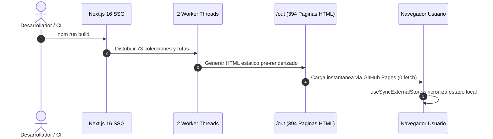
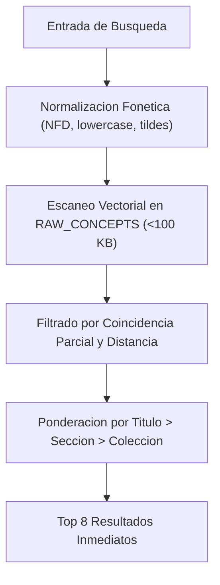

# Arquitectura Tecnica y Rendimiento de Dev Visualizer

**Dev Visualizer** esta disenado bajo los principios de maxima fidelidad pedagogica, cero regresiones y rendimiento extremo en el navegador web.

---

## Stack Tecnologico Principal

| Componente | Tecnologia | Version | Rol en la Arquitectura |
| :--- | :--- | :--- | :--- |
| **Framework Web** | Next.js | `16.4.3` | Generacion Estatica (SSG), compilacion atomica de 394 paginas y optimizacion de assets. |
| **Libreria UI** | React | `19.2.8` | Modelo de componentes declarativo, hooks modernos y uso de `useSyncExternalStore` para estado desacoplado. |
| **Motor de Animacion** | Motion (Framer Motion) | `14.8.0` | Animaciones vectoriales GPU a 60 FPS con soporte estricto de `prefers-reduced-motion`. |
| **Tipado Estatico** | TypeScript | `6.0.3` | Contratos rigurosos para colecciones, preguntas de examen, esquemas de busqueda y metadatos. |
| **Sintesis de Audio** | Web Speech API | Nativa | Narracion pedagogica de conceptos con chunking semantico por pausas de puntuacion. |
| **Motor de Busqueda** | En Memoria | Nativo (<100 KB) | Indexacion instantanea con tuplas comprimidas y normalizacion fonetica de acentos. |

---

## Diagrama de Ciclo de Vida SSG y Cero Latencia de Runtime

---

## Decisiones de Diseno Clave

### 1. Static Site Generation (SSG) Puro
Dev Visualizer compila sus 394 paginas y rutas tecnicas durante el build de Next.js. No realiza llamadas de red ni solicitudes a bases de datos en tiempo de ejecucion (0 runtime fetch lag). Esto garantiza disponibilidad del 100% en GitHub Pages, tiempos de carga casi instantaneos y navegacion offline via Service Workers.

### 2. Motor de Busqueda Compacto

El indice de los 7,410 conceptos se almacena en una estructura de tuplas compactas `[titulo, seccion, idColeccion]`, manteniendo el tamano total del bundle de busqueda por debajo de los 100 KB. La busqueda utiliza un algoritmo de distancia difusa con eliminacion de tildes y caracteres especiales.

### 3. Animaciones Aceleradas por Hardware
Todas las escenas pedagogicas animadas (`AnimatedConceptScene`) transforman exclusivamente propiedades de composicion (`transform: translate3d`, `opacity`), evitando recalcular el layout o causar repaints en el hilo principal del navegador.

---
[<- Volver al Inicio](Home)
