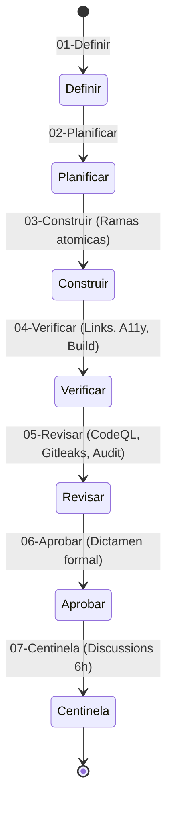

# Gobernanza, Calidad y Pipeline de Auditoria

El repositorio **Dev Visualizer** implementa un modelo de gobernanza estricta asistido por un orquestador de agentes autonomos y CI/CD reproducible.

---

## Diagrama del Pipeline de 7 Habilidades Oficiales

---

## Descripcion de las 7 Habilidades Oficiales

Cada cambio propuesto debe recorrer rigurosamente las 7 fases normativas:

1. **01-Definir:** Especificacion de requisitos, criterios de aceptacion, contratos de datos y alcance atomico.
2. **02-Planificar:** Desglose secuencial de tareas con dependencias, mitigacion de riesgos y puntos de control.
3. **03-Construir:** Creacion de ramas Git atomicas (`feat/`, `fix/`, `docs/`) y Pull Requests con plantillas formales y coautoria tecnica (`Co-authored-by: Azlynn17`).
4. **04-Verificar:** Ejecucion del conjunto exhaustivo de validaciones:
   - `npm run check:library`: Validacion de integridad de colecciones y recursos.
   - `npm run check:links`: Auditoria estatica de enlaces internos para asegurar 0 enlaces rotos en las 394 paginas.
   - `npm run check:a11y`: Validacion estricta de contrastes, atributos ARIA y navegacion por teclado.
   - `npm run build` y `npm run typecheck`: Compilacion limpia sin errores de tipos.
5. **05-Revisar:** Auditoria de seguridad con `npm audit`, escaneo de credenciales con Gitleaks y analisis SAST con **GitHub CodeQL**.
6. **06-Aprobar:** Emision del dictamen formal ejecutivo (`Aprobado`, `Requiere Cambios` o `Bloqueado`).
7. **07-Centinela:** Monitoreo y asistencia tecnica en GitHub Discussions con ventana de cortesia humana y analisis contextualizado.

---

## Postura de Seguridad Activa

- **Dependabot Alerts y Automated Fixes:** Monitoreo continuo de CVEs y apertura automatica de PRs de actualizacion.
- **Private Vulnerability Reporting:** Canal oficial privado para divulgacion coordinada y responsable de fallos de seguridad.
- **GitHub CodeQL SAST:** Analisis semantico profundo de seguridad en TypeScript, JavaScript y Python en cada PR.

---
[<- Volver al Inicio](Home)
