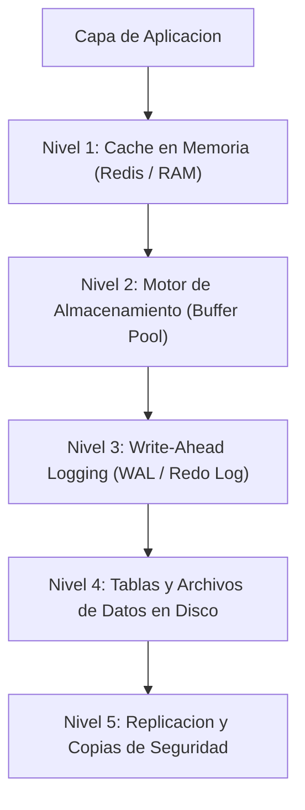

# Grupo: Datos

> **Estado, modelado, consultas y persistencia**  
> **Total de Colecciones:** 10  
> **Total de Conceptos Tecnicos:** 1120

---

## Flujo Arquitectonico y Modelo Conceptual

---

## Colecciones Integradas

### [XML](Coleccion-xml) (`XML`)

- **Resumen:** Documentos, namespaces, parsing, XPath, XSLT, seguridad e interoperabilidad.
- **Ciclo de Vida:** `actual`
- **Conceptos:** 110 conceptos distribuidos en 22 capitulos.
- **Enlaces Directos:**
  - [Explorar Atlas Teorico](https://luics415.github.io/Dev-Visualizer/xml)
  - [Ver Caso Practico en Accion](https://luics415.github.io/Dev-Visualizer/xml-en-accion)
  - [Ver Pagina Wiki Detallada](Coleccion-xml)

---

### [XSD](Coleccion-xsd) (`XSD`)

- **Resumen:** Schemas XML, tipos, facets, identidad, composición, evolución y validación.
- **Ciclo de Vida:** `actual`
- **Conceptos:** 100 conceptos distribuidos en 20 capitulos.
- **Enlaces Directos:**
  - [Explorar Atlas Teorico](https://luics415.github.io/Dev-Visualizer/xsd)
  - [Ver Caso Practico en Accion](https://luics415.github.io/Dev-Visualizer/xsd-en-accion)
  - [Ver Pagina Wiki Detallada](Coleccion-xsd)

---

### [JSON](Coleccion-json) (`JSON`)

- **Resumen:** Sintaxis, JSON Schema, Pointer, Patch, seguridad, contratos y producción.
- **Ciclo de Vida:** `actual`
- **Conceptos:** 110 conceptos distribuidos en 22 capitulos.
- **Enlaces Directos:**
  - [Explorar Atlas Teorico](https://luics415.github.io/Dev-Visualizer/json)
  - [Ver Caso Practico en Accion](https://luics415.github.io/Dev-Visualizer/json-en-accion)
  - [Ver Pagina Wiki Detallada](Coleccion-json)

---

### [Gestión de estado](Coleccion-state-management) (`State`)

- **Resumen:** Ownership, stores, caché remota, persistencia y offline.
- **Ciclo de Vida:** `actual`
- **Conceptos:** 75 conceptos distribuidos en 7 capitulos.
- **Enlaces Directos:**
  - [Explorar Atlas Teorico](https://luics415.github.io/Dev-Visualizer/gestion-estado)
  - [Ver Caso Practico en Accion](https://luics415.github.io/Dev-Visualizer/gestion-estado-en-accion)
  - [Ver Pagina Wiki Detallada](Coleccion-state-management)

---

### [Bases de datos](Coleccion-databases) (`DB`)

- **Resumen:** Modelado, SQL, índices, concurrencia, distribución y backups.
- **Ciclo de Vida:** `actual`
- **Conceptos:** 113 conceptos distribuidos en 10 capitulos.
- **Enlaces Directos:**
  - [Explorar Atlas Teorico](https://luics415.github.io/Dev-Visualizer/bases-datos)
  - [Ver Caso Practico en Accion](https://luics415.github.io/Dev-Visualizer/bases-datos-en-accion)
  - [Ver Pagina Wiki Detallada](Coleccion-databases)

---

### [Microsoft SQL Server](Coleccion-sql-server) (`SQL`)

- **Resumen:** T-SQL, almacenamiento, optimizador, concurrencia, seguridad, operación y alta disponibilidad.
- **Ciclo de Vida:** `actual`
- **Conceptos:** 120 conceptos distribuidos en 24 capitulos.
- **Enlaces Directos:**
  - [Explorar Atlas Teorico](https://luics415.github.io/Dev-Visualizer/sql-server)
  - [Ver Caso Practico en Accion](https://luics415.github.io/Dev-Visualizer/sql-server-en-accion)
  - [Ver Pagina Wiki Detallada](Coleccion-sql-server)

---

### [SQL](Coleccion-sql) (`SQL`)

- **Resumen:** Modelo relacional, DDL, consultas, joins, transacciones, optimización y portabilidad.
- **Ciclo de Vida:** `actual`
- **Conceptos:** 130 conceptos distribuidos en 20 capitulos.
- **Enlaces Directos:**
  - [Explorar Atlas Teorico](https://luics415.github.io/Dev-Visualizer/sql)
  - [Ver Caso Practico en Accion](https://luics415.github.io/Dev-Visualizer/sql-en-accion)
  - [Ver Pagina Wiki Detallada](Coleccion-sql)

---

### [NoSQL](Coleccion-nosql) (`NoSQL`)

- **Resumen:** Documentos, clave-valor, columnas, grafos, partición, replicación y consistencia.
- **Ciclo de Vida:** `actual`
- **Conceptos:** 123 conceptos distribuidos en 19 capitulos.
- **Enlaces Directos:**
  - [Explorar Atlas Teorico](https://luics415.github.io/Dev-Visualizer/nosql)
  - [Ver Caso Practico en Accion](https://luics415.github.io/Dev-Visualizer/nosql-en-accion)
  - [Ver Pagina Wiki Detallada](Coleccion-nosql)

---

### [Blockchain](Coleccion-blockchain) (`Chain`)

- **Resumen:** Criptografía, bloques, consenso, transacciones, contratos y operación.
- **Ciclo de Vida:** `actual`
- **Conceptos:** 109 conceptos distribuidos en 17 capitulos.
- **Enlaces Directos:**
  - [Explorar Atlas Teorico](https://luics415.github.io/Dev-Visualizer/blockchain)
  - [Ver Caso Practico en Accion](https://luics415.github.io/Dev-Visualizer/blockchain-en-accion)
  - [Ver Pagina Wiki Detallada](Coleccion-blockchain)

---

### [Inteligencia Artificial](Coleccion-artificial-intelligence) (`IA`)

- **Resumen:** Datos, modelos, entrenamiento, evaluación, inferencia, seguridad y monitoreo.
- **Ciclo de Vida:** `actual`
- **Conceptos:** 130 conceptos distribuidos en 20 capitulos.
- **Enlaces Directos:**
  - [Explorar Atlas Teorico](https://luics415.github.io/Dev-Visualizer/inteligencia-artificial)
  - [Ver Caso Practico en Accion](https://luics415.github.io/Dev-Visualizer/inteligencia-artificial-en-accion)
  - [Ver Pagina Wiki Detallada](Coleccion-artificial-intelligence)

---

[<- Volver al Inicio](Home) | [Ir al Indice Maestro de Conceptos ->](Indice-Maestro-7410-Conceptos)
