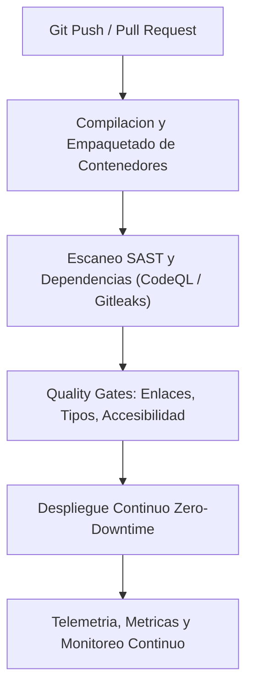

# Grupo: Infraestructura y entrega

> **Hosts, nube, pipelines y releases operables**  
> **Total de Colecciones:** 8  
> **Total de Conceptos Tecnicos:** 1359

---

## Flujo Arquitectonico y Modelo Conceptual

---

## Colecciones Integradas

### [Linux](Coleccion-linux) (`Linux`)

- **Resumen:** Kernel, shell, procesos, redes, storage, hardening y contenedores.
- **Ciclo de Vida:** `actual`
- **Conceptos:** 182 conceptos distribuidos en 10 capitulos.
- **Enlaces Directos:**
  - [Explorar Atlas Teorico](https://luics415.github.io/Dev-Visualizer/linux)
  - [Ver Caso Practico en Accion](https://luics415.github.io/Dev-Visualizer/linux-en-accion)
  - [Ver Pagina Wiki Detallada](Coleccion-linux)

---

### [AWS](Coleccion-aws) (`AWS`)

- **Resumen:** Identidad, VPC, compute, datos, eventos, gobierno y costo.
- **Ciclo de Vida:** `actual`
- **Conceptos:** 228 conceptos distribuidos en 18 capitulos.
- **Enlaces Directos:**
  - [Explorar Atlas Teorico](https://luics415.github.io/Dev-Visualizer/aws)
  - [Ver Caso Practico en Accion](https://luics415.github.io/Dev-Visualizer/aws-en-accion)
  - [Ver Pagina Wiki Detallada](Coleccion-aws)

---

### [CI/CD](Coleccion-ci-cd) (`CI`)

- **Resumen:** Integración, evidencia, artefactos, supply chain y promoción.
- **Ciclo de Vida:** `actual`
- **Conceptos:** 42 conceptos distribuidos en 7 capitulos.
- **Enlaces Directos:**
  - [Explorar Atlas Teorico](https://luics415.github.io/Dev-Visualizer/ci-cd)
  - [Ver Caso Practico en Accion](https://luics415.github.io/Dev-Visualizer/ci-cd-en-accion)
  - [Ver Pagina Wiki Detallada](Coleccion-ci-cd)

---

### [Deployment](Coleccion-deployment) (`Ship`)

- **Resumen:** Entornos, configuración, rollouts, tráfico, migraciones y rollback.
- **Ciclo de Vida:** `actual`
- **Conceptos:** 133 conceptos distribuidos en 8 capitulos.
- **Enlaces Directos:**
  - [Explorar Atlas Teorico](https://luics415.github.io/Dev-Visualizer/deployment)
  - [Ver Caso Practico en Accion](https://luics415.github.io/Dev-Visualizer/deployment-en-accion)
  - [Ver Pagina Wiki Detallada](Coleccion-deployment)

---

### [NGINX](Coleccion-nginx) (`NGINX`)

- **Resumen:** Servidor web, reverse proxy, balanceo, TLS, caché y operación.
- **Ciclo de Vida:** `actual`
- **Conceptos:** 313 conceptos distribuidos en 12 capitulos.
- **Enlaces Directos:**
  - [Explorar Atlas Teorico](https://luics415.github.io/Dev-Visualizer/nginx)
  - [Ver Caso Practico en Accion](https://luics415.github.io/Dev-Visualizer/nginx-en-accion)
  - [Ver Pagina Wiki Detallada](Coleccion-nginx)

---

### [Docker](Coleccion-docker) (`Docker`)

- **Resumen:** Imágenes, BuildKit, storage, networking, Compose y runtime.
- **Ciclo de Vida:** `actual`
- **Conceptos:** 236 conceptos distribuidos en 13 capitulos.
- **Enlaces Directos:**
  - [Explorar Atlas Teorico](https://luics415.github.io/Dev-Visualizer/docker)
  - [Ver Caso Practico en Accion](https://luics415.github.io/Dev-Visualizer/docker-en-accion)
  - [Ver Pagina Wiki Detallada](Coleccion-docker)

---

### [Sistemas operativos](Coleccion-operating-systems) (`OS`)

- **Resumen:** Procesos, scheduling, memoria virtual, archivos, E/S, concurrencia y seguridad.
- **Ciclo de Vida:** `actual`
- **Conceptos:** 130 conceptos distribuidos en 20 capitulos.
- **Enlaces Directos:**
  - [Explorar Atlas Teorico](https://luics415.github.io/Dev-Visualizer/sistemas-operativos)
  - [Ver Caso Practico en Accion](https://luics415.github.io/Dev-Visualizer/sistemas-operativos-en-accion)
  - [Ver Pagina Wiki Detallada](Coleccion-operating-systems)

---

### [LaTeX](Coleccion-latex) (`TeX`)

- **Resumen:** Composición, estructura, referencias, matemáticas, paquetes, builds y publicación.
- **Ciclo de Vida:** `actual`
- **Conceptos:** 95 conceptos distribuidos en 15 capitulos.
- **Enlaces Directos:**
  - [Explorar Atlas Teorico](https://luics415.github.io/Dev-Visualizer/latex)
  - [Ver Caso Practico en Accion](https://luics415.github.io/Dev-Visualizer/latex-en-accion)
  - [Ver Pagina Wiki Detallada](Coleccion-latex)

---

[<- Volver al Inicio](Home) | [Ir al Indice Maestro de Conceptos ->](Indice-Maestro-7410-Conceptos)
