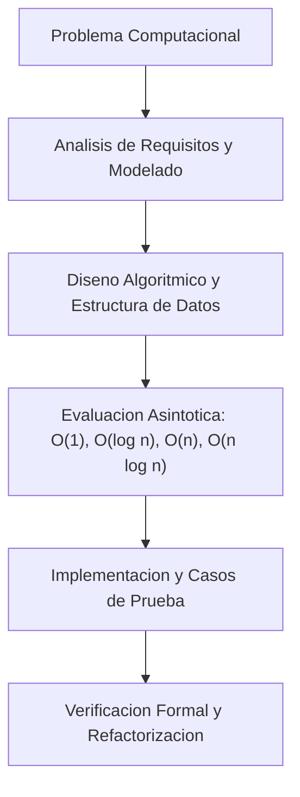

# Grupo: Fundamentos

> **Pensamiento computacional, algoritmos y práctica profesional**  
> **Total de Colecciones:** 5  
> **Total de Conceptos Tecnicos:** 480

---

## Flujo Arquitectonico y Modelo Conceptual

---

## Colecciones Integradas

### [Fundamentos de programación](Coleccion-programming-fundamentals) (`101`)

- **Resumen:** Problemas, datos, control, funciones, diseño, pruebas y pensamiento computacional.
- **Ciclo de Vida:** `actual`
- **Conceptos:** 91 conceptos distribuidos en 15 capitulos.
- **Enlaces Directos:**
  - [Explorar Atlas Teorico](https://luics415.github.io/Dev-Visualizer/fundamentos-programacion)
  - [Ver Caso Practico en Accion](https://luics415.github.io/Dev-Visualizer/fundamentos-programacion-en-accion)
  - [Ver Pagina Wiki Detallada](Coleccion-programming-fundamentals)

---

### [Algoritmos y estructuras de datos](Coleccion-algorithms) (`A&D`)

- **Resumen:** Complejidad, secuencias, árboles, grafos, búsqueda, ordenación y optimización.
- **Ciclo de Vida:** `actual`
- **Conceptos:** 120 conceptos distribuidos en 20 capitulos.
- **Enlaces Directos:**
  - [Explorar Atlas Teorico](https://luics415.github.io/Dev-Visualizer/algoritmos)
  - [Ver Caso Practico en Accion](https://luics415.github.io/Dev-Visualizer/algoritmos-en-accion)
  - [Ver Pagina Wiki Detallada](Coleccion-algorithms)

---

### [Matemáticas para programación](Coleccion-mathematics) (`Math`)

- **Resumen:** Lógica, conjuntos, álgebra, probabilidad, cálculo y matemática discreta.
- **Ciclo de Vida:** `actual`
- **Conceptos:** 105 conceptos distribuidos en 18 capitulos.
- **Enlaces Directos:**
  - [Explorar Atlas Teorico](https://luics415.github.io/Dev-Visualizer/matematicas-programacion)
  - [Ver Caso Practico en Accion](https://luics415.github.io/Dev-Visualizer/matematicas-programacion-en-accion)
  - [Ver Pagina Wiki Detallada](Coleccion-mathematics)

---

### [Metodologías de desarrollo](Coleccion-methodologies) (`Flow`)

- **Resumen:** Descubrimiento, entrega iterativa, Scrum, Kanban, XP, evidencia y mejora continua.
- **Ciclo de Vida:** `actual`
- **Conceptos:** 88 conceptos distribuidos en 15 capitulos.
- **Enlaces Directos:**
  - [Explorar Atlas Teorico](https://luics415.github.io/Dev-Visualizer/metodologias-desarrollo)
  - [Ver Caso Practico en Accion](https://luics415.github.io/Dev-Visualizer/metodologias-desarrollo-en-accion)
  - [Ver Pagina Wiki Detallada](Coleccion-methodologies)

---

### [Scratch](Coleccion-scratch) (`Cat`)

- **Resumen:** Programación visual, eventos, mensajes, clones, juegos y pensamiento computacional.
- **Ciclo de Vida:** `actual`
- **Conceptos:** 76 conceptos distribuidos en 13 capitulos.
- **Enlaces Directos:**
  - [Explorar Atlas Teorico](https://luics415.github.io/Dev-Visualizer/scratch)
  - [Ver Caso Practico en Accion](https://luics415.github.io/Dev-Visualizer/scratch-en-accion)
  - [Ver Pagina Wiki Detallada](Coleccion-scratch)

---

[<- Volver al Inicio](Home) | [Ir al Indice Maestro de Conceptos ->](Indice-Maestro-7410-Conceptos)
