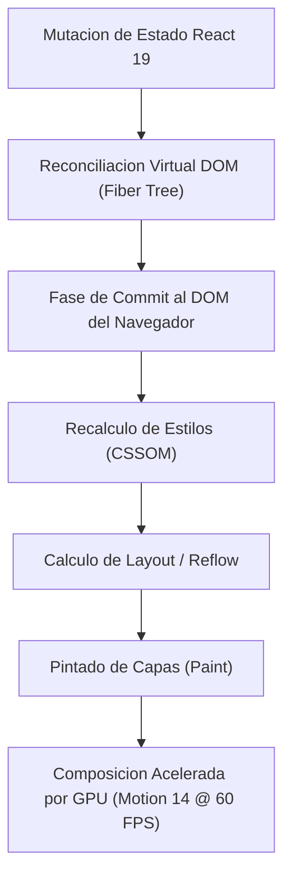

# Grupo: Diseño e interfaces

> **Experiencia, web y aplicaciones móviles**  
> **Total de Colecciones:** 9  
> **Total de Conceptos Tecnicos:** 624

---

## Flujo Arquitectonico y Modelo Conceptual

---

## Colecciones Integradas

### [UX/UI](Coleccion-ux-ui) (`UX`)

- **Resumen:** Investigación, flujos, accesibilidad, prototipos y validación.
- **Ciclo de Vida:** `actual`
- **Conceptos:** 55 conceptos distribuidos en 11 capitulos.
- **Enlaces Directos:**
  - [Explorar Atlas Teorico](https://luics415.github.io/Dev-Visualizer/ux-ui)
  - [Ver Caso Practico en Accion](https://luics415.github.io/Dev-Visualizer/ux-ui-en-accion)
  - [Ver Pagina Wiki Detallada](Coleccion-ux-ui)

---

### [HTML y CSS](Coleccion-html-css) (`HTML`)

- **Resumen:** Semántica, cascade, layout, responsive y render del navegador.
- **Ciclo de Vida:** `actual`
- **Conceptos:** 42 conceptos distribuidos en 1 capitulos.
- **Enlaces Directos:**
  - [Explorar Atlas Teorico](https://luics415.github.io/Dev-Visualizer/html-css)
  - [Ver Caso Practico en Accion](https://luics415.github.io/Dev-Visualizer/html-css-en-accion)
  - [Ver Pagina Wiki Detallada](Coleccion-html-css)

---

### [Bootstrap](Coleccion-bootstrap) (`BS`)

- **Resumen:** Grid, utilidades, componentes, Sass, accesibilidad y personalización.
- **Ciclo de Vida:** `actual`
- **Conceptos:** 55 conceptos distribuidos en 11 capitulos.
- **Enlaces Directos:**
  - [Explorar Atlas Teorico](https://luics415.github.io/Dev-Visualizer/bootstrap)
  - [Ver Caso Practico en Accion](https://luics415.github.io/Dev-Visualizer/bootstrap-en-accion)
  - [Ver Pagina Wiki Detallada](Coleccion-bootstrap)

---

### [AngularJS](Coleccion-angularjs) (`AJS`)

- **Resumen:** Mantenimiento de aplicaciones 1.x, digest cycle y migración gradual.
- **Ciclo de Vida:** `legado`
- **Conceptos:** 52 conceptos distribuidos en 9 capitulos.
- **Enlaces Directos:**
  - [Explorar Atlas Teorico](https://luics415.github.io/Dev-Visualizer/angularjs)
  - [Ver Caso Practico en Accion](https://luics415.github.io/Dev-Visualizer/angularjs-en-accion)
  - [Ver Pagina Wiki Detallada](Coleccion-angularjs)

---

### [React](Coleccion-react) (`React`)

- **Resumen:** Componentes, estado, reconciliación, efectos y concurrencia.
- **Ciclo de Vida:** `actual`
- **Conceptos:** 62 conceptos distribuidos en 7 capitulos.
- **Enlaces Directos:**
  - [Explorar Atlas Teorico](https://luics415.github.io/Dev-Visualizer/react)
  - [Ver Caso Practico en Accion](https://luics415.github.io/Dev-Visualizer/react-en-accion)
  - [Ver Pagina Wiki Detallada](Coleccion-react)

---

### [React Native](Coleccion-react-native) (`RN`)

- **Resumen:** Nueva Arquitectura, dispositivo, offline, performance y releases.
- **Ciclo de Vida:** `actual`
- **Conceptos:** 80 conceptos distribuidos en 7 capitulos.
- **Enlaces Directos:**
  - [Explorar Atlas Teorico](https://luics415.github.io/Dev-Visualizer/react-native)
  - [Ver Caso Practico en Accion](https://luics415.github.io/Dev-Visualizer/react-native-en-accion)
  - [Ver Pagina Wiki Detallada](Coleccion-react-native)

---

### [Qwik](Coleccion-qwik) (`Qwik`)

- **Resumen:** Resumibilidad, serialización, carga bajo demanda, routing y rendimiento.
- **Ciclo de Vida:** `actual`
- **Conceptos:** 88 conceptos distribuidos en 14 capitulos.
- **Enlaces Directos:**
  - [Explorar Atlas Teorico](https://luics415.github.io/Dev-Visualizer/qwik)
  - [Ver Caso Practico en Accion](https://luics415.github.io/Dev-Visualizer/qwik-en-accion)
  - [Ver Pagina Wiki Detallada](Coleccion-qwik)

---

### [Angular](Coleccion-angular) (`Ng`)

- **Resumen:** Componentes, señales, DI, router, formularios, SSR, pruebas y producción.
- **Ciclo de Vida:** `actual`
- **Conceptos:** 130 conceptos distribuidos en 20 capitulos.
- **Enlaces Directos:**
  - [Explorar Atlas Teorico](https://luics415.github.io/Dev-Visualizer/angular)
  - [Ver Caso Practico en Accion](https://luics415.github.io/Dev-Visualizer/angular-en-accion)
  - [Ver Pagina Wiki Detallada](Coleccion-angular)

---

### [Flutter](Coleccion-flutter) (`Flutter`)

- **Resumen:** Framework UI declarativo multiplataforma, árbol tripartito, motor Impeller y renderizado autónomo por GPU.
- **Ciclo de Vida:** `actual`
- **Conceptos:** 60 conceptos distribuidos en 12 capitulos.
- **Enlaces Directos:**
  - [Explorar Atlas Teorico](https://luics415.github.io/Dev-Visualizer/flutter)
  - [Ver Caso Practico en Accion](https://luics415.github.io/Dev-Visualizer/flutter-en-accion)
  - [Ver Pagina Wiki Detallada](Coleccion-flutter)

---

[<- Volver al Inicio](Home) | [Ir al Indice Maestro de Conceptos ->](Indice-Maestro-7410-Conceptos)
