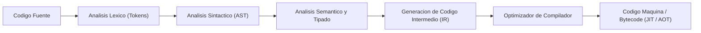

# Grupo: Lenguajes

> **Sintaxis, tipos, memoria y ejecución**  
> **Total de Colecciones:** 27  
> **Total de Conceptos Tecnicos:** 2384

---

## Flujo Arquitectonico y Modelo Conceptual

---

## Colecciones Integradas

### [JavaScript ES6+](Coleccion-javascript) (`JS`)

- **Resumen:** Lenguaje, objetos, asincronía, módulos, protocolos y memoria.
- **Ciclo de Vida:** `actual`
- **Conceptos:** 55 conceptos distribuidos en 12 capitulos.
- **Enlaces Directos:**
  - [Explorar Atlas Teorico](https://luics415.github.io/Dev-Visualizer/)
  - [Ver Caso Practico en Accion](https://luics415.github.io/Dev-Visualizer/javascript-en-accion)
  - [Ver Pagina Wiki Detallada](Coleccion-javascript)

---

### [TypeScript](Coleccion-typescript) (`TS`)

- **Resumen:** Modelado, narrowing, genéricos, compilador y producción.
- **Ciclo de Vida:** `actual`
- **Conceptos:** 64 conceptos distribuidos en 7 capitulos.
- **Enlaces Directos:**
  - [Explorar Atlas Teorico](https://luics415.github.io/Dev-Visualizer/typescript)
  - [Ver Caso Practico en Accion](https://luics415.github.io/Dev-Visualizer/typescript-en-accion)
  - [Ver Pagina Wiki Detallada](Coleccion-typescript)

---

### [Python](Coleccion-python) (`Py`)

- **Resumen:** Desde cero: lenguaje, biblioteca estándar, automatización, web, datos, IA y producción.
- **Ciclo de Vida:** `actual`
- **Conceptos:** 240 conceptos distribuidos en 48 capitulos.
- **Enlaces Directos:**
  - [Explorar Atlas Teorico](https://luics415.github.io/Dev-Visualizer/python)
  - [Ver Caso Practico en Accion](https://luics415.github.io/Dev-Visualizer/python-en-accion)
  - [Ver Pagina Wiki Detallada](Coleccion-python)

---

### [Prolog](Coleccion-prolog) (`PL`)

- **Resumen:** Términos, unificación, resolución, backtracking, restricciones, tabling, gramáticas y producción.
- **Ciclo de Vida:** `actual`
- **Conceptos:** 120 conceptos distribuidos en 24 capitulos.
- **Enlaces Directos:**
  - [Explorar Atlas Teorico](https://luics415.github.io/Dev-Visualizer/prolog)
  - [Ver Caso Practico en Accion](https://luics415.github.io/Dev-Visualizer/prolog-en-accion)
  - [Ver Pagina Wiki Detallada](Coleccion-prolog)

---

### [C](Coleccion-c) (`C`)

- **Resumen:** Compilación, memoria, punteros, ABI, herramientas y seguridad.
- **Ciclo de Vida:** `actual`
- **Conceptos:** 60 conceptos distribuidos en 10 capitulos.
- **Enlaces Directos:**
  - [Explorar Atlas Teorico](https://luics415.github.io/Dev-Visualizer/c)
  - [Ver Caso Practico en Accion](https://luics415.github.io/Dev-Visualizer/c-en-accion)
  - [Ver Pagina Wiki Detallada](Coleccion-c)

---

### [C++](Coleccion-cpp) (`C++`)

- **Resumen:** RAII, tipos, STL, templates, concurrencia y rendimiento.
- **Ciclo de Vida:** `actual`
- **Conceptos:** 66 conceptos distribuidos en 10 capitulos.
- **Enlaces Directos:**
  - [Explorar Atlas Teorico](https://luics415.github.io/Dev-Visualizer/cpp)
  - [Ver Caso Practico en Accion](https://luics415.github.io/Dev-Visualizer/cpp-en-accion)
  - [Ver Pagina Wiki Detallada](Coleccion-cpp)

---

### [C#](Coleccion-c-sharp) (`C#`)

- **Resumen:** Tipos, patrones, LINQ, asincronía, memoria y concurrencia.
- **Ciclo de Vida:** `actual`
- **Conceptos:** 49 conceptos distribuidos en 7 capitulos.
- **Enlaces Directos:**
  - [Explorar Atlas Teorico](https://luics415.github.io/Dev-Visualizer/c-sharp)
  - [Ver Caso Practico en Accion](https://luics415.github.io/Dev-Visualizer/c-sharp-en-accion)
  - [Ver Pagina Wiki Detallada](Coleccion-c-sharp)

---

### [Objective-C](Coleccion-objective-c) (`Obj-C`)

- **Resumen:** Mensajería, runtime, ARC, Foundation e interoperabilidad con Swift.
- **Ciclo de Vida:** `legado`
- **Conceptos:** 48 conceptos distribuidos en 8 capitulos.
- **Enlaces Directos:**
  - [Explorar Atlas Teorico](https://luics415.github.io/Dev-Visualizer/objective-c)
  - [Ver Caso Practico en Accion](https://luics415.github.io/Dev-Visualizer/objective-c-en-accion)
  - [Ver Pagina Wiki Detallada](Coleccion-objective-c)

---

### [C*](Coleccion-c-star) (`C*`)

- **Resumen:** Programación data-parallel para sistemas Connection Machine.
- **Ciclo de Vida:** `histórico`
- **Conceptos:** 42 conceptos distribuidos en 7 capitulos.
- **Enlaces Directos:**
  - [Explorar Atlas Teorico](https://luics415.github.io/Dev-Visualizer/c-star)
  - [Ver Caso Practico en Accion](https://luics415.github.io/Dev-Visualizer/c-star-en-accion)
  - [Ver Pagina Wiki Detallada](Coleccion-c-star)

---

### [CWEB](Coleccion-cweb) (`CWEB`)

- **Resumen:** Programación literaria con CTANGLE, CWEAVE, C y TeX.
- **Ciclo de Vida:** `histórico`
- **Conceptos:** 42 conceptos distribuidos en 7 capitulos.
- **Enlaces Directos:**
  - [Explorar Atlas Teorico](https://luics415.github.io/Dev-Visualizer/cweb)
  - [Ver Caso Practico en Accion](https://luics415.github.io/Dev-Visualizer/cweb-en-accion)
  - [Ver Pagina Wiki Detallada](Coleccion-cweb)

---

### [Embedded C](Coleccion-embedded-c) (`EC`)

- **Resumen:** Microcontroladores, registros, interrupciones, timing y seguridad.
- **Ciclo de Vida:** `actual`
- **Conceptos:** 55 conceptos distribuidos en 10 capitulos.
- **Enlaces Directos:**
  - [Explorar Atlas Teorico](https://luics415.github.io/Dev-Visualizer/embedded-c)
  - [Ver Caso Practico en Accion](https://luics415.github.io/Dev-Visualizer/embedded-c-en-accion)
  - [Ver Pagina Wiki Detallada](Coleccion-embedded-c)

---

### [Visual Basic .NET](Coleccion-visual-basic) (`VB`)

- **Resumen:** Lenguaje .NET, eventos, LINQ, WinForms e interoperabilidad.
- **Ciclo de Vida:** `actual`
- **Conceptos:** 48 conceptos distribuidos en 8 capitulos.
- **Enlaces Directos:**
  - [Explorar Atlas Teorico](https://luics415.github.io/Dev-Visualizer/visual-basic)
  - [Ver Caso Practico en Accion](https://luics415.github.io/Dev-Visualizer/visual-basic-en-accion)
  - [Ver Pagina Wiki Detallada](Coleccion-visual-basic)

---

### [Ruby](Coleccion-ruby) (`Rb`)

- **Resumen:** Objetos, bloques, enumerables, metaprogramación, concurrencia, tooling y producción.
- **Ciclo de Vida:** `actual`
- **Conceptos:** 93 conceptos distribuidos en 16 capitulos.
- **Enlaces Directos:**
  - [Explorar Atlas Teorico](https://luics415.github.io/Dev-Visualizer/ruby)
  - [Ver Caso Practico en Accion](https://luics415.github.io/Dev-Visualizer/ruby-en-accion)
  - [Ver Pagina Wiki Detallada](Coleccion-ruby)

---

### [Rust](Coleccion-rust) (`Rs`)

- **Resumen:** Ownership, borrowing, tipos, traits, concurrencia segura, tooling y rendimiento.
- **Ciclo de Vida:** `actual`
- **Conceptos:** 113 conceptos distribuidos en 19 capitulos.
- **Enlaces Directos:**
  - [Explorar Atlas Teorico](https://luics415.github.io/Dev-Visualizer/rust)
  - [Ver Caso Practico en Accion](https://luics415.github.io/Dev-Visualizer/rust-en-accion)
  - [Ver Pagina Wiki Detallada](Coleccion-rust)

---

### [PHP](Coleccion-php) (`PHP`)

- **Resumen:** Lenguaje, runtime web, tipos, objetos, Composer, seguridad y operación.
- **Ciclo de Vida:** `actual`
- **Conceptos:** 99 conceptos distribuidos en 17 capitulos.
- **Enlaces Directos:**
  - [Explorar Atlas Teorico](https://luics415.github.io/Dev-Visualizer/php)
  - [Ver Caso Practico en Accion](https://luics415.github.io/Dev-Visualizer/php-en-accion)
  - [Ver Pagina Wiki Detallada](Coleccion-php)

---

### [Haskell](Coleccion-haskell) (`Hs`)

- **Resumen:** Funciones puras, tipos algebraicos, evaluación perezosa, efectos y concurrencia.
- **Ciclo de Vida:** `actual`
- **Conceptos:** 112 conceptos distribuidos en 19 capitulos.
- **Enlaces Directos:**
  - [Explorar Atlas Teorico](https://luics415.github.io/Dev-Visualizer/haskell)
  - [Ver Caso Practico en Accion](https://luics415.github.io/Dev-Visualizer/haskell-en-accion)
  - [Ver Pagina Wiki Detallada](Coleccion-haskell)

---

### [Go](Coleccion-go) (`Go`)

- **Resumen:** Tipos, interfaces, goroutines, canales, contexto, módulos y servicios.
- **Ciclo de Vida:** `actual`
- **Conceptos:** 103 conceptos distribuidos en 18 capitulos.
- **Enlaces Directos:**
  - [Explorar Atlas Teorico](https://luics415.github.io/Dev-Visualizer/go)
  - [Ver Caso Practico en Accion](https://luics415.github.io/Dev-Visualizer/go-en-accion)
  - [Ver Pagina Wiki Detallada](Coleccion-go)

---

### [Kotlin](Coleccion-kotlin) (`Kt`)

- **Resumen:** Null safety, objetos, funciones, coroutines, multiplataforma e interoperabilidad JVM.
- **Ciclo de Vida:** `actual`
- **Conceptos:** 105 conceptos distribuidos en 18 capitulos.
- **Enlaces Directos:**
  - [Explorar Atlas Teorico](https://luics415.github.io/Dev-Visualizer/kotlin)
  - [Ver Caso Practico en Accion](https://luics415.github.io/Dev-Visualizer/kotlin-en-accion)
  - [Ver Pagina Wiki Detallada](Coleccion-kotlin)

---

### [Java](Coleccion-java) (`Java`)

- **Resumen:** JVM, tipos, objetos, colecciones, concurrencia, GC, tooling y producción.
- **Ciclo de Vida:** `actual`
- **Conceptos:** 115 conceptos distribuidos en 20 capitulos.
- **Enlaces Directos:**
  - [Explorar Atlas Teorico](https://luics415.github.io/Dev-Visualizer/java)
  - [Ver Caso Practico en Accion](https://luics415.github.io/Dev-Visualizer/java-en-accion)
  - [Ver Pagina Wiki Detallada](Coleccion-java)

---

### [R](Coleccion-r) (`R`)

- **Resumen:** Vectores, data frames, estadística, visualización, modelado e informes reproducibles.
- **Ciclo de Vida:** `actual`
- **Conceptos:** 117 conceptos distribuidos en 20 capitulos.
- **Enlaces Directos:**
  - [Explorar Atlas Teorico](https://luics415.github.io/Dev-Visualizer/r)
  - [Ver Caso Practico en Accion](https://luics415.github.io/Dev-Visualizer/r-en-accion)
  - [Ver Pagina Wiki Detallada](Coleccion-r)

---

### [Ensamblador](Coleccion-assembly) (`ASM`)

- **Resumen:** ISA, registros, memoria, pila, llamadas, ABI, depuración y optimización.
- **Ciclo de Vida:** `actual`
- **Conceptos:** 103 conceptos distribuidos en 18 capitulos.
- **Enlaces Directos:**
  - [Explorar Atlas Teorico](https://luics415.github.io/Dev-Visualizer/ensamblador)
  - [Ver Caso Practico en Accion](https://luics415.github.io/Dev-Visualizer/ensamblador-en-accion)
  - [Ver Pagina Wiki Detallada](Coleccion-assembly)

---

### [Erlang](Coleccion-erlang) (`Erl`)

- **Resumen:** BEAM, procesos, mensajes, supervisión, distribución y tolerancia a fallos.
- **Ciclo de Vida:** `actual`
- **Conceptos:** 94 conceptos distribuidos en 16 capitulos.
- **Enlaces Directos:**
  - [Explorar Atlas Teorico](https://luics415.github.io/Dev-Visualizer/erlang)
  - [Ver Caso Practico en Accion](https://luics415.github.io/Dev-Visualizer/erlang-en-accion)
  - [Ver Pagina Wiki Detallada](Coleccion-erlang)

---

### [Lisp](Coleccion-lisp) (`λ`)

- **Resumen:** S-expressions, evaluación, funciones, macros, metaprogramación y REPL.
- **Ciclo de Vida:** `actual`
- **Conceptos:** 98 conceptos distribuidos en 16 capitulos.
- **Enlaces Directos:**
  - [Explorar Atlas Teorico](https://luics415.github.io/Dev-Visualizer/lisp)
  - [Ver Caso Practico en Accion](https://luics415.github.io/Dev-Visualizer/lisp-en-accion)
  - [Ver Pagina Wiki Detallada](Coleccion-lisp)

---

### [Perl](Coleccion-perl) (`Pl`)

- **Resumen:** Texto, expresiones regulares, referencias, módulos, automatización y operación.
- **Ciclo de Vida:** `actual`
- **Conceptos:** 86 conceptos distribuidos en 14 capitulos.
- **Enlaces Directos:**
  - [Explorar Atlas Teorico](https://luics415.github.io/Dev-Visualizer/perl)
  - [Ver Caso Practico en Accion](https://luics415.github.io/Dev-Visualizer/perl-en-accion)
  - [Ver Pagina Wiki Detallada](Coleccion-perl)

---

### [Raku](Coleccion-raku) (`Rk`)

- **Resumen:** Gramáticas, tipos, junctions, concurrencia, metaprogramación y herramientas.
- **Ciclo de Vida:** `actual`
- **Conceptos:** 88 conceptos distribuidos en 14 capitulos.
- **Enlaces Directos:**
  - [Explorar Atlas Teorico](https://luics415.github.io/Dev-Visualizer/raku)
  - [Ver Caso Practico en Accion](https://luics415.github.io/Dev-Visualizer/raku-en-accion)
  - [Ver Pagina Wiki Detallada](Coleccion-raku)

---

### [Scala](Coleccion-scala) (`Sc`)

- **Resumen:** Objetos y funciones, tipos, colecciones, efectos, concurrencia y JVM.
- **Ciclo de Vida:** `actual`
- **Conceptos:** 109 conceptos distribuidos en 17 capitulos.
- **Enlaces Directos:**
  - [Explorar Atlas Teorico](https://luics415.github.io/Dev-Visualizer/scala)
  - [Ver Caso Practico en Accion](https://luics415.github.io/Dev-Visualizer/scala-en-accion)
  - [Ver Pagina Wiki Detallada](Coleccion-scala)

---

### [Dart](Coleccion-dart) (`Dart`)

- **Resumen:** Lenguaje orientado a objetos, Sound Null Safety, records, isolates, event loop y compilación dual JIT/AOT.
- **Ciclo de Vida:** `actual`
- **Conceptos:** 60 conceptos distribuidos en 12 capitulos.
- **Enlaces Directos:**
  - [Explorar Atlas Teorico](https://luics415.github.io/Dev-Visualizer/dart)
  - [Ver Caso Practico en Accion](https://luics415.github.io/Dev-Visualizer/dart-en-accion)
  - [Ver Pagina Wiki Detallada](Coleccion-dart)

---

[<- Volver al Inicio](Home) | [Ir al Indice Maestro de Conceptos ->](Indice-Maestro-7410-Conceptos)
