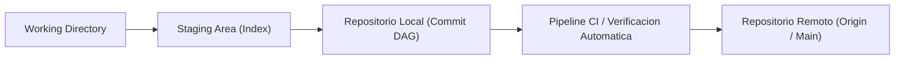

# Grupo: Control de versiones y calidad

> **Historia, colaboración, diagnóstico y recuperación**  
> **Total de Colecciones:** 4  
> **Total de Conceptos Tecnicos:** 439

---

## Flujo Arquitectonico y Modelo Conceptual

---

## Colecciones Integradas

### [Git](Coleccion-git) (`Git`)

- **Resumen:** Objetos, referencias, staging, historia, sincronización y rescate.
- **Ciclo de Vida:** `actual`
- **Conceptos:** 60 conceptos distribuidos en 10 capitulos.
- **Enlaces Directos:**
  - [Explorar Atlas Teorico](https://luics415.github.io/Dev-Visualizer/git)
  - [Ver Caso Practico en Accion](https://luics415.github.io/Dev-Visualizer/git-en-accion)
  - [Ver Pagina Wiki Detallada](Coleccion-git)

---

### [GitHub](Coleccion-github) (`GH`)

- **Resumen:** Colaboración, PRs, gobierno, seguridad, comunidad y releases.
- **Ciclo de Vida:** `actual`
- **Conceptos:** 60 conceptos distribuidos en 10 capitulos.
- **Enlaces Directos:**
  - [Explorar Atlas Teorico](https://luics415.github.io/Dev-Visualizer/github)
  - [Ver Caso Practico en Accion](https://luics415.github.io/Dev-Visualizer/github-en-accion)
  - [Ver Pagina Wiki Detallada](Coleccion-github)

---

### [Debugging](Coleccion-debugging) (`Debug`)

- **Resumen:** Reproducción, evidencia, hipótesis, rendimiento e incidentes.
- **Ciclo de Vida:** `actual`
- **Conceptos:** 238 conceptos distribuidos en 12 capitulos.
- **Enlaces Directos:**
  - [Explorar Atlas Teorico](https://luics415.github.io/Dev-Visualizer/debugging)
  - [Ver Caso Practico en Accion](https://luics415.github.io/Dev-Visualizer/debugging-en-accion)
  - [Ver Pagina Wiki Detallada](Coleccion-debugging)

---

### [Subversion](Coleccion-subversion) (`SVN`)

- **Resumen:** Control centralizado, working copies, revisiones, ramas, merges y administración.
- **Ciclo de Vida:** `legado`
- **Conceptos:** 81 conceptos distribuidos en 13 capitulos.
- **Enlaces Directos:**
  - [Explorar Atlas Teorico](https://luics415.github.io/Dev-Visualizer/subversion)
  - [Ver Caso Practico en Accion](https://luics415.github.io/Dev-Visualizer/subversion-en-accion)
  - [Ver Pagina Wiki Detallada](Coleccion-subversion)

---

[<- Volver al Inicio](Home) | [Ir al Indice Maestro de Conceptos ->](Indice-Maestro-7410-Conceptos)
