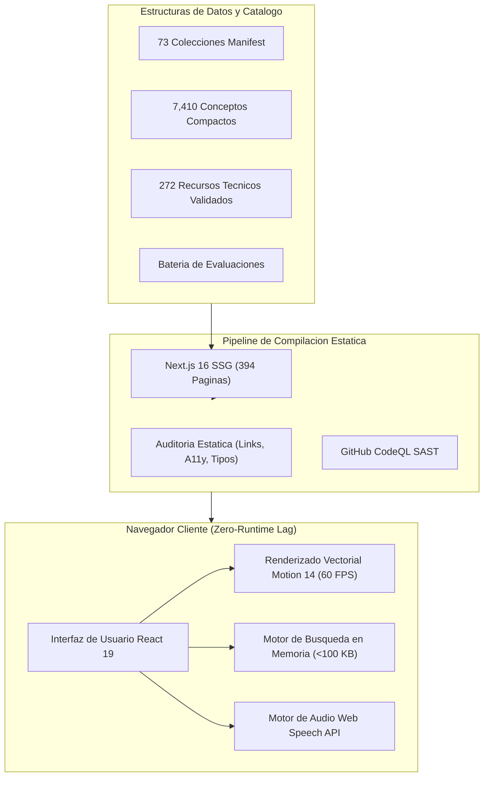
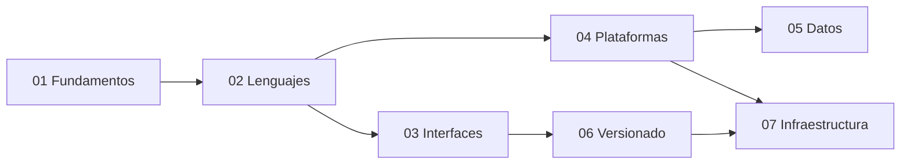

# Dev Visualizer Wiki - Enciclopedia Tecnica de Arquitectura

Bienvenido a la **Wiki Oficial de Dev Visualizer**, el atlas tecnico e interactivo de arquitectura de software, ingenieria de sistemas y lenguajes de programacion.

---

## Metricas Globales del Ecosistema

| Metrica | Valor Verificado | Descripcion Tecnica |
| :--- | :--- | :--- |
| **Conceptos Tecnicos Indexados** | **7,410** | Modelos atomicos de aprendizaje con definiciones y escenas visuales |
| **Colecciones Oficiales** | **73** | Nucleos tecnologicos categorizados en 7 grupos de especializacion |
| **Rutas Interactivas** | **146** | 73 atlas teoricos + 73 estudios de caso practicos en accion |
| **Paginas Estaticas Generadas** | **394 paginas** | Compilacion 100% estatica (SSG) de alto rendimiento (0 latencia de red) |
| **Estandar de Accesibilidad** | **WCAG 2.1 AAA** | Soporte para lectores de pantalla, alto contraste y navegacion por teclado |
| **Arquitectura de Software** | **Next.js 16 + React 19** | Motion 14 (GPU 60 FPS), Web Speech API y TypeScript 6 |

---

## Diagrama de Arquitectura Global del Sistema

---

## Topologia de los 7 Grupos Arquitectonicos

### [Fundamentos](Grupo-Fundamentals)
> *Pensamiento computacional, algoritmos y práctica profesional*  
> **5 Colecciones** | **480 Conceptos Tecnicos**

- **[Fundamentos de programación](Coleccion-programming-fundamentals)** (`101`): Problemas, datos, control, funciones, diseño, pruebas y pensamiento computacional. — *(91 conceptos)*
- **[Algoritmos y estructuras de datos](Coleccion-algorithms)** (`A&D`): Complejidad, secuencias, árboles, grafos, búsqueda, ordenación y optimización. — *(120 conceptos)*
- **[Matemáticas para programación](Coleccion-mathematics)** (`Math`): Lógica, conjuntos, álgebra, probabilidad, cálculo y matemática discreta. — *(105 conceptos)*
- **[Metodologías de desarrollo](Coleccion-methodologies)** (`Flow`): Descubrimiento, entrega iterativa, Scrum, Kanban, XP, evidencia y mejora continua. — *(88 conceptos)*
- **[Scratch](Coleccion-scratch)** (`Cat`): Programación visual, eventos, mensajes, clones, juegos y pensamiento computacional. — *(76 conceptos)*

### [Lenguajes](Grupo-Languages)
> *Sintaxis, tipos, memoria y ejecución*  
> **27 Colecciones** | **2384 Conceptos Tecnicos**

- **[JavaScript ES6+](Coleccion-javascript)** (`JS`): Lenguaje, objetos, asincronía, módulos, protocolos y memoria. — *(55 conceptos)*
- **[TypeScript](Coleccion-typescript)** (`TS`): Modelado, narrowing, genéricos, compilador y producción. — *(64 conceptos)*
- **[Python](Coleccion-python)** (`Py`): Desde cero: lenguaje, biblioteca estándar, automatización, web, datos, IA y producción. — *(240 conceptos)*
- **[Prolog](Coleccion-prolog)** (`PL`): Términos, unificación, resolución, backtracking, restricciones, tabling, gramáticas y producción. — *(120 conceptos)*
- **[C](Coleccion-c)** (`C`): Compilación, memoria, punteros, ABI, herramientas y seguridad. — *(60 conceptos)*
- **[C++](Coleccion-cpp)** (`C++`): RAII, tipos, STL, templates, concurrencia y rendimiento. — *(66 conceptos)*
- **[C#](Coleccion-c-sharp)** (`C#`): Tipos, patrones, LINQ, asincronía, memoria y concurrencia. — *(49 conceptos)*
- **[Objective-C](Coleccion-objective-c)** (`Obj-C`): Mensajería, runtime, ARC, Foundation e interoperabilidad con Swift. — *(48 conceptos)*
- **[C*](Coleccion-c-star)** (`C*`): Programación data-parallel para sistemas Connection Machine. — *(42 conceptos)*
- **[CWEB](Coleccion-cweb)** (`CWEB`): Programación literaria con CTANGLE, CWEAVE, C y TeX. — *(42 conceptos)*
- **[Embedded C](Coleccion-embedded-c)** (`EC`): Microcontroladores, registros, interrupciones, timing y seguridad. — *(55 conceptos)*
- **[Visual Basic .NET](Coleccion-visual-basic)** (`VB`): Lenguaje .NET, eventos, LINQ, WinForms e interoperabilidad. — *(48 conceptos)*
- **[Ruby](Coleccion-ruby)** (`Rb`): Objetos, bloques, enumerables, metaprogramación, concurrencia, tooling y producción. — *(93 conceptos)*
- **[Rust](Coleccion-rust)** (`Rs`): Ownership, borrowing, tipos, traits, concurrencia segura, tooling y rendimiento. — *(113 conceptos)*
- **[PHP](Coleccion-php)** (`PHP`): Lenguaje, runtime web, tipos, objetos, Composer, seguridad y operación. — *(99 conceptos)*
- **[Haskell](Coleccion-haskell)** (`Hs`): Funciones puras, tipos algebraicos, evaluación perezosa, efectos y concurrencia. — *(112 conceptos)*
- **[Go](Coleccion-go)** (`Go`): Tipos, interfaces, goroutines, canales, contexto, módulos y servicios. — *(103 conceptos)*
- **[Kotlin](Coleccion-kotlin)** (`Kt`): Null safety, objetos, funciones, coroutines, multiplataforma e interoperabilidad JVM. — *(105 conceptos)*
- **[Java](Coleccion-java)** (`Java`): JVM, tipos, objetos, colecciones, concurrencia, GC, tooling y producción. — *(115 conceptos)*
- **[R](Coleccion-r)** (`R`): Vectores, data frames, estadística, visualización, modelado e informes reproducibles. — *(117 conceptos)*
- **[Ensamblador](Coleccion-assembly)** (`ASM`): ISA, registros, memoria, pila, llamadas, ABI, depuración y optimización. — *(103 conceptos)*
- **[Erlang](Coleccion-erlang)** (`Erl`): BEAM, procesos, mensajes, supervisión, distribución y tolerancia a fallos. — *(94 conceptos)*
- **[Lisp](Coleccion-lisp)** (`λ`): S-expressions, evaluación, funciones, macros, metaprogramación y REPL. — *(98 conceptos)*
- **[Perl](Coleccion-perl)** (`Pl`): Texto, expresiones regulares, referencias, módulos, automatización y operación. — *(86 conceptos)*
- **[Raku](Coleccion-raku)** (`Rk`): Gramáticas, tipos, junctions, concurrencia, metaprogramación y herramientas. — *(88 conceptos)*
- **[Scala](Coleccion-scala)** (`Sc`): Objetos y funciones, tipos, colecciones, efectos, concurrencia y JVM. — *(109 conceptos)*
- **[Dart](Coleccion-dart)** (`Dart`): Lenguaje orientado a objetos, Sound Null Safety, records, isolates, event loop y compilación dual JIT/AOT. — *(60 conceptos)*

### [Diseño e interfaces](Grupo-Interfaces)
> *Experiencia, web y aplicaciones móviles*  
> **9 Colecciones** | **624 Conceptos Tecnicos**

- **[UX/UI](Coleccion-ux-ui)** (`UX`): Investigación, flujos, accesibilidad, prototipos y validación. — *(55 conceptos)*
- **[HTML y CSS](Coleccion-html-css)** (`HTML`): Semántica, cascade, layout, responsive y render del navegador. — *(42 conceptos)*
- **[Bootstrap](Coleccion-bootstrap)** (`BS`): Grid, utilidades, componentes, Sass, accesibilidad y personalización. — *(55 conceptos)*
- **[AngularJS](Coleccion-angularjs)** (`AJS`): Mantenimiento de aplicaciones 1.x, digest cycle y migración gradual. — *(52 conceptos)*
- **[React](Coleccion-react)** (`React`): Componentes, estado, reconciliación, efectos y concurrencia. — *(62 conceptos)*
- **[React Native](Coleccion-react-native)** (`RN`): Nueva Arquitectura, dispositivo, offline, performance y releases. — *(80 conceptos)*
- **[Qwik](Coleccion-qwik)** (`Qwik`): Resumibilidad, serialización, carga bajo demanda, routing y rendimiento. — *(88 conceptos)*
- **[Angular](Coleccion-angular)** (`Ng`): Componentes, señales, DI, router, formularios, SSR, pruebas y producción. — *(130 conceptos)*
- **[Flutter](Coleccion-flutter)** (`Flutter`): Framework UI declarativo multiplataforma, árbol tripartito, motor Impeller y renderizado autónomo por GPU. — *(60 conceptos)*

### [Plataformas y servidor](Grupo-Platforms)
> *Runtimes, frameworks, contratos y automatización*  
> **10 Colecciones** | **1004 Conceptos Tecnicos**

- **[APIs](Coleccion-apis)** (`API`): REST, GraphQL, gRPC, eventos, tiempo real, contratos y seguridad. — *(48 conceptos)*
- **[Backend](Coleccion-backend)** (`Back`): Arquitectura, seguridad, persistencia, mensajería y confiabilidad. — *(96 conceptos)*
- **[Node.js](Coleccion-nodejs)** (`Node`): Runtime, event loop, streams, workers, módulos y operación. — *(65 conceptos)*
- **[Laravel](Coleccion-laravel)** (`Lv`): Contenedor, HTTP, Eloquent, políticas, colas, eventos y pruebas. — *(65 conceptos)*
- **[n8n](Coleccion-n8n)** (`n8n`): Workflows, credenciales, datos, reintentos, subflujos y operación. — *(55 conceptos)*
- **[.NET](Coleccion-dotnet)** (`.NET`): SDK, CLR, IL, JIT/AOT, GC, bibliotecas, hosting y diagnóstico. — *(52 conceptos)*
- **[MediaPipe](Coleccion-mediapipe)** (`MP`): Tasks, modelos, grafos, visión, audio, texto, tiempo real, edge y operación responsable. — *(120 conceptos)*
- **[Firebase](Coleccion-firebase)** (`FB`): Auth, datos, Storage, Functions, Hosting, FCM y Rules. — *(250 conceptos)*
- **[Android](Coleccion-android)** (`And`): Componentes, lifecycle, Compose, almacenamiento, permisos, trabajo y publicación. — *(130 conceptos)*
- **[Django](Coleccion-django)** (`Dj`): Proyecto, HTTP, ORM, formularios, seguridad, tareas, pruebas y despliegue. — *(123 conceptos)*

### [Datos](Grupo-Data)
> *Estado, modelado, consultas y persistencia*  
> **10 Colecciones** | **1120 Conceptos Tecnicos**

- **[XML](Coleccion-xml)** (`XML`): Documentos, namespaces, parsing, XPath, XSLT, seguridad e interoperabilidad. — *(110 conceptos)*
- **[XSD](Coleccion-xsd)** (`XSD`): Schemas XML, tipos, facets, identidad, composición, evolución y validación. — *(100 conceptos)*
- **[JSON](Coleccion-json)** (`JSON`): Sintaxis, JSON Schema, Pointer, Patch, seguridad, contratos y producción. — *(110 conceptos)*
- **[Gestión de estado](Coleccion-state-management)** (`State`): Ownership, stores, caché remota, persistencia y offline. — *(75 conceptos)*
- **[Bases de datos](Coleccion-databases)** (`DB`): Modelado, SQL, índices, concurrencia, distribución y backups. — *(113 conceptos)*
- **[Microsoft SQL Server](Coleccion-sql-server)** (`SQL`): T-SQL, almacenamiento, optimizador, concurrencia, seguridad, operación y alta disponibilidad. — *(120 conceptos)*
- **[SQL](Coleccion-sql)** (`SQL`): Modelo relacional, DDL, consultas, joins, transacciones, optimización y portabilidad. — *(130 conceptos)*
- **[NoSQL](Coleccion-nosql)** (`NoSQL`): Documentos, clave-valor, columnas, grafos, partición, replicación y consistencia. — *(123 conceptos)*
- **[Blockchain](Coleccion-blockchain)** (`Chain`): Criptografía, bloques, consenso, transacciones, contratos y operación. — *(109 conceptos)*
- **[Inteligencia Artificial](Coleccion-artificial-intelligence)** (`IA`): Datos, modelos, entrenamiento, evaluación, inferencia, seguridad y monitoreo. — *(130 conceptos)*

### [Control de versiones y calidad](Grupo-Versioning)
> *Historia, colaboración, diagnóstico y recuperación*  
> **4 Colecciones** | **439 Conceptos Tecnicos**

- **[Git](Coleccion-git)** (`Git`): Objetos, referencias, staging, historia, sincronización y rescate. — *(60 conceptos)*
- **[GitHub](Coleccion-github)** (`GH`): Colaboración, PRs, gobierno, seguridad, comunidad y releases. — *(60 conceptos)*
- **[Debugging](Coleccion-debugging)** (`Debug`): Reproducción, evidencia, hipótesis, rendimiento e incidentes. — *(238 conceptos)*
- **[Subversion](Coleccion-subversion)** (`SVN`): Control centralizado, working copies, revisiones, ramas, merges y administración. — *(81 conceptos)*

### [Infraestructura y entrega](Grupo-Delivery)
> *Hosts, nube, pipelines y releases operables*  
> **8 Colecciones** | **1359 Conceptos Tecnicos**

- **[Linux](Coleccion-linux)** (`Linux`): Kernel, shell, procesos, redes, storage, hardening y contenedores. — *(182 conceptos)*
- **[AWS](Coleccion-aws)** (`AWS`): Identidad, VPC, compute, datos, eventos, gobierno y costo. — *(228 conceptos)*
- **[CI/CD](Coleccion-ci-cd)** (`CI`): Integración, evidencia, artefactos, supply chain y promoción. — *(42 conceptos)*
- **[Deployment](Coleccion-deployment)** (`Ship`): Entornos, configuración, rollouts, tráfico, migraciones y rollback. — *(133 conceptos)*
- **[NGINX](Coleccion-nginx)** (`NGINX`): Servidor web, reverse proxy, balanceo, TLS, caché y operación. — *(313 conceptos)*
- **[Docker](Coleccion-docker)** (`Docker`): Imágenes, BuildKit, storage, networking, Compose y runtime. — *(236 conceptos)*
- **[Sistemas operativos](Coleccion-operating-systems)** (`OS`): Procesos, scheduling, memoria virtual, archivos, E/S, concurrencia y seguridad. — *(130 conceptos)*
- **[LaTeX](Coleccion-latex)** (`TeX`): Composición, estructura, referencias, matemáticas, paquetes, builds y publicación. — *(95 conceptos)*

---

## Modelos Computacionales y Algoritmos Centrales

### 1. Busqueda Vectorial Difusa en Tiempo Lineal: $O(N)$
El motor de busqueda de Dev Visualizer indexa los 7410 conceptos en una estructura de tuplas compactas `[titulo, seccion, idColeccion]` cargada directamente en memoria del cliente. La normalizacion fonetica descompone caracteres diacriticos mediante Unicode NFD, garantizando coincidencia insensible a tildes con una sobrecarga de memoria inferior a 100 KB.

### 2. Sincronizacion de Estado React 19 sin Render-Drift
El desacoplamiento del progreso de lectura se implementa mediante `useSyncExternalStore`, eliminando estados intermedios y desfases visuales entre el scroll pasivo del navegador y la barra de navegacion flotante.

### 3. Pipeline de Audio Adaptativo
La sintesis vocal en navegadores divide las cadenas de texto en fragmentos semanticos delimitados por pausas ortograficas (puntos y comas), previniendo los bloqueos clasicos de buffer del Web Speech API en oraciones largas.

---

## Enlaces de Referencia del Ecosistema
- [Dev Visualizer en Vivo](https://luics415.github.io/Dev-Visualizer/)
- [Indice Maestro de los 7410 Conceptos](Indice-Maestro-7410-Conceptos)
- [Arquitectura del Sistema y Rendimiento](Arquitectura-del-Sistema)
- [Gobernanza, Seguridad y Pipeline de Auditoria](Gobernanza-y-Auditoria)
- [Repositorio en GitHub](https://github.com/Luics415/Dev-Visualizer)

---
*Dev Visualizer Wiki • Mantenedor: [@Luics415](https://github.com/Luics415) • Coautoria Tecnica: [@Azlynn17](https://github.com/Azlynn17).*
